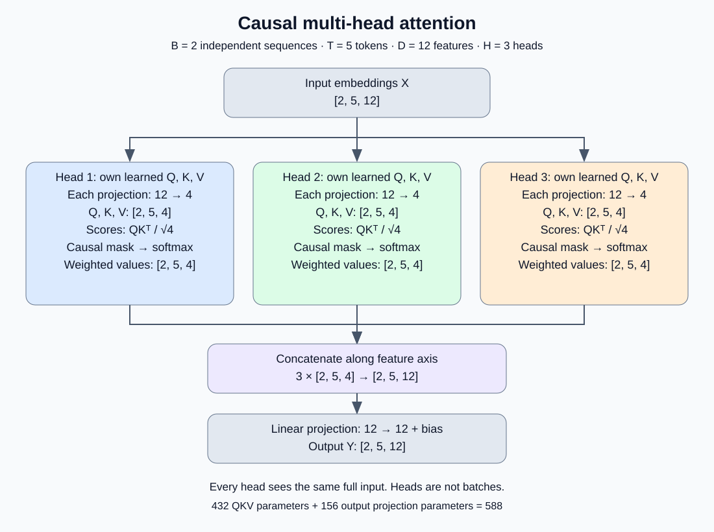

# Mike-LLM v0.1

An educational project implementing and training a small character-level decoder-only Transformer from random weights. Recorded experiments use reproducible CPU execution on Apple Silicon.


## Finalized small-corpus result

Validation selected the learned-position checkpoint trained with capacity 64 for 40000 updates, seed 42, using **16-character inference windows with positions reset** and ordinary causal attention. This uses four times the training targets of the 10000-step comparisons. The frozen choice was recorded before evaluating the reserved test book.

| Split | Character perplexity | Next-character accuracy |
| --- | ---: | ---: |
| Validation: Alice in Wonderland | 6.288657 | 44.85% |
| Test: Pride and Prejudice | 5.750783 | 46.33% |

The test has now been used for this final selection and is no longer untouched for future development. These single-book results do not establish conversational ability, factual knowledge, broad generalization or absence of validation-selection bias. See [stage closure and model details](docs/31-stage-closure-and-test.md), the [frozen selection](docs/results/final-model-selection.json), and [test report](docs/results/final-test-evaluation.json).

The local checkpoint is `runs/position-exposure-40000/seed-42/primary/checkpoint.pt`. It retains capacity 64; explicitly use inference context 16 to match the selected policy. Checkpoint and corpus files remain local ignored artifacts. The final manifest does not automatically change the existing generation CLI's default window.


## Next-stage plan

The [next-stage plan](docs/32-next-stage-plan.md) prioritizes a versioned licensed corpus with fiction, nonfiction and educational prose; new group-isolated development/test splits; a Unicode-preserving byte baseline; and controlled capacity/context improvements before source-grounded QA training. English remains the proposed initial language. Source rights must be verified per edition, and the new test is **planned, not yet assembled or frozen**. Begin with a small reviewed ingestion pilot and measured compute budgets.


## Corpus-v2 ingestion pilot

The [first pilot](docs/33-corpus-ingestion-pilot.md) ingests **14 development-only documents** with edition/revision metadata, rights evidence, attribution and raw/output hashes. Twelve books provide 6.39 million Unicode-preserving characters; two Open Logic LaTeX sections are quarantined pending conversion. Source rights statements are scoped per edition, including Gutenberg's US-only public-domain assertion. No training or new test evaluation occurred; inspected pilot families cannot become the future untouched test.

```bash
python scripts/ingest_corpus_pilot.py
```

Existing snapshots verify and reuse offline. See the [source registry](configs/corpus_v2_sources.json) and [measured report](docs/results/corpus-v2-ingestion-pilot.json). Near-duplicate review, source balance and final split freezing remain next-stage work.

The [editorial cleaning and near-duplicate screen](docs/34-editorial-cleaning-and-near-duplicates.md) then applies document-specific, reversible rules to the twelve extracted books. It removes 5,773 characters (about 0.0903%) of edition-selection text, digitization credits and image placeholders while retaining attribution and source hashes. No pair among 12 documents or 7,621 screened cross-document paragraphs reaches the predeclared 0.80 five-word-shingle Jaccard threshold. This is a lexical pilot check, not a general contamination guarantee. No new test or model result was used.

```bash
PYTHONPATH=src python scripts/clean_corpus_pilot.py
```

## Current progress

The repository contains the complete small GPT pipeline: reusable model components, reproducible training on normalized novels, checkpoint generation, evaluation, and controlled context/position/attention experiments. The small-corpus experimental stage is closed; the model predicts characters and is not a conversational or instruction-following assistant.

- Character-level tokenizer with reversible encoding for known characters.
- Token embeddings with learned absolute positions by default and optional fixed sinusoidal positions.
- Dot-product attention and causal masking.
- Learned Query, Key, and Value projections with scaled dot-product attention.
- Multi-head attention with independent heads, feature concatenation, and an output projection.
- Position-wise feed-forward network with configurable expansion and GELU.
- Pre-normalized Transformer block with two LayerNorm modules and residual connections.
- Configurable GPT model with learned embeddings, independent blocks, final LayerNorm, and vocabulary logits.
- Reproducible CPU training with shifted targets, AdamW, fixed validation batches, metrics, and a checkpoint.
- Autoregressive generation with temperature sampling, greedy selection, and a sliding context window.
- Full-stream validation evaluation with per-token loss, perplexity, bits per character, and next-token accuracy.

## Setup on macOS

```bash
git clone https://github.com/kaiserg/mike-llm.git
cd mike-llm
uv venv --python 3.13
source .venv/bin/activate
uv pip install -r requirements.txt
python scripts/check_device.py
```

The device check reports local backend availability. The current educational examples use CPU tensors by default.

## Run the demonstrations

From the repository root with the environment activated:

```bash
python src/tokenizer.py
python src/embeddings.py
python src/positional_embeddings.py
python src/attention.py
python src/causal_self_attention.py
python src/multi_head_attention.py
python src/feed_forward.py
python src/transformer_block.py
python src/gpt.py
```

The multi-head attention demonstration produces:

```text
Input shape: torch.Size([2, 5, 12])
Output shape: torch.Size([2, 5, 12])
Number of heads: 3
Trainable parameters: 588
```

This confirms dimensions and parameter count, not trained model quality. Batch size is two independent sequences; three attention heads process each sequence with their own QKV projections.

## Documentation

Start with the [English learning guide and notation](docs/README.md). Each chapter includes explanations, equations, runnable examples, Mermaid diagrams, and links to the existing implementation.

1. [Tokenization](docs/01-tokenization.md)
2. [Token embeddings](docs/02-token-embeddings.md)
3. [Positional embeddings](docs/03-positional-embeddings.md)
4. [Dot-product attention](docs/04-dot-product-attention.md)
5. [Causal masking](docs/05-causal-masking.md)
6. [Query, Key, Value](docs/06-query-key-value.md)
7. [Multi-head attention](docs/07-multi-head-attention.md)
8. [Feed-forward network](docs/08-feed-forward.md)
9. [Transformer block: LayerNorm and residual connections](docs/09-transformer-block.md)
10. [GPT language model](docs/10-gpt-model.md)
11. [First reproducible training run](docs/11-training.md)
12. [Text generation and temperature](docs/12-text-generation.md)
13. [Checkpoint evaluation and perplexity](docs/13-evaluation.md)
14. [Real corpus preparation and held-out splits](docs/14-real-corpus.md)
15. [First training experiment on real books](docs/15-real-books-training.md)
16. [Real-book generation and temperature comparison](docs/16-real-books-generation.md)
17. [Context-length experiment: 16 versus 64](docs/17-context-length-experiment.md)
18. [Longer training for context 64](docs/18-longer-context-training.md)
19. [Matched-budget context comparison](docs/19-matched-budget-contexts.md)
20. [Context comparison across training seeds](docs/20-multiseed-contexts.md)
21. [Loss by position and available context](docs/21-position-loss-diagnostics.md)
22. [Match examples per absolute position](docs/22-position-exposure-training.md)
23. [Sinusoidal positional encoding experiment](docs/23-sinusoidal-positions.md)
24. [Learned versus sinusoidal position diagnostics](docs/24-sinusoidal-position-diagnostics.md)
34. [Editorial cleaning and near-duplicate screening](docs/34-editorial-cleaning-and-near-duplicates.md)



## Repository layout

```text
src/        Educational scripts and reusable GPT model components
scripts/    Device availability check
configs/    Reviewed corpus sources and expected download hashes
data/       Local corpus storage (contents ignored by Git)
docs/       Learning chapters and diagrams
```

## Roadmap

1. Expand the initial reviewed corpus while keeping document-level train/validation/test splits fixed.
2. Decide whether to extend the current character tokenizer or train a subword tokenizer.
3. Select context length, depth, and width for a training configuration.
4. Scale the implemented GPT architecture; approximately 10–15M parameters is a target, not the 4008-parameter toy demonstration.
5. Extend the initial training workflow with resumable runs and representative validation.
6. Evaluate generation quality, perplexity, and speed on representative data.

Use appropriately licensed data and keep private data out of the corpus. Training from scratch requires suitable data and compute; the initial synthetic training results are documented in [chapter 11](docs/11-training.md).

## First training run

```bash
python src/train.py
```

Uses included synthetic text and runs 100 deterministic CPU updates. Metrics and a reloadable checkpoint are saved under `runs/first-training/` (ignored by Git). See [the training chapter](docs/11-training.md) for data preparation, measured losses, and custom corpus options.

## Generate text

After training:

```bash
python src/generate.py --prompt "a model" --temperature 0.8 --max-new-tokens 80 --seed 42
```

See [the generation chapter](docs/12-text-generation.md) for temperature, context handling, and limitations.

## Evaluate a checkpoint

```bash
python src/evaluate.py
```

Evaluates the default checkpoint on the built-in synthetic validation text and saves `runs/first-training/evaluation.json`. See [the evaluation chapter](docs/13-evaluation.md) for custom validation files, the scoring protocol, and interpretation of perplexity.

## Prepare a real corpus

```bash
python scripts/download_corpus.py
python src/prepare_corpus.py --profile ascii-letters
```

Downloads three reviewed Gutenberg editions, preserves the raw notices, verifies source hashes, and separates whole books into train, validation, and test. See [chapter 14](docs/14-real-corpus.md) for the territorial rights statements, normalization tradeoffs, and custom local manifests. Corpus files are ignored by Git.

## Real-book training result

```bash
python scripts/run_real_experiment.py
```

Trains twice for 2000 updates on Frankenstein and evaluates all 135522 next-token targets in Alice validation. Measured perplexity improved from 32.57 to 8.06; both runs produced identical weights on the recorded CPU runtime. The reserved test was not evaluated. See [chapter 15](docs/15-real-books-training.md) and the saved result reports. The experiment requires a fresh output directory.

## Compare trained-model samples

```bash
python scripts/compare_temperatures.py
```

Generates a fixed grid of 20 continuations across two prompts, five temperatures, and two seeds. See [chapter 16](docs/16-real-books-generation.md) for the unfiltered outputs, descriptive repetition measurements, and limitations.

## Context-length experiment

```bash
python scripts/run_context_experiment.py
```

Context 64 was trained twice at the same 256000-target budget as context 16. Validation perplexity was worse (11.10 versus 8.06), with no clear coherence gain in generated samples. See [chapter 17](docs/17-context-length-experiment.md) for common-context evaluation, full results, and limitations.

## Longer context-64 training

```bash
python scripts/run_long_context_experiment.py
```

Extends the verified context-64 trajectory to 10000 updates, twice. Full-validation perplexity improved from 11.10 to 6.95, while generated text still contains malformed words and loops. See [chapter 18](docs/18-longer-context-training.md) for all results and the unequal-budget comparison with context 16. A fresh output directory is required.

## Matched-budget context comparison

```bash
python scripts/run_matched_budget_experiment.py
```

Both contexts now have 10000 updates and 1280000 training targets. Full-validation perplexity favors context 16 (6.71 versus 6.95); generated samples remain incoherent. See [chapter 19](docs/19-matched-budget-contexts.md) for reproducibility, common-cap evaluation, all samples, and limitations.

## Context comparison across seeds

```bash
python scripts/run_multiseed_experiment.py
```

Context 16 has lower validation loss in all four training seeds tested at the matched 1280000-target budget. Mean perplexity is 6.63 ± 0.06 versus 7.12 ± 0.17 (sample SD across seeds). See [chapter 20](docs/20-multiseed-contexts.md) for paired results, 160 complete generated samples, and limitations. The test remains reserved.

## Diagnose loss by position

```bash
python scripts/analyze_positions.py
python scripts/analyze_window_positions.py
```

Across all four seed pairs, context 64 already has higher loss on short identical histories; late windows do not show a simple loss collapse. See [chapter 21](docs/21-position-loss-diagnostics.md) for matched-target curves, controlled position-ID shifts, all-position window losses, and causal limitations.

## Match examples per position

```bash
python scripts/run_position_exposure_experiment.py
```

Context 64 at 40000 updates matches context 16 at 10000 in examples per absolute position, using four times more training tokens. It wins 3/4 native-context pairs (mean PPL 6.56 versus 6.63), but every new checkpoint improves further when evaluation is capped at 16 characters. See [chapter 22](docs/22-position-exposure-training.md) for the full comparison and limitations.

## Sinusoidal positional encoding

```bash
python scripts/run_sinusoidal_experiment.py
```

At the common 1280000-target budget and four seeds, mean sinusoidal perplexity is 6.84 for context 16 and 7.00 for context 64. Learned references score 6.63 and 7.12 respectively. The replacement does not improve both contexts uniformly. See [chapter 23](docs/23-sinusoidal-positions.md) for implementation, checkpoint compatibility, all samples, and limitations.

## Compare positional loss profiles

```bash
python scripts/compare_position_diagnostics.py
```

Sinusoidal context 64 scores better than the learned counterpart at many intermediate lengths, but extending its own history from 16 to 64 still worsens mean loss (1.9159 to 1.9483) on identical diagnostic targets. See [chapter 24](docs/24-sinusoidal-position-diagnostics.md) for per-seed, shifted-ID, and complete-window comparisons.

## Mask distant history while keeping position IDs

```bash
python scripts/analyze_history_ablation.py
```

Across four seeds for each positional encoding, isolating the last 16 characters while retaining IDs 48–63 worsens validation log loss in all eight context-64 checkpoints. The distant history contributes under this controlled intervention, despite earlier improvements from cropping and resetting positions. The learned mean effect is dominated by one seed. See [chapter 25](docs/25-fixed-position-history-ablation.md) for complete-validation metrics, the mask definition, and limitations.

## How much fixed-position history helps

```bash
python scripts/analyze_history_curve.py
```

Keeping 8, 16, 32, 48, or all 64 characters with unchanged position IDs reveals non-monotonic curves. Both 16→32 and 32→48 improve validation NLL in all four seeds for both encodings; 48→64 improves 3/4 learned and 2/4 sinusoidal seeds. See [chapter 26](docs/26-fixed-position-history-curve.md) for per-seed curves, marginal gains, provenance, and limitations.

## Diagnose non-monotonic history curves

```bash
python scripts/analyze_nonmonotonic_history.py
```

The large 8→16 penalties in learned seed 7 and sinusoidal seed 123 affect more than half of validation targets and persist after excluding the worst 1%. Layer-specific interventions locate different dominant effects: block 1 in the learned outlier and block 2 in the sinusoidal outlier. The small sinusoidal seed-2026 reversal is tail-sensitive. See [chapter 27](docs/27-nonmonotonic-history-diagnostics.md) for the factorial mask experiment, attention observations, added-content order control, and causal limitations.

## Isolate added-history effects by attention head

```bash
python scripts/analyze_head_history.py
```

Masking the added eight characters one head at a time identifies block-1 head 1 as the largest individual contributor to the learned seed-7 penalty (+0.027647 NLL improvement when masked). In sinusoidal seed 123, all three block-2 heads contribute similarly (+0.020–0.021 each). Some heads benefit from the added history, and individual effects do not add independently. See [chapter 28](docs/28-head-history-diagnostics.md) for all six interventions per checkpoint and joint controls.

## Joint masks and interactions among selected heads

```bash
python scripts/analyze_joint_head_history.py
```

Jointly masking the previously detrimental heads reduces PPL from 9.668 to 9.285 for learned seed 7 and from 8.153 to 7.514 for sinusoidal seed 123. The learned gain is smaller than the sum of individual gains; the sinusoidal gain is larger. All selected heads still help conditionally, but masking all six heads scores slightly better in both checkpoints, illustrating why individual rankings do not define an optimal joint mask. See [chapter 29](docs/29-joint-head-history-diagnostics.md) for leave-one-out effects, cumulative paths, and limitations.

## Exhaustive six-head mask search

```bash
python scripts/analyze_all_head_masks.py
```

All 64 access-mask combinations per checkpoint select the all-eight mask as the lowest-validation-NLL condition: PPL 9.253523 for learned seed 7 and 7.491846 for sinusoidal seed 123. Conditional effects show sign changes for some heads; exact Shapley and interaction expansions quantify contributions beyond individual masks. See [chapter 30](docs/30-exhaustive-head-mask-diagnostics.md) for all 128 measured conditions, best alternatives, efficient computation, and validation-selection limitations.
