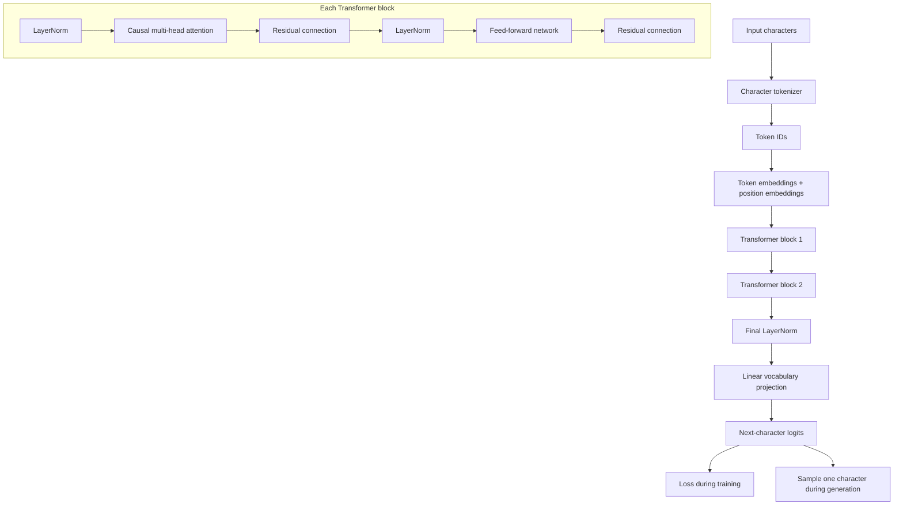

# Mike-LLM — Building a GPT-Style Language Model from Scratch

Mike-LLM is an educational decoder-only Transformer implemented and trained from random weights with Python and PyTorch. It is not an OpenAI or Ollama wrapper, and it does not fine-tune a pretrained model. The goal is to make every important step—from characters to attention, loss, backpropagation, evaluation, and generation—small enough to inspect.

## Choose your path

| Explore the project | Build your first GPT |
| --- | --- |
| **For reviewers and recruiters.** Run a measurable training demo, inspect the architecture, and read the verified results in about five minutes. | **For students and developers.** Build the model progressively through the guided tutorial and 41 detailed research chapters. |
| [Run the quick demo](#five-minute-learning-demo) · [Review results and lessons](docs/RESULTS_AND_LESSONS.md) · [Read the technical record](docs/TECHNICAL_README.md) | [Start the guided tutorial](docs/GETTING_STARTED.md) · [Browse all chapters](docs/README.md) · [Inspect the source](src/) |

## Five-minute learning demo

This clean-clone demo initializes a 15,360-parameter GPT with random weights, prints its output before training, trains on a tiny synthetic color language, measures validation loss, and generates again. The data ships inside the script; no private corpus or pretrained checkpoint is required.

```bash
git clone https://github.com/kaiserg/mike-llm.git
cd mike-llm
python3 -m venv .venv
source .venv/bin/activate
python -m pip install -r requirements.txt
python scripts/quick_demo.py
```

A verified reference run reduced validation loss from **2.7454 to 0.3196** and validation perplexity from **15.57 to 1.38**. Before training, greedy output had no stable structure. After 150 CPU updates, it reproduced the learned cycle:

```text
red blue green yellow red blue green yellow red blue green yellow...
```

This proves measurable pattern learning on an intentionally simple task. It does not demonstrate language understanding. See the [archived demo report](docs/results/quick-demo.json) and [loss curve](docs/images/quick-demo-loss.svg).

Run the complete test suite:

```bash
PYTHONPATH=src python -m unittest discover -s tests -q
```

## What is implemented

- Character-level tokenization and reversible encoding
- Token embeddings and learned or sinusoidal position encodings
- Causal multi-head self-attention with learned Query, Key, and Value projections
- Position-wise feed-forward networks, LayerNorm, and residual connections
- Stacked decoder-only Transformer blocks and a vocabulary projection
- Next-character training, AdamW updates, checkpoints, and deterministic CPU runs
- Autoregressive generation with temperature and an explicit context window
- Full-stream evaluation, perplexity, accuracy, and controlled ablation experiments

## Architecture



The implementation is intentionally direct. Start with [`src/gpt.py`](src/gpt.py), then follow the components through [`src/transformer_block.py`](src/transformer_block.py), [`src/multi_head_attention.py`](src/multi_head_attention.py), and [`src/feed_forward.py`](src/feed_forward.py).

## Final small-corpus experiment

The completed research stage selected a 17,232-parameter character model using validation only, then evaluated it once on its reserved test book.

| Metric | Validation | Test |
| --- | ---: | ---: |
| Character perplexity | **6.288657** | **5.750783** |
| Next-character accuracy | 44.85% | **46.33%** |

These are next-character prediction metrics. They do not measure conversational quality, factual knowledge, or instruction following. The final checkpoint and book corpus are ignored local artifacts and are not available from a clean clone; the metrics, selection record, and test report are committed for audit. The synthetic quick demo above is the reproducible clean-clone path.

## Documentation

- [Build Your First GPT](docs/GETTING_STARTED.md) — the progressive educational path
- [Results and Lessons](docs/RESULTS_AND_LESSONS.md) — outcomes, failures, and honest interpretation
- [Technical README](docs/TECHNICAL_README.md) — preserved architecture, corpus, and experiment reference
- [Documentation index](docs/README.md) — all 41 chapters, including negative results
- [Final selection](docs/results/final-model-selection.json) and [held-out test report](docs/results/final-test-evaluation.json) — machine-readable evidence

## Limitations

Mike-LLM is intentionally small. The finalized model predicts characters from a short context, can produce malformed or repetitive text, and is not trained to follow instructions or hold a reliable conversation. The broader licensed corpus work is documented but was not used to retrain the v0.1 checkpoint. This is an educational engineering project, not a production language model.

## Future work

Possible v0.2 directions include UTF-8 byte or BPE tokenization, a more balanced corpus, larger models, measured MPS training, specialization on a narrow task, instruction tuning, and broader evaluation. They are intentionally outside the v0.1 scope.

## Purpose

Mike-LLM is an independent learning and engineering project. Its value is the inspectable implementation, reproducible evidence, experimental discipline, and clear account of what a tiny Transformer can and cannot learn.
