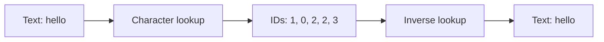

# Tokenization

[Documentation index](README.md) · [Next](02-token-embeddings.md)

Implementation: [`src/tokenizer.py`](../src/tokenizer.py).

A model operates on numbers. `CharacterTokenizer` builds a vocabulary from `sorted(set(text))`, then creates reversible character-to-ID and ID-to-character dictionaries. Each token is one character, including spaces and punctuation. IDs are labels, not measurements of meaning.

For vocabulary $\mathcal{V}$, encoding maps characters to integers in $[0, |\mathcal{V}|-1]$. Decoding reverses that lookup:

$$\operatorname{decode}(\operatorname{encode}(s))=s$$

This holds when every character of $s$ belongs to the vocabulary. An unseen character raises `KeyError`; the implementation has no unknown-token fallback, subword merges, or special tokens. Building this vocabulary is deterministic and does not optimize neural weights.

```python
from tokenizer import CharacterTokenizer

tokenizer = CharacterTokenizer("hello")
assert tokenizer.stoi == {"e": 0, "h": 1, "l": 2, "o": 3}
assert tokenizer.encode("hello") == [1, 0, 2, 2, 3]
assert tokenizer.decode([1, 0, 2, 2, 3]) == "hello"
```



The IDs above belong only to the vocabulary built from `"hello"`. The source demonstration builds a larger vocabulary and therefore assigns different IDs. Repeated `l` characters share an ID but occupy different sequence positions.
