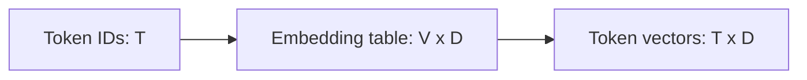

# Token embeddings

[Documentation index](README.md) · [Previous](01-tokenization.md) · [Next](03-positional-embeddings.md)

Implementation: [`src/embeddings.py`](../src/embeddings.py).

An embedding is a trainable lookup table $E\in\mathbb{R}^{V\times D}$, where $V$ is vocabulary size and $D$ is embedding width. Token ID $t_i$ selects a row:

$$x_i=E[t_i]$$

For five IDs and width four, `nn.Embedding` produces shape `[5, 4]`. With a batch, `[B, T]` IDs become `[B, T, D]`. A lookup is equivalent to multiplying a one-hot vector by $E$, without explicitly constructing that vector. The table contains $VD$ trainable parameters.

```python
import torch
from torch import nn
from tokenizer import CharacterTokenizer

torch.manual_seed(42)
tokenizer = CharacterTokenizer("hello")
ids = torch.tensor(tokenizer.encode("hello"), dtype=torch.long)
embedding = nn.Embedding(tokenizer.vocab_size, 4)
x = embedding(ids)
assert x.shape == (5, 4)
assert torch.equal(x[2], x[3])  # Same token, same lookup row.
assert embedding.weight.numel() == tokenizer.vocab_size * 4
```



These vectors start randomly initialized. Their numerical values do not yet demonstrate learned semantics. The source script does not set a random seed; the independent example above does. Optimization and language-model training have not been implemented in this script.
