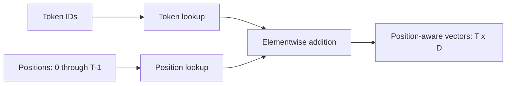

# Positional embeddings

[Documentation index](README.md) · [Previous](02-token-embeddings.md) · [Next](04-dot-product-attention.md)

Implementation: [`src/positional_embeddings.py`](../src/positional_embeddings.py).

Token lookup alone gives both occurrences of `l` the same vector. The implementation adds a separate trainable vector for each absolute position. It uses learned positions, not sinusoidal encodings or rotary embeddings.

$$x_i=E[t_i]+P[i],\qquad P\in\mathbb{R}^{C\times D}$$

Here $C$ is context capacity. Addition preserves width $D$. The script uses $C=16$, $D=4$, and five tokens; valid position indices are 0 through 15. Positions outside the table raise an indexing error.

```python
import torch
from torch import nn
from tokenizer import CharacterTokenizer

torch.manual_seed(42)
tokenizer = CharacterTokenizer("hello")
ids = torch.tensor(tokenizer.encode("hello"))
token_table = nn.Embedding(tokenizer.vocab_size, 4)
position_table = nn.Embedding(16, 4)
positions = torch.arange(ids.numel())
x = token_table(ids) + position_table(positions)
assert positions.tolist() == [0, 1, 2, 3, 4]
assert x.shape == (5, 4)
assert torch.allclose(x - token_table(ids), position_table(positions))
```

The subtraction can incur floating-point rounding; use `torch.allclose` when comparing reconstructed vectors.



Position information distinguishes occurrences without changing their token IDs. The table adds $CD$ parameters. The current multi-head module receives already prepared vectors; it does not add embeddings itself.

GPT also supports optional fixed sinusoidal positions; see [chapter 23](23-sinusoidal-positions.md). The earlier demonstration and learned default remain unchanged.
