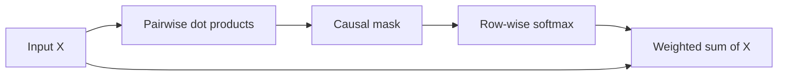

# Dot-product attention

[Documentation index](README.md) · [Previous](03-positional-embeddings.md) · [Next](05-causal-masking.md)

Implementation: [`src/attention.py`](../src/attention.py).

Attention mixes information from sequence positions. A dot product measures compatibility, a row-wise softmax turns scores into weights, and a weighted sum forms output vectors.

The educational script starts with a shared representation $X\in\mathbb{R}^{T\times D}$:

$$S=XX^\top,\qquad A=\operatorname{softmax}_{\mathrm{last}}(S+M),\qquad O=AX$$

$S$ and $A$ have shape `[T, T]`; $O$ has shape `[T, D]`. Row $i$ represents the querying position and column $j$ the position it consults. Each row of $A$ sums to one. $M$ is the causal mask explained next.

Despite its general filename, `attention.py` already includes causal masking. It does not have learned QKV projections or the $1/\sqrt{d_k}$ scaling used in the later scripts. It is a learning step, not the final attention implementation.

```python
import torch

x = torch.tensor([[1., 0.], [0., 1.], [1., 1.]])
scores = x @ x.T
allowed = torch.tril(torch.ones(3, 3, dtype=torch.bool))
weights = scores.masked_fill(~allowed, float("-inf")).softmax(dim=-1)
output = weights @ x
assert scores.shape == (3, 3)
assert output.shape == x.shape
assert torch.allclose(weights.sum(dim=-1), torch.ones(3))
assert torch.equal(output[0], x[0])
```



Attention weights are computed from the input; they are not a table of model parameters. High attention weight is not by itself proof of a linguistic explanation.
