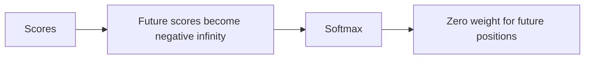

# Causal masking

[Documentation index](README.md) · [Previous](04-dot-product-attention.md) · [Next](06-query-key-value.md)

Implementation: [`src/attention.py`](../src/attention.py).

An autoregressive language model predicts the next token using only the available prefix. During training, many positions can be processed together, but position $i$ must not read future input positions $j>i$.

$$M_{ij}=\begin{cases}0 & j\leq i\\-\infty & j>i\end{cases}$$

$$A=\operatorname{softmax}_{\mathrm{last}}(S+M)$$

Mask scores before softmax. Since $\exp(-\infty)=0$, blocked positions receive zero weight. A lower triangular mask includes the diagonal: a token may read itself. The first `l` in `hello`, at zero-based position 2, may consult `h`, `e`, and itself, but not the second `l` or `o`.

```text
       h e l l o   <- key positions
h      1 0 0 0 0
 e     1 1 0 0 0
 l     1 1 1 0 0
 l     1 1 1 1 0
 o     1 1 1 1 1
^ query positions; 1 means allowed
```

```python
import torch

allowed = torch.tril(torch.ones(5, 5, dtype=torch.bool))
scores = torch.zeros(5, 5)
a = scores.masked_fill(~allowed, float("-inf")).softmax(dim=-1)
assert allowed[2].tolist() == [True, True, True, False, False]
assert torch.all(a.triu(diagonal=1) == 0)
assert torch.allclose(a.sum(-1), torch.ones(5))
```



Reading the current input token is valid because its training target is the *next* token. A future training loop must shift inputs and targets accordingly. Causality applies during both training and generation; when processing a prefix in parallel, later prefix tokens must still be hidden from earlier positions. Causal masking is different from padding masking; these scripts do not implement padding handling.

The more advanced [QKV script](../src/causal_self_attention.py) also checks that upper-triangular attention weights are zero.
