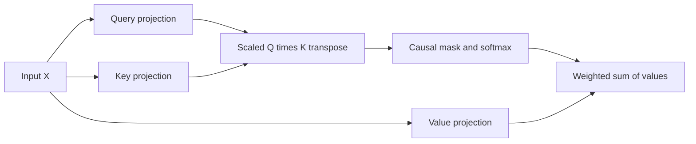

# Query, Key, Value

[Documentation index](README.md) · [Previous](05-causal-masking.md) · [Next](07-multi-head-attention.md)

Implementation: [`src/causal_self_attention.py`](../src/causal_self_attention.py).

Instead of using the same vectors for comparison and aggregation, self-attention learns three projections of the same input. A query represents what a position seeks, a key what can be matched, and a value what gets aggregated. These are useful intuitions, not manually assigned meanings.

Using row-vector mathematical notation:

$$Q=XW_Q,\quad K=XW_K,\quad V=XW_V$$
$$A=\operatorname{softmax}_{\mathrm{last}}\left(\frac{QK^\top}{\sqrt{d_k}}+M\right),\qquad O=AV$$

PyTorch stores a linear layer's weight as `[out_features, in_features]`, so `nn.Linear` implements the corresponding multiplication with the stored weight transposed. The source uses three bias-free `nn.Linear(4, 4)` layers. Each of Q, K, V and output is `[5, 4]`; scores are `[5, 5]`. The three projection matrices contribute $3\times4\times4=48$ parameters, excluding embedding tables.

Scaling by $\sqrt{d_k}$ helps control score magnitude as key width grows, reducing the tendency toward overly concentrated softmax weights at initialization.

```python
import torch
from torch import nn

torch.manual_seed(42)
x = torch.randn(5, 4)
query, key, value = [nn.Linear(4, 4, bias=False) for _ in range(3)]
q, k, v = query(x), key(x), value(x)
scores = (q @ k.T) / (k.shape[-1] ** 0.5)
allowed = torch.tril(torch.ones(5, 5, dtype=torch.bool))
a = scores.masked_fill(~allowed, float("-inf")).softmax(-1)
out = a @ v
assert out.shape == (5, 4)
assert torch.all(a.triu(1) == 0)
```



The matrices are trainable but have not learned useful relationships merely by running the demonstration. The next chapter runs several independently parameterized projections in parallel.
