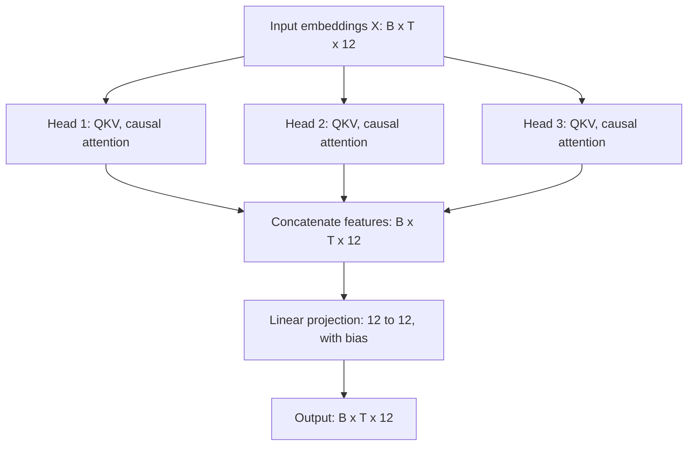

# Multi-head attention

[Documentation index](README.md) · [Previous](06-query-key-value.md) · [Next](08-feed-forward.md)

Implementation: [`src/multi_head_attention.py`](../src/multi_head_attention.py).

Multiple heads let a layer compute several attention distributions over the same input. Every head receives all $D$ input features and learns its own Q, K, and V projections into a smaller space. Heads may learn different relationships, but the implementation does not prescribe specializations.

$$d_h=D/H$$
$$\mathrm{head}_h=\operatorname{softmax}_{\mathrm{last}}\left(\frac{(XW_{Q,h})(XW_{K,h})^\top}{\sqrt{d_h}}+M\right)(XW_{V,h})$$
$$Y=\operatorname{Concat}(\mathrm{head}_1,\ldots,\mathrm{head}_H)W_O+b_O$$

The transpose in the batched implementation applies to the final two dimensions, preserving independent batch elements. `MultiHeadAttention` requires `embedding_dim % num_heads == 0`.


| Stage | Shape in the source example |
| --- | --- |
| Input X | `[2, 5, 12]` |
| Q, K, V per head | `[2, 5, 4]` |
| Scores / weights per head | `[2, 5, 5]` |
| Output per head | `[2, 5, 4]` |
| Concatenated outputs | `[2, 5, 12]` |
| Output projection | `[2, 5, 12]` |

**Heads are not batches.** $B=2$ means two independent sequences; $H=3$ means three learned attention computations for each sequence. The heads do not split the batch or split the raw input into three slices. Concatenation joins the head outputs along the feature axis (`dim=-1`), not along the sequence or batch axis. The output projection mixes features at each position and does not mix different positions.



Run the existing demonstration from the repository root:

```bash
python src/multi_head_attention.py
```

```text
Input shape: torch.Size([2, 5, 12])
Output shape: torch.Size([2, 5, 12])
Number of heads: 3
Trainable parameters: 588
```

This output was verified locally; it checks dimensions and parameter count, not trained language quality. The count follows directly from the implementation: three bias-free projections per head contribute $H(3Dd_h)=432$ parameters; the final biased projection contributes $D^2+D=156$. Total: $588$, or generally $4D^2+D$ under this configuration.

```python
import torch
from multi_head_attention import MultiHeadAttention

torch.manual_seed(42)
layer = MultiHeadAttention(embedding_dim=12, num_heads=3)
x = torch.randn(2, 5, 12)
y = layer(x)
assert y.shape == x.shape
assert sum(p.numel() for p in layer.parameters()) == 588
# Changing the suffix cannot affect the prefix.
changed = x.clone()
changed[:, 3:, :] += 10
with torch.no_grad():
    assert torch.allclose(layer(x)[:, :3], layer(changed)[:, :3])
```

The module includes causal masking and an output projection. It does not yet include dropout, residual connections, normalization, feed-forward layers, padding masks, a KV cache, or a training loop. A standalone [feed-forward network](08-feed-forward.md) is now available; integrating it into a Transformer block remains a future step.
