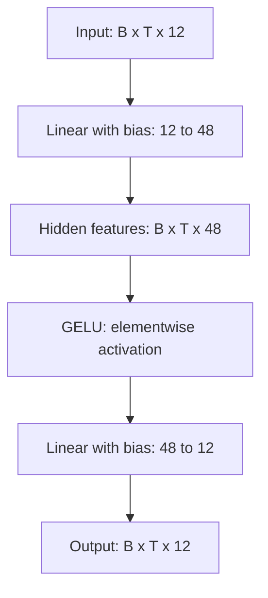
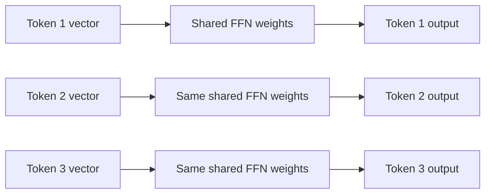

# Feed-forward network (FFN)

[Documentation index](README.md) · [Previous](07-multi-head-attention.md) · [Next](09-transformer-block.md)

Implementation: [`src/feed_forward.py`](../src/feed_forward.py), class `FeedForward`.

## From attention to feature transformation

Attention combines information from allowed sequence positions. A position-wise FFN then transforms each token's feature vector independently. In a Transformer, that vector can already contain context gathered by attention. The FFN adds nonlinear processing without gathering information from additional positions.

All tokens and batch elements use the **same learned weights**. Independent application does not mean a separate network is created for every token. The module also accepts `[T, D]` inputs because its linear layers operate only on the final dimension.

## Expand, activate, project

For embedding width $D$ and expansion factor $r$, the hidden width is $F=rD$. This implementation defaults to $r=4$, a design choice rather than a mathematical requirement. Use positive integer dimensions and a positive integer expansion factor.

Using row-vector notation:

$$H=XW_1+b_1$$
$$A=\operatorname{GELU}(H)$$
$$Y=AW_2+b_2$$

Here $W_1\in\mathbb{R}^{D\times F}$ and $W_2\in\mathbb{R}^{F\times D}$. Biases broadcast over batch and sequence axes. PyTorch stores the weight matrices transposed relative to this notation.

Expansion provides more intermediate features for learned transformations. GELU introduces nonlinearity, and the second linear layer maps those features back to the original width. Matching input and output widths will let us add a residual connection in a later Transformer block.

Without the activation, composing the two affine layers would still be a single affine transformation:

$$(XW_1+b_1)W_2+b_2=X(W_1W_2)+(b_1W_2+b_2)$$

The extra width alone would not introduce a nonlinear function.



## What GELU does

GELU is a smooth activation defined by:

$$\operatorname{GELU}(z)=z\Phi(z)$$

$\Phi$ is the standard normal cumulative distribution function. Large positive inputs remain close to their original value, large negative inputs approach zero, and intermediate inputs are smoothly scaled. Negative values are not all set to zero. The implementation uses `nn.GELU()` with its default `approximate="none"`.

```python
import torch
from torch import nn

z = torch.tensor([-3., -1., 0., 1., 3.])
a = nn.GELU()(z)
assert a.shape == z.shape
assert a[2].item() == 0.0
assert a[1].item() < 0.0  # GELU differs from ReLU.
```

## Positions stay independent



These branches depict repeated application of one module, not three parameter sets. A causal mask is unnecessary inside the FFN: no operation combines different positions. It preserves the causal behavior of an input produced by causal attention. It cannot undo future information already leaked by an earlier layer.

## Run the implementation

From the repository root with the project environment activated:

```bash
python src/feed_forward.py
```

Verified demonstration output:

```text
Input shape: torch.Size([2, 5, 12])
Hidden dimension: 48
Output shape: torch.Size([2, 5, 12])
Trainable parameters: 1212
```

Both linear layers include biases. The parameter count is:

$$DF+F+FD+D=2DF+F+D$$
$$2(12)(48)+48+12=1212$$

GELU adds no trainable parameters. Batch size and sequence length do not affect this count. These are untrained parameters; the demonstration does not measure language quality.

## Reproducible checks

Run this snippet using `PYTHONPATH=src python` from the repository root. It checks output shape, parameter count, and the absence of mixing between positions or batch elements.

```python
import torch
from feed_forward import FeedForward

torch.manual_seed(42)
ffn = FeedForward(embedding_dim=12)
x = torch.randn(2, 5, 12)
with torch.no_grad():
    y = ffn(x)
    assert y.shape == x.shape
    assert sum(p.numel() for p in ffn.parameters()) == 1212
    # Processing one token alone gives the same result.
    assert torch.allclose(ffn(x[0, 2]), y[0, 2], atol=1e-6)
    # Changing one token leaves every other output unchanged.
    changed = x.clone()
    changed[0, 2] += 10
    updated = ffn(changed)
    unchanged = torch.ones(2, 5, dtype=torch.bool)
    unchanged[0, 2] = False
    assert torch.allclose(updated[unchanged], y[unchanged])
```

The expansion factor can be configured independently of attention's head count:

```python
import torch
from feed_forward import FeedForward

ffn = FeedForward(embedding_dim=12, expansion_factor=2)
assert ffn(torch.zeros(2, 5, 12)).shape == (2, 5, 12)
assert sum(p.numel() for p in ffn.parameters()) == 612
```

## Next: assemble a Transformer block

The FFN module implements only the two linear layers and GELU. The [Transformer block](09-transformer-block.md) now combines this module with normalization and residual connections. It computes:

$$U=X+\operatorname{Attention}(\operatorname{LayerNorm}_1(X))$$
$$Y=U+\operatorname{FFN}(\operatorname{LayerNorm}_2(U))$$

The standalone FFN remains independent; `TransformerBlock` connects it to attention. Neither demonstration trains a language model.
