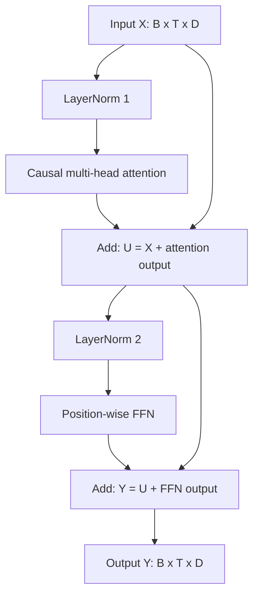
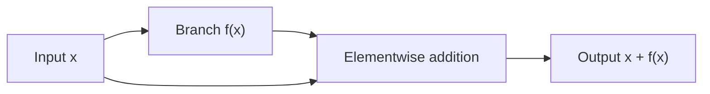

# Transformer block: LayerNorm and residual connections

[Documentation index](README.md) · [Previous](08-feed-forward.md)

Implementation: [`src/transformer_block.py`](../src/transformer_block.py), class `TransformerBlock`.

## Combine the building blocks

A decoder block combines causal attention, a position-wise FFN, two LayerNorm modules, and two residual additions. We use **pre-normalization**: normalize the input to each transformation branch, then add its output back to the unnormalized residual stream.

$$U=X+\operatorname{Attention}(\operatorname{LN}_1(X))$$
$$Y=U+\operatorname{FFN}(\operatorname{LN}_2(U))$$

Each intermediate residual stream has shape `[B, T, D]`. The second normalization receives the updated stream $U$, not the original $X$. The two normalization modules have independent learned parameters.



## LayerNorm: normalize one token's features

For each token vector $x\in\mathbb{R}^D$, LayerNorm computes a mean and variance across its **features**:

$$\mu=\frac{1}{D}\sum_{j=1}^{D}x_j$$
$$\sigma^2=\frac{1}{D}\sum_{j=1}^{D}(x_j-\mu)^2$$
$$\operatorname{LN}(x)_j=\gamma_j\frac{x_j-\mu}{\sqrt{\sigma^2+\epsilon}}+\beta_j$$

`nn.LayerNorm(D)` uses this population variance (`unbiased=False`), with default $\epsilon=10^{-5}$. Epsilon stabilizes division, including for constant vectors. Each module learns a scale $\gamma$ and offset $\beta$ of width $D$, initialized to one and zero respectively.

The operation controls the scale entering each branch, which helps optimization when stacking blocks. It does not normalize across tokens or across batch elements. It uses statistics from the current token in both training and evaluation, with no running averages. Consequently, it introduces no future-token leakage.

Before the learned affine transform, normalized features have mean approximately zero and variance close to one for nonconstant inputs; epsilon prevents an exact unit-variance guarantee. After learning $\gamma$ and $\beta$, even those approximate output statistics need not hold.

```python
import torch
from torch import nn

x = torch.tensor([[[1., 2., 3., 4.], [10., 10., 10., 10.]]])
ln = nn.LayerNorm(4)
mean = x.mean(dim=-1, keepdim=True)
variance = x.var(dim=-1, unbiased=False, keepdim=True)
manual = (x - mean) / torch.sqrt(variance + ln.eps)
manual = manual * ln.weight + ln.bias
assert torch.allclose(ln(x), manual, atol=1e-6)
assert torch.isfinite(ln(x)).all()
assert torch.equal(ln(x)[0, 1], torch.zeros(4))
```

## Residual connections: add an update

A residual connection computes $y=x+f(x)$. It keeps a direct path for the existing representation while the branch learns an additive update. This is why attention and the FFN both return width $D$.

For a differentiable branch, its Jacobian is:

$$\frac{\partial y}{\partial x}=I+\frac{\partial f}{\partial x}$$

The identity term gives gradients a direct route through the addition. This helps train deep stacks, but does not guarantee that gradients or training will always remain stable. Residual addition is elementwise, not concatenation; the batch, sequence, and feature dimensions stay unchanged.



With pre-normalization the branch function includes LayerNorm. Normalization occurs on a branch; the skip path carries the original stream. A post-normalized design would instead normalize after the addition. This implementation deliberately uses the pre-normalized equations above.

## Run the block

From the repository root with the environment activated:

```bash
python src/transformer_block.py
```

Verified output:

```text
Input shape: torch.Size([2, 5, 12])
Output shape: torch.Size([2, 5, 12])
Trainable parameters: 1848
```

For $D=12$, three heads, and FFN expansion four:

| Component | Parameters |
| --- | ---: |
| Causal multi-head attention | 588 |
| Feed-forward network | 1212 |
| LayerNorm 1: scale and offset | 24 |
| LayerNorm 2: scale and offset | 24 |
| Total | 1848 |

Residual additions have no parameters. This counts one untrained block, excluding token embeddings, position embeddings, and a vocabulary output layer.

## Reproducible behavioral checks

Run using `PYTHONPATH=src python` from the repository root:

```python
import torch
from transformer_block import TransformerBlock

torch.manual_seed(42)
block = TransformerBlock(embedding_dim=12, num_heads=3)
x = torch.randn(2, 5, 12)
with torch.no_grad():
    y = block(x)
    assert y.shape == x.shape
    assert sum(p.numel() for p in block.parameters()) == 1848
    # A suffix change cannot affect earlier positions.
    changed = x.clone()
    changed[:, 3:] += torch.randn_like(changed[:, 3:])
    assert torch.allclose(block(changed)[:, :3], y[:, :3], atol=1e-6)
    # Batch elements remain independent.
    changed_batch = x.clone()
    changed_batch[1] = torch.randn_like(changed_batch[1])
    assert torch.allclose(block(changed_batch)[0], y[0], atol=1e-6)
```

To see the skip paths directly, zero only the attention and FFN parameters in a separate block. Both updates then vanish and the output equals the original input, despite the branch normalizations:

```python
import torch
from transformer_block import TransformerBlock

block = TransformerBlock(embedding_dim=12, num_heads=3)
x = torch.randn(2, 5, 12)
with torch.no_grad():
    for branch in (block.attention, block.feed_forward):
        for parameter in branch.parameters():
            parameter.zero_()
    assert torch.equal(block(x), x)
```

## What remains

The block reuses the existing causal attention and FFN without modifying their implementations. It has no dropout, padding mask, KV cache, embeddings, final normalization, vocabulary logits, loss, or generation loop. A future language model can stack these blocks, then apply a final normalization and a vocabulary projection. Training and evaluation remain separate future steps.
