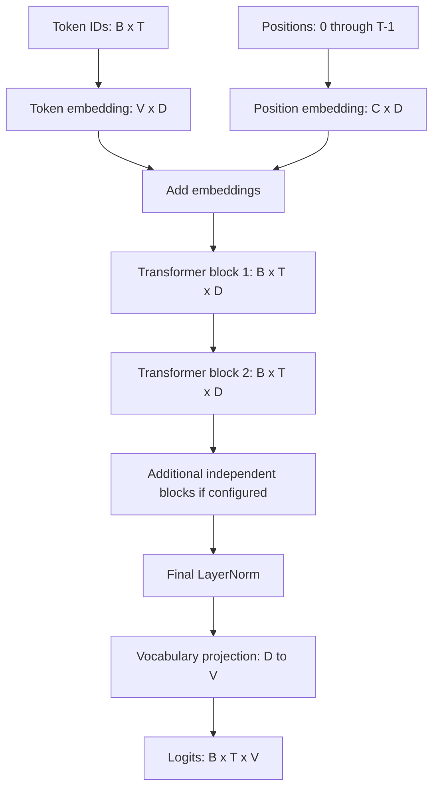

# Assemble a GPT language model

[Documentation index](README.md) · [Previous](09-transformer-block.md) · [Next](11-training.md)

Implementation: [`src/gpt.py`](../src/gpt.py), class `GPT`.

## From IDs to next-token scores

The model combines our existing causal decoder blocks with learned token and absolute position embeddings, a final LayerNorm, and a vocabulary projection. It implements a complete small GPT-style forward architecture with randomly initialized weights. Training and generation loops remain future work.

For vocabulary size $V$, embedding width $D$, context capacity $C$, and $L$ blocks:

$$X^{(0)}_{b,t}=E[\mathrm{token\_ids}_{b,t}]+P[t]$$
$$X^{(\ell+1)}=\operatorname{Block}_{\ell}(X^{(\ell)}),\quad \ell=0,\ldots,L-1$$
$$Z=\operatorname{LayerNorm}_{\mathrm{final}}(X^{(L)})$$
$$\mathrm{logits}=ZW_{\mathrm{vocab}}$$

Each block has its own weights. The implementation constructs a new `TransformerBlock` for every layer; it does not repeatedly reuse one instance. All blocks preserve `[B, T, D]`. The embedding tables are shared across positions and batch elements, while position indices `0, ..., T-1` broadcast across the batch.



## Why a final normalization?

Our blocks normalize before each attention and FFN branch. Their residual additions still change the stream leaving the last block. The final LayerNorm normalizes this stream before the vocabulary projection. It has its own scale and offset; it is separate from the two normalizations inside each block.

## The output layer predicts tokens

`lm_head` is `nn.Linear(D, V, bias=False)`. It applies the same projection at every position. Output entry `[b, t, v]` is a **logit**, an unnormalized score for vocabulary token `v` as the next token after the prefix ending at position `t`.

The output width is vocabulary size, not embedding width. For the demonstration tokenizer built from `"hello"`, there are four unique characters, so `[2, 5]` IDs become `[2, 5, 4]` logits even though the internal width is twelve.

Probabilities can be obtained with `logits.softmax(dim=-1)`. The forward method returns logits directly because cross-entropy consumes logits and handles normalization internally. These values are not token IDs or meaningful predictions before training.

The output projection and token embedding table have separate weights in this implementation. Weight tying is an optional future design choice, not something done automatically by PyTorch.

## Run the demonstration

From the repository root with the environment activated:

```bash
python src/gpt.py
```

Verified output:

```text
Input shape: torch.Size([2, 5])
Logits shape: torch.Size([2, 5, 4])
Number of blocks: 2
Trainable parameters: 4008
```

The configuration uses $V=4$, $C=16$, $D=12$, three heads, two blocks, and FFN expansion four:

| Component | Parameters |
| --- | ---: |
| Token embeddings: VD | 48 |
| Position embeddings: CD | 192 |
| Two blocks: 2 × 1848 | 3696 |
| Final LayerNorm: 2D | 24 |
| Bias-free vocabulary projection: DV | 48 |
| Total | 4008 |

This small configuration demonstrates architecture and tensor flow, not the future 10–15M parameter training target.

## Reproducible next-token loss example

Run snippets using `PYTHONPATH=src python` from the repository root:

```python
import torch
import torch.nn.functional as F
from gpt import GPT
from tokenizer import CharacterTokenizer

torch.manual_seed(42)
tokenizer = CharacterTokenizer("hello")
model = GPT(vocab_size=tokenizer.vocab_size, context_length=16)
ids = torch.tensor([tokenizer.encode("hello")], dtype=torch.long)
inputs = ids[:, :-1]   # h e l l
targets = ids[:, 1:]  # e l l o
logits = model(inputs)
assert logits.shape == (1, 4, tokenizer.vocab_size)
loss = F.cross_entropy(logits.reshape(-1, tokenizer.vocab_size), targets.reshape(-1))
assert torch.isfinite(loss)
loss.backward()
assert model.token_embedding.weight.grad is not None
```

The input at each position predicts the following token. A diagonal-inclusive causal mask is therefore correct: the current input is visible, but the future target is hidden. This snippet computes gradients for one toy example; it does not run an optimizer or claim training progress. Never apply softmax before passing logits to `cross_entropy`.

## Causality through the whole stack

Every block masks future attention positions. Embeddings, LayerNorm, the FFN, residual additions, and the output projection do not mix positions, so the complete model preserves that restriction.

```python
import torch
from gpt import GPT

torch.manual_seed(42)
model = GPT(vocab_size=4, context_length=16, num_layers=3)
ids = torch.tensor([[1, 0, 2, 2, 3]], dtype=torch.long)
changed = ids.clone()
changed[:, 3:] = torch.tensor([[0, 1]])
with torch.no_grad():
    original_logits = model(ids)
    assert torch.allclose(model(changed)[:, :3], original_logits[:, :3], atol=1e-6)
    # Last-position logits are unchanged when processing only that prefix.
    assert torch.allclose(model(ids[:, :3])[:, -1], original_logits[:, 2], atol=1e-6)
    probabilities = original_logits[:, -1].softmax(dim=-1)
    assert torch.allclose(probabilities.sum(dim=-1), torch.ones(1))
```

A future autoregressive loop can select a token from the last position's distribution, append it, and run the model again. A loop, sampling controls, and a KV cache are not included here.

## Input contract and limits

- `token_ids` must be a nonempty `[B, T]` tensor of dtype `torch.long`.
- All IDs must be in `[0, vocab_size - 1]`; embedding lookup rejects invalid indices.
- `1 <= T <= context_length`. Overlong inputs raise `ValueError`; the model does not silently truncate them.
- All dimension settings must be positive integers, and embedding width must be divisible by head count.
- Put inputs and model on the same device. The demonstration uses CPU. A device-specific training benchmark has not been performed.
- Position indices restart at zero on each forward call. There is no cache or position-offset interface.

There is no padding mask or padding-loss handling. Do not treat padded batches as fully supported. Dropout, data loading, optimization, checkpoints, validation metrics, and generation remain future work.

## Automated checks

Run the saved behavioral tests from the repository root:

```bash
PYTHONPATH=src python -m unittest discover -s tests -v
```

They verify prefix causality, batch independence, gradient propagation through the full model, independent layer weights, input boundaries, and invalid configurations.

The initial training workflow is now implemented separately in [`src/train.py`](../src/train.py); see [chapter 11](11-training.md). The GPT forward module itself remains independent of training and generation loops.
