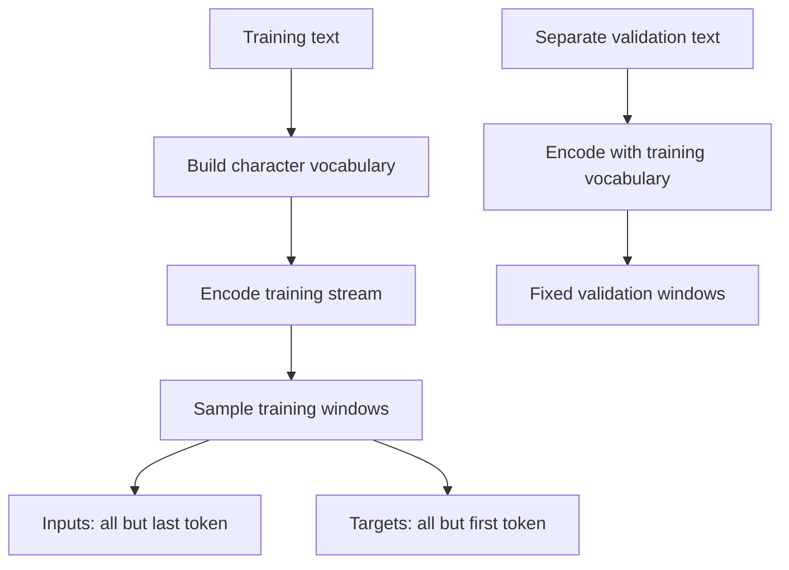
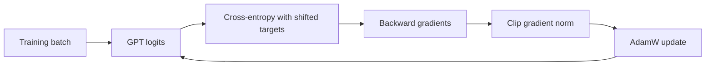

# First reproducible training run

[Documentation index](README.md) · [Previous](10-gpt-model.md)

Implementation: [`src/train.py`](../src/train.py). Behavioral checks: [`tests/test_training.py`](../tests/test_training.py).

## Prepare separate text streams

The default demonstration contains original synthetic training and validation strings embedded in the script. They use similar vocabulary and repetitive patterns, but are separate strings. Repetition is intentional for this tiny learning experiment; validation here is not a realistic language benchmark or evidence of broad generalization.

For real data, select appropriately licensed text, remove duplicates, and split by document or source before constructing windows. Keep validation documents out of training. Reserve a separate test set if you intend to make a final quality claim. Avoid splitting overlapping windows randomly between train and validation, since near-identical text can then appear in both.

The tokenizer vocabulary is built **only from training text**. Validation characters absent from that vocabulary trigger a clear error. This character tokenizer has no unknown token. Decide on text normalization or a tokenizer with unknown-character handling before using more diverse data; do not silently discard validation characters.

Each split is encoded separately into a one-dimensional integer stream. A sampled start index selects `context_length + 1` tokens, entirely inside that split:

```text
window: h e l l o
input:  h e l l
 target: e l l o
```

For context length T and stream length N, valid starts are 0 through N-T-1, inclusive. Inputs and targets both have shape `[batch_size, T]`. Each split therefore needs at least T+1 characters. The sampler draws starts uniformly with replacement; a training step is not an epoch or a complete pass over the corpus. Training windows can overlap other training windows.



## Calculate next-token loss

The model returns logits `[B, T, V]`. At every position, the target is the next character. The causal mask hides future inputs while allowing the current input token.

For N=B×T predictions and correct next-token IDs y:

$$\mathcal{L}=-\frac{1}{N}\sum_{i=1}^{N}\log\left(\frac{\exp(z_{i,y_i})}{\sum_{v=1}^{V}\exp(z_{i,v})}\right)$$

Cross-entropy penalizes low probability for the actual next token. Flattening batch and sequence axes gives `[B*T, V]` logits and `[B*T]` targets. PyTorch performs the log-softmax internally, so pass raw logits directly. Loss uses natural logarithms and is reported in nats per token.

```python
import torch
from train import prepare_data, sample_batch

tokenizer, train_ids, val_ids = prepare_data("hellohello", "hello", 4)
x, y = sample_batch(train_ids, 2, 4, torch.Generator().manual_seed(42))
assert x.shape == y.shape == (2, 4)
assert torch.equal(x[:, 1:], y[:, :-1])
```

## Update weights

Each step performs:

```text
zero_grad → forward → cross_entropy → backward → clip gradients → optimizer.step
```

`zero_grad(set_to_none=True)` clears gradients left by the previous step. `backward()` differentiates loss through the output layer, normalization, blocks, and embeddings. Gradient clipping limits the combined gradient norm to 1.0; nonfinite losses or gradient norms stop the run. AdamW updates the parameters using gradient estimates, adaptive moments, and decoupled weight decay.

For intuition, ordinary gradient descent would update a weight as:

$$\theta\leftarrow\theta-\eta\nabla_\theta\mathcal{L}$$

AdamW uses a more elaborate update, but the goal is the same: reduce prediction error using gradients. This demonstration uses learning rate 0.003 and weight decay 0.01 on all parameters, including biases and LayerNorm parameters. Parameter groups and learning-rate scheduling can be added later.



Validation uses `model.eval()` and `torch.no_grad()`, without optimizer updates. Evaluation restores the previous training mode afterward. Loss is averaged over fixed, equally sized sampled batches, not every possible window in the split. Independent random generators keep evaluation from changing the training-batch sequence.

## Run and inspect

From the repository root with the environment activated:

```bash
python src/train.py
```

Defaults: CPU, one thread, seed 42, deterministic algorithms, 100 updates, batch size 8, context length 16, embedding width 24, three heads, two blocks, FFN expansion four. Evaluation uses eight fixed batches per split at step zero, every 25 steps, and the final step.

Observed locally with Python 3.13 and PyTorch 2.14.1:

| Step | Training loss | Validation loss |
| --- | ---: | ---: |
| 0 | 3.0604 | 3.0353 |
| 25 | 2.1843 | 2.2386 |
| 50 | 1.8159 | 1.9279 |
| 75 | 1.5466 | 1.7082 |
| 100 | 1.2734 | 1.4788 |

These measured losses show learning on the tiny synthetic task. They do not establish useful language generation. Training and validation loss need not decrease at every step on other datasets.

```bash
python src/train.py --steps 100 --seed 42 --output-dir runs/repeated-training
python src/train.py --train-file data/train.txt --validation-file data/validation.txt --output-dir runs/custom-training
```

Both file arguments must be supplied together and use UTF-8. Split the files yourself before running. Each output directory contains `metrics.json` and `checkpoint.pt`; reusing a directory overwrites those two files. The `runs/` directory is ignored by Git.

Metrics record the model and training settings, vocabulary mapping, text lengths, SHA-256 hashes of the decoded UTF-8 text, PyTorch version, and evaluation history. Checkpoints additionally contain model weights, optimizer state, completed step, and training/global random-generator states. A resume command is not implemented; restarting the command starts from random initialization.

Repeatability was checked with identical CPU runs: evaluation histories and final weights match exactly on the same runtime. Identical seeds do not guarantee bitwise agreement across PyTorch versions, operating systems, or devices. This script deliberately stays on CPU; MPS performance has not been tested.

## Restore the trained forward model

Only load checkpoints you trust. For checkpoints created by this script:

```python
import torch
from gpt import GPT
from tokenizer import CharacterTokenizer

checkpoint = torch.load("runs/first-training/checkpoint.pt", map_location="cpu", weights_only=True)
model = GPT(**checkpoint["model_config"])
model.load_state_dict(checkpoint["model_state_dict"])
model.eval()
# Rebuild exactly the saved character-to-ID mapping.
vocabulary = sorted(checkpoint["tokenizer_stoi"], key=checkpoint["tokenizer_stoi"].get)
tokenizer = CharacterTokenizer("".join(vocabulary))
assert tokenizer.stoi == checkpoint["tokenizer_stoi"]
with torch.no_grad():
    ids = torch.tensor([tokenizer.encode("a model")], dtype=torch.long)
    logits = model(ids)
    assert logits.shape[-1] == tokenizer.vocab_size
```

## Verification and next steps

```bash
PYTHONPATH=src python -m unittest discover -s tests -v
```

Tests cover shifted targets, split validation, exact repeated-run results, decreased loss on this fixed synthetic task, and checkpoint reload equivalence, alongside the GPT tests. The next steps are generation, a representative corpus, stronger held-out evaluation, and a resumable training workflow.
