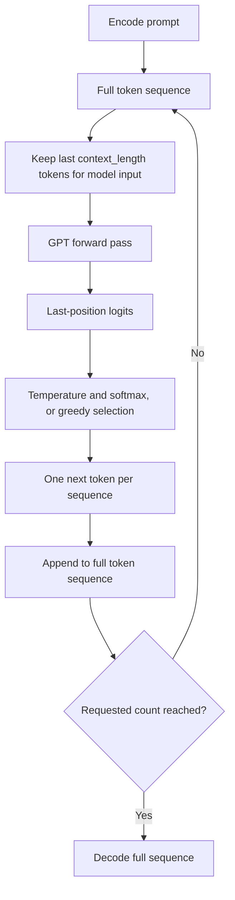

# Autoregressive text generation and temperature

[Documentation index](README.md) · [Previous](11-training.md)

Implementation: [`src/generate.py`](../src/generate.py). Tests: [`tests/test_generation.py`](../tests/test_generation.py).

## Predict, append, repeat

During training, we knew the next token and used it as a target. During generation, the model must choose a token and use its own choice as input to the next step. This is autoregressive generation.

1. Encode a nonempty prompt with the checkpoint's exact character vocabulary.
2. Pass the most recent context window through GPT.
3. Select logits from the **last position**: `logits[:, -1, :]`.
4. Apply temperature, convert scores into probabilities, and sample one token per batch element.
5. Append the sampled token to the full sequence and repeat.
6. Decode the complete prompt and continuation.



The final position already summarizes the available prefix through causal attention. Other positions' logits predict tokens after earlier prefixes, so they are not the distribution for continuing the entire current prompt.

The model performs a fresh forward pass at each step. `torch.no_grad()` disables gradient tracking; `model.eval()` selects evaluation behavior. The generation function restores the model's previous training mode afterward. No optimizer runs and weights remain unchanged.

## Temperature reshapes probabilities

For next-token logits $z_v$ and temperature $\tau>0$:

$$p_v=\frac{\exp(z_v/\tau)}{\sum_u\exp(z_u/\tau)}$$

- At temperature 1, sample from the model's original softmax distribution.
- Below 1, probability becomes more concentrated on the higher-scoring tokens.
- Above 1, probability is spread more evenly, allowing lower-scoring tokens more often.
- At temperature 0, this implementation uses `argmax` directly. Division by zero is never performed.

Temperature does not change model weights or improve what the model has learned. Very high values can produce incoherent output, and low values can repeat patterns. Positive-temperature sampling is random; greedy selection takes the first maximum when scores tie.

For numerical stability, the code subtracts the largest logit before dividing by temperature, using double precision for this calculation. Subtracting a common constant does not change softmax probabilities.

```python
import torch

logits = torch.tensor([0., 1., 2.])
cold = (logits / 0.5).softmax(-1)
hot = (logits / 2.0).softmax(-1)
assert cold[-1] > hot[-1]
assert torch.allclose(cold.sum(), torch.tensor(1.))
assert torch.allclose(hot.sum(), torch.tensor(1.))
```

## Respect the context limit

The full output can be longer than `context_length`, but each model call receives only its most recent `context_length` tokens. Earlier tokens remain in the returned text but are no longer visible to the model.

Learned absolute position indices restart at zero within every cropped window, matching the model's current forward interface. There is no KV cache or position-offset handling. Generation is therefore simple but recomputes the entire active window at each step.

## Run from a trained checkpoint

From the repository root with the project environment activated:

```bash
# If the checkpoint does not exist yet:
python src/train.py

python src/generate.py --prompt "a model" --max-new-tokens 80 --temperature 0.8 --seed 42
python src/generate.py --prompt "a model" --max-new-tokens 80 --temperature 0
```

The default checkpoint is `runs/first-training/checkpoint.pt`. Use `--checkpoint path/to/checkpoint.pt` for another training run. The command prints the prompt and continuation to standard output and does not overwrite checkpoints.

Actual output from the 100-step demonstration checkpoint, temperature 0.8 and seed 42:

```text
a model feates ten. a omarn. lowen teast de as st t. sma t ma todsten. t.
 te wext text
```

This sample is evidence that generation runs, not that the model has learned fluent language. The dataset, model, context, and training budget are all tiny. Exact samples can differ across runtimes even with the same seed.

The checkpoint loader restores the model configuration, trained weights, and character vocabulary. It checks that the saved vocabulary matches the deterministic `CharacterTokenizer` mapping. Unknown prompt characters are rejected clearly. Empty prompts are also rejected because this tokenizer has no beginning-of-sequence token.

## Use the generation function

This example requires the checkpoint created by chapter 11:

```python
import torch
from generate import generate, load_checkpoint

model, tokenizer = load_checkpoint("runs/first-training/checkpoint.pt")
ids = torch.tensor([tokenizer.encode("a model")], dtype=torch.long)
a = generate(model, ids, max_new_tokens=20, temperature=0.8,
             generator=torch.Generator().manual_seed(42))
b = generate(model, ids, max_new_tokens=20, temperature=0.8,
             generator=torch.Generator().manual_seed(42))
assert torch.equal(a, b)
assert torch.equal(a[:, :ids.shape[1]], ids)
assert a.shape == (1, ids.shape[1] + 20)
text = tokenizer.decode(a[0].tolist())
```

The function supports nonempty batches of equal-length token sequences. Inputs must be `torch.long`, use valid token IDs, and share a device with the model. A supplied generator must also be compatible with that device. The CLI deliberately uses CPU, one thread, deterministic algorithms, and an independent seeded sampling generator.

## Limits and tests

`max_new_tokens` is a nonnegative integer; zero returns an unchanged copy of the prompt. Temperature must be finite and nonnegative. The loop stops only at the requested token count: this character tokenizer has no end-of-sequence token. There is no padding mask, top-k/top-p filtering, streaming, beam search, or repetition penalty.

Run the saved tests:

```bash
PYTHONPATH=src python -m unittest discover -s tests -v
```

Generation tests verify repeatable sampling, prompt preservation, greedy equivalence to a manual sliding-window loop, context overflow, invalid arguments, mode restoration, and the effect of temperature on a controlled distribution. Existing model and training tests continue to pass.
