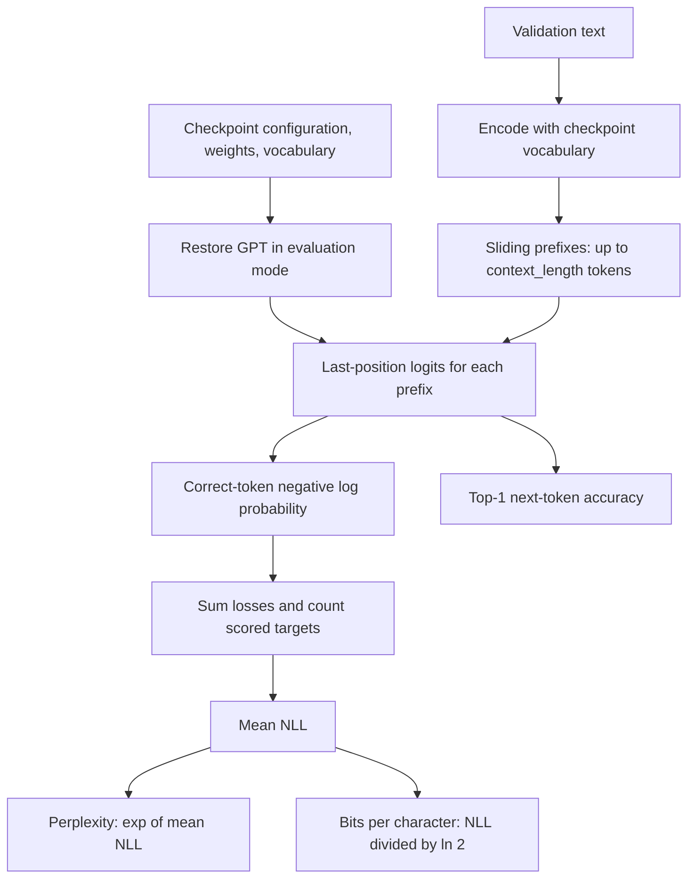

# Checkpoint evaluation and perplexity

[Documentation index](README.md) · [Previous](12-text-generation.md) · [Next](14-real-corpus.md)

Implementation: [`src/evaluate.py`](../src/evaluate.py). Tests: [`tests/test_evaluation.py`](../tests/test_evaluation.py).

## What perplexity measures

Cross-entropy measures how surprised the model is by the correct next tokens. For N evaluated targets, let p_i be the probability assigned to the correct token at position i:

$$\mathrm{NLL}=-\frac{1}{N}\sum_{i=1}^{N}\log(p_i)$$
$$\mathrm{PPL}=\exp(\mathrm{NLL})=\left(\prod_{i=1}^{N}\frac{1}{p_i}\right)^{1/N}$$

The script uses natural logarithms, so NLL is in nats per token. Perplexity is the geometric mean of the reciprocal correct-token probabilities. A uniform model over V tokens has perplexity V; assigning probability one to every observed correct target gives perplexity one. Lower is better under the same evaluation conditions.

A perplexity near five does **not** mean five candidate tokens are equally likely at every position, or that accuracy is one fifth. It summarizes correct-token probabilities across the dataset. Confident mistakes can increase it substantially.

Compare perplexity only when tokenizer, validation data, and context/scoring protocol match. Character-token perplexity cannot be compared directly with subword-token perplexity. This character model also reports bits per character:

$$\mathrm{BPC}=\mathrm{NLL}/\log(2)$$

Here a character means one Python Unicode code point, not a byte or a user-perceived grapheme. BPC is not the size of an actual compressed file.

## Evaluate every target exactly once

Given a validation stream containing N characters, the evaluator scores N-1 targets. The first character is not scored because there is no preceding token or beginning-of-sequence token.

For target position t, the input is:

```text
ids[max(0, t - context_length):t]
```

Only the final-position logits predict that target. Each character after the first is counted once, including the final character. Earlier ground-truth validation tokens supply context, even if the model would have generated something else. This is teacher-forced evaluation, not free-running generation.



Initial prefixes are shorter than the context limit; later prefixes use a full rolling window. Positions restart at zero within each window, just as in generation. The evaluator batches windows of equal length so it needs no padding mask and never inserts artificial context. Each group has at most `batch_size` examples. CPU evaluation uses one thread and deterministic algorithms; no sampling seed is needed.

Losses are summed across targets and divided by the **number of scored tokens**, not averaged as equally weighted batch means. Logits are converted to double precision for cross-entropy accumulation. Model weights and gradients are left unchanged; the previous training/evaluation mode is restored after the function returns or raises an error.

## Run the checkpoint evaluation

From the repository root with the environment activated:

```bash
# Create the demonstration checkpoint if needed:
python src/train.py

python src/evaluate.py
```

Without a validation file, evaluation uses the built-in synthetic validation text from `train.py`, regardless of which checkpoint path is supplied. For a custom corpus, supply its validation file explicitly:

```bash
python src/evaluate.py --checkpoint runs/custom-training/checkpoint.pt --validation-file data/validation.txt --batch-size 32 --output runs/custom-training/evaluation.json
```

The command reads UTF-8 text, reuses the checkpoint vocabulary, and rejects unknown characters instead of silently changing the corpus. Text must contain at least two characters. There is no requirement to fill a complete context window.

It prints a JSON report and writes it to `runs/first-training/evaluation.json` by default. Reusing an output path replaces that report. Checkpoints are read for evaluation. Reports under `runs/` are ignored by Git.

## Observed result

On the 100-step demonstration checkpoint from chapter 11, with PyTorch 2.14.1 and batch size 32:

| Metric | Value |
| --- | ---: |
| Validation characters | 452 |
| Scored next tokens | 451 |
| Vocabulary size | 19 |
| Context limit | 16 |
| Mean NLL, nats per token | 1.607857 |
| Perplexity | 4.992104 |
| Bits per character | 2.319648 |
| Top-1 next-token accuracy | 39.91% |

These are measured results on repetitive synthetic validation text with vocabulary and patterns similar to the demonstration training text. They are not a benchmark of broad language ability. This validation has also been used during training; an untouched test set is needed for final quality claims after model selection.

Chapter 11 reported validation loss 1.4788 from fixed randomly sampled windows. The values differ because that training-time estimate scores all positions within each sampled window, giving many targets short contexts and potentially counting targets more than once. This evaluator instead scores each target once with its longest available context up to the configured limit. Neither difference alone proves an implementation failure or a quality change.

## Saved metrics and provenance

The JSON report includes:

- Total negative log likelihood, mean NLL, perplexity, BPC, top-1 accuracy, and target count.
- Validation character count, vocabulary size, context length, batch size, and scoring protocol.
- Checkpoint path and SHA-256 hash of its exact bytes.
- Validation source and SHA-256 hash of the decoded text re-encoded as UTF-8, matching the text-hash convention used by training.
- PyTorch version, CPU device, and thread count.

Top-1 accuracy uses raw-logit argmax, without temperature or sampling. If exponentiation overflows, perplexity is recorded as JSON `null` with `perplexity_overflow: true`; the finite NLL remains available. Nonfinite losses stop evaluation.

The report identifies inputs but cannot certify corpus independence or detect semantic duplication. Keep data selection, normalization, and held-out documents consistent when comparing checkpoints.

## Reproducible example

Run using `PYTHONPATH=src python` from the repository root:

```python
import math
import torch
from evaluate import evaluate_text
from gpt import GPT
from tokenizer import CharacterTokenizer

tokenizer = CharacterTokenizer("abc")
model = GPT(vocab_size=3, context_length=3)
with torch.no_grad():
    model.lm_head.weight.zero_()  # Uniform next-token probabilities.
metrics = evaluate_text(model, tokenizer, "abcabc", batch_size=2)
assert metrics["scored_tokens"] == 5
assert abs(metrics["mean_nll"] - math.log(3)) < 1e-6
assert abs(metrics["perplexity"] - 3) < 1e-6
```

## Tests and next steps

```bash
PYTHONPATH=src python -m unittest discover -s tests -v
```

Evaluation tests compare batched scoring with a manual sliding-window reference, check uniform-model perplexity and accuracy, and cover short inputs, unknown characters, mode restoration, and unchanged weights/gradients. Batch-size changes can introduce tiny floating-point differences; tests compare numerical values with tolerance.

The next useful step is a representative licensed corpus with separate train, validation, and final test documents, followed by consistent comparisons of checkpoints, generated samples, and runtime performance.

The initial real-corpus preparation workflow is implemented in [chapter 14](14-real-corpus.md).

Context-length comparisons can pass `--context-length N` to limit available history without changing the checkpoint capacity. The default remains native context. The report records both values; see [chapter 17](17-context-length-experiment.md).
