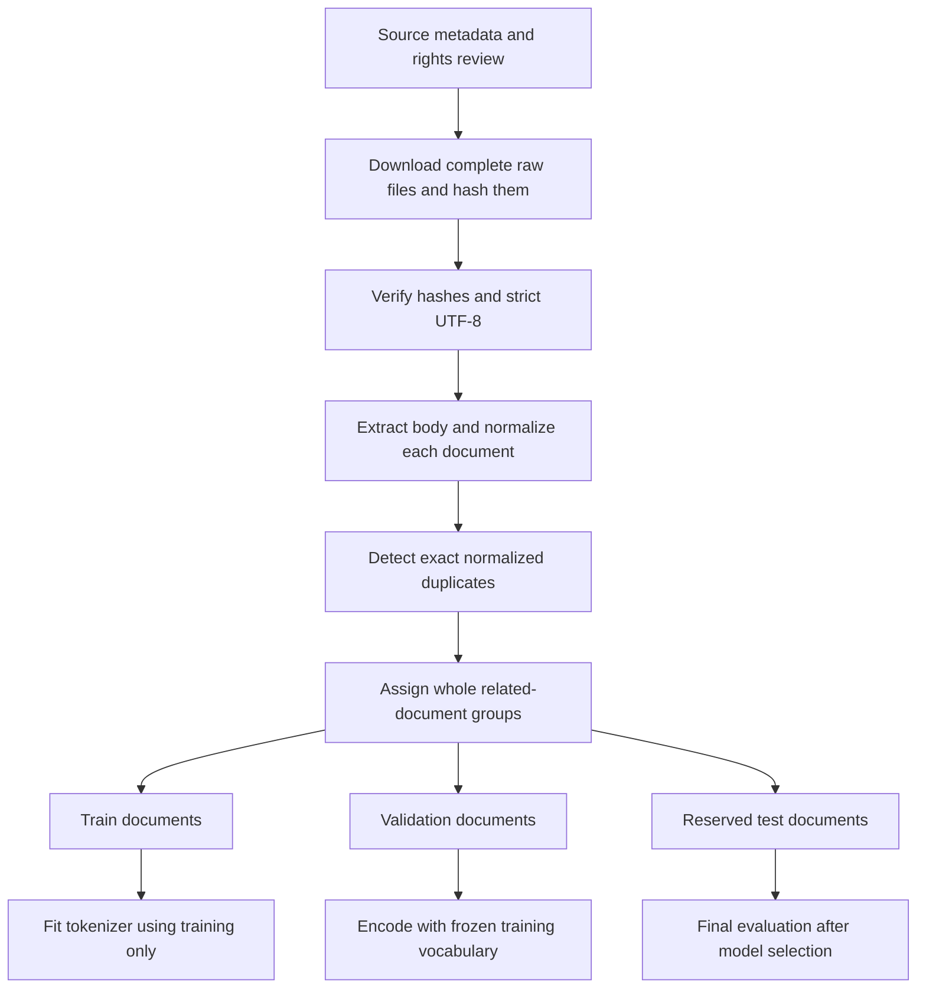

# Prepare a real corpus: provenance, normalization, and held-out documents

[Documentation index](README.md) · [Previous](13-evaluation.md)

Implementation: [`src/prepare_corpus.py`](../src/prepare_corpus.py), [`scripts/download_corpus.py`](../scripts/download_corpus.py). Sources and reviewed byte hashes: [`configs/corpus_sources.json`](../configs/corpus_sources.json). Tests: [`tests/test_corpus.py`](../tests/test_corpus.py).

## Choose data deliberately

Start with the language and domain you want the model to learn. Inspect actual documents for encoding problems, boilerplate, repetition, personal data, and unsuitable content. Prefer a small coherent corpus you can inspect before scaling. More text alone does not guarantee better data.

Publicly accessible text is not automatically licensed for reuse. Record the author, source page, exact downloaded version, license or rights statement, applicable territory, and any attribution or redistribution conditions. A dataset's software license does not necessarily cover its underlying texts. Keep the original notices as well as the transformed training copy.

For example, [CC BY 4.0](https://creativecommons.org/licenses/by/4.0/) permits sharing and adaptation under its terms, including attribution, a license link, and indication of changes. Other licenses have different conditions: read the source's actual grant rather than treating every Creative Commons label as interchangeable.

Our example sources are Project Gutenberg editions of [Alice's Adventures in Wonderland](https://www.gutenberg.org/ebooks/11), [Frankenstein](https://www.gutenberg.org/ebooks/84), and [Pride and Prejudice](https://www.gutenberg.org/ebooks/1342). Their item pages state **public domain in the USA**. That is a territorial statement, not a worldwide rights determination. Project Gutenberg explains the distinction between the underlying text and its trademark/licensing material in its [license](https://www.gutenberg.org/policy/license) and [permission guidance](https://www.gutenberg.org/policy/permission); its [terms](https://www.gutenberg.org/policy/terms_of_use) also address downloading and non-US use. Check the status relevant to your use and location before distributing a corpus.

The repository contains source metadata and code, not copies of the books. Downloaded originals retain their complete notices locally. The preparation script extracts the body between Gutenberg markers into a separate derived copy; it does not overwrite the originals. Some in-body editorial content can remain, so inspection is still needed. Recording a license field is provenance, not an automated legal determination.

## Separate train, validation, and test before windows

- **Train:** data used by the optimizer to update weights.
- **Validation:** data used to choose settings, checkpoints, or stopping criteria. No weight updates use this split.
- **Test:** held-out data for a final assessment after those decisions are frozen. Repeatedly selecting settings from test results makes it another validation set.

Use complete documents as the minimum split unit. Put chapters from one book, alternate editions, translations, or other closely related material in a common `group` when those relationships could leak information across partitions. For author-generalization studies, group by author. For future-data prediction, consider chronological splits rather than a random assignment.

The preparer sorts groups by a SHA-256 key derived from `seed:group`, independently of input-record order. It assigns validation and test groups first, then the rest to training. Each held-out split receives `max(1, floor(group_count * ratio))` groups; at least one training group must remain. Defaults request 80/10/10 by **group count**, not token count. With only three books, the result is one book per split. Unequal book lengths make the character proportions very different. This example verifies the pipeline; it is too small for a balanced benchmark.

Freeze the manifest, group IDs, seed, normalization, and prepared hashes for an experiment. Adding or renaming groups can change assignments; the splitting algorithm does not promise incremental stability. Do not move a held-out document into training merely to improve scores or cover a missing character.



## Download the small reviewed example

From the repository root:

```bash
python scripts/download_corpus.py
```

The downloader uses `curl` with HTTPS certificate verification, a timeout, and HTTPS-only redirects. It accepts only the three documented Gutenberg download URLs. It saves complete raw files and `manifest.json` under `data/raw/gutenberg/`, including retrieval timestamps and SHA-256 hashes. Downloaded bytes must match the reviewed `expected_sha256` fields in the tracked source configuration. If an upstream edition changes, inspect it and deliberately update the expected hashes rather than bypassing the check.

Downloads are staged before publication; failure does not leave a partially published snapshot. Existing snapshots are reused only after verifying source metadata and every raw checksum. Missing, changed, or incomplete snapshots produce an error; choose another `--output-dir` to create a fresh snapshot. This is a three-file example, not a bulk crawler.

## Prepare the documents

```bash
python src/prepare_corpus.py --profile ascii-letters
```

Two normalization profiles are available:

| Profile | Behavior |
| --- | --- |
| `unicode` (default) | NFC normalization, LF newlines, horizontal whitespace collapse, trimming and blank-line cleanup; preserves case and punctuation |
| `ascii-letters` | Explicitly lossy English learning profile: NFKD decomposition, discard non-ASCII code points, lowercase, replace non-letter/non-whitespace characters with spaces, then whitespace cleanup |

The ASCII profile removes punctuation and digits, strips decomposable accents, and can lose letters that have no ASCII decomposition. It is not a general multilingual preprocessing rule. We use it here to keep a small character alphabet for the first real-data experiment. The same fixed transform applies independently to all documents; it does not learn from held-out text.

The preparer requires source IDs, group IDs, local paths, byte hashes, titles, authors, URLs, license statements, and license URLs. Paths are relative to the manifest file. Custom sources can use `format: "text"`; Gutenberg sources use `format: "gutenberg"` and must have valid start/end markers. UTF-8 decoding is strict. Documents shorter than `--min-characters` (default 100 after cleanup) cause an error rather than silently disappearing.

Exact duplicate normalized texts within a group are removed, retaining the lexicographically first document ID and recording removed aliases. If identical content has different group IDs, preparation stops and asks you to correct the grouping. This detects exact whole-document duplicates, **not** near duplicates, copied paragraphs, paraphrases, or semantic leakage. Manually inspect related documents before relying on the split.

## Outputs and vocabulary compatibility

The directory `data/prepared/gutenberg/` contains:

```text
train.txt          train.jsonl
validation.txt     validation.jsonl
test.txt           test.jsonl
report.json
```

Each JSONL record retains document boundaries, text, provenance, and normalized hashes. Text files concatenate documents within one split using two newlines, with a final newline, for compatibility with the current trainer. The report records settings, raw-manifest hash, removed duplicates, group assignments, split counts, character counts, text hashes, and characters absent from the training alphabet.

The existing trainer treats each TXT file as one continuous stream, so a sampled window can cross a document boundary **within the same split**. That creates artificial transitions between books; it never crosses train/validation/test boundaries. Use JSONL and a future document-aware loader if avoiding those transitions matters. With one book per split in this demonstration, there are no between-book transitions.

Fit the tokenizer from training text only. The preparation report diagnoses held-out characters absent from training but does not silently delete them, add held-out data to training, or fit a vocabulary on all splits. The trainer currently rejects unknown validation characters. If needed, choose a justified fixed normalization before freezing the experiment, or extend the tokenizer with explicit unknown-character handling in a separate change. Do not keep inspecting test predictions or adjusting settings to suit them.

## Verified real-data preparation

The downloaded snapshots and ASCII profile with seed 42 produced:

| Split | Document | Prepared characters |
| --- | --- | ---: |
| Train | Frankenstein | 408305 |
| Validation | Alice's Adventures in Wonderland | 135523 |
| Test | Pride and Prejudice | 694305 |

No exact normalized duplicates were found. The prepared files have no held-out characters missing from the training alphabet. These are preparation counts, not test-set model metrics. The report and raw snapshot remain under the Git-ignored `data/` directory; source hashes in the tracked configuration identify the reviewed versions.

A three-update training smoke check using these train/validation files completed successfully. It verifies compatibility, not model quality. The held-out test was not used for optimization or model evaluation.

```bash
python src/train.py --train-file data/prepared/gutenberg/train.txt --validation-file data/prepared/gutenberg/validation.txt --steps 100 --output-dir runs/real-corpus
python src/evaluate.py --checkpoint runs/real-corpus/checkpoint.pt --validation-file data/prepared/gutenberg/validation.txt --output runs/real-corpus/validation-evaluation.json
```

Only after final model choices are frozen, score `test.txt` with the same checkpoint and protocol, saving a distinct report. The small synthetic checkpoint has a different vocabulary and should not be used as the starting checkpoint for this corpus without a deliberate vocabulary migration.

## Reproducibility and checks

```bash
PYTHONPATH=src python -m unittest discover -s tests -v
```

Tests verify identical repeated outputs, disjoint document assignments, 8/1/1 group counts for ten fixture documents, output hashes, exact deduplication, conflicting duplicate groups, bad source checksums, normalization, and Gutenberg markers. Existing model, training, generation, and evaluation tests also pass.

The pipeline loads documents into memory and performs exact whole-document hashing. Large corpora need streaming, near-duplicate analysis, more detailed quality filters, and a document-aware training loader. The next useful experiment is training on a larger reviewed collection while keeping its validation and test assignments fixed.

Repeating the preparation command with identical inputs and settings verifies and reuses all seven existing output files without rewriting them. Changed configuration, modified files, or incomplete output causes an error; select a new `--output-dir` for a different experiment.
