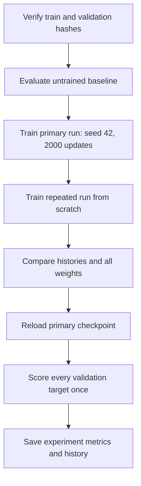

# First training experiment on real books

[Documentation index](README.md) · [Previous](14-real-corpus.md) · [Next](16-real-books-generation.md)

Experiment driver: [`scripts/run_real_experiment.py`](../scripts/run_real_experiment.py). Recorded [experiment metadata and history](results/real-books-2000.json) and [standalone validation report](results/real-books-2000-validation.json).

## Question and fixed setup

Can our small randomly initialized GPT reduce next-character prediction error on a different book after training on real literary text? We ran a fixed 2000-update experiment, repeated it from scratch, and compared the untrained baseline and final checkpoint on the same full validation stream. We did not search hyperparameters or select a checkpoint from test results.

The input is the reviewed corpus prepared in [chapter 14](14-real-corpus.md), using seed 42 and the explicitly lossy `ascii-letters` profile. The tokenizer is built from training only. It contains 28 tokens: lowercase ASCII letters, space, and newline.

| Split used | Book | Characters |
| --- | --- | ---: |
| Train | Frankenstein | 408305 |
| Validation | Alice's Adventures in Wonderland | 135523 |

Pride and Prejudice remains reserved for test. The experiment does not open its text file, train on it, or calculate predictions or model metrics for it. The corpus preparation report includes split metadata, which is used to verify the train and validation hashes.

## Configuration

| Setting | Value |
| --- | --- |
| Initialization seed | 42 |
| Device / threads | CPU / 1 |
| Runtime | Python 3.13.15, PyTorch 2.14.1, macOS arm64 |
| Context length | 16 characters |
| Embedding width | 24 |
| Attention heads / blocks | 3 / 2 |
| FFN expansion | 4 |
| Trainable parameters | 16080 |
| Optimizer | AdamW |
| Learning rate / weight decay | 0.003 / 0.01 |
| Gradient norm cap | 1.0 |
| Batch size / updates | 8 / 2000 |
| Periodic evaluation | Every 200 updates, 8 fixed batches per split |
| Full validation batch size | 128 windows |

The training batches contain 2000 × 8 × 16 = 256000 next-token targets sampled with replacement. This is not 2000 epochs or a complete corpus pass: windows can overlap, and some training positions may never be sampled. The driver uses the existing trainer without changing its architecture or optimizer behavior. Training-batch and evaluation-window generators are seeded independently.

## Reproduce the experiment

Run from the repository root with the environment activated:

```bash
python scripts/download_corpus.py
python src/prepare_corpus.py --profile ascii-letters
python scripts/run_real_experiment.py
```

The first two commands verify and reuse existing matching data. The experiment writes to a new `runs/real-books-2000/` directory and refuses to overwrite an existing experiment. For another reproduction:

```bash
python scripts/run_real_experiment.py --output-dir runs/real-books-repeat
```

Each invocation evaluates a newly initialized baseline, runs training twice from the same seed into `primary/` and `repeat/`, compares histories and every final model tensor exactly, reloads the primary checkpoint, and evaluates it on the full validation text. It also checks that reloaded and in-memory logits agree exactly on a fixed prompt. A failed repeatability check aborts the experiment.



The driver accepts `--steps` for separate experiments; the published results below use the default 2000. Distinct output directories keep those experiments separate.

## Measured full-validation results

Both columns use exactly the same data and protocol: score every character after the first once, with up to 16 preceding ground-truth characters and positions reset within each sliding window. No temperature scaling is applied. The initial model has the same configuration and seeded initialization as the primary training run.

| Metric | Before training | After 2000 updates |
| --- | ---: | ---: |
| Scored targets | 135522 | 135522 |
| Mean NLL, nats per character | 3.483504 | 2.086953 |
| Perplexity | 32.573658 | 8.060321 |
| Bits per character | 5.025634 | 3.010837 |
| Top-1 next-character accuracy | 5.87% | 37.45% |

The initially random model's perplexity can exceed vocabulary size 28: its distribution is not uniform, and it can assign low probability to frequent correct targets. The observed improvement supports learning transferable character patterns within this particular prepared literary corpus. It does not establish fluent generation, general reasoning, or broad language ability.

The periodic validation estimates during training were:

| Update | Sampled train loss | Sampled validation loss |
| --- | ---: | ---: |
| 0 | 3.5080 | 3.5602 |
| 400 | 2.3790 | 2.3110 |
| 800 | 2.2208 | 2.2000 |
| 1200 | 2.1793 | 2.1728 |
| 1600 | 2.1171 | 2.1246 |
| 2000 | 2.0828 | 2.0712 |

These estimates score all positions in fixed sampled windows. The final full-stream loss is 2.086953, rather than 2.0712, because the evaluation protocols differ. Use the full-stream before/after columns for the direct comparison. The final checkpoint was selected by the predefined update count, not by picking the lowest of many validation runs.

## Reproducibility and artifacts

Both runs had identical periodic histories and bitwise-identical final weights on the recorded runtime. Reloaded checkpoint logits also matched exactly. Independent evaluation via the existing CLI reproduced every final metric in the experiment report:

```bash
python src/evaluate.py --checkpoint runs/real-books-2000/primary/checkpoint.pt --validation-file data/prepared/gutenberg/validation.txt --batch-size 128 --output runs/real-books-2000/validation-evaluation.json
```

The measured training-loop duration, including periodic evaluation, was approximately 2.87 seconds for the primary run and 2.85 seconds for the repeat on this host. These timings exclude full-stream evaluation, are not a hardware benchmark, and should not be expected on every machine.

The local experiment contains:

```text
runs/real-books-2000/
├── primary/metrics.json
├── primary/checkpoint.pt
├── repeat/metrics.json
├── repeat/checkpoint.pt
├── experiment.json
└── validation-evaluation.json
```

Raw books, prepared text, and checkpoints remain Git-ignored. The compact JSON copies in `docs/results/` preserve measured metrics, history, model and optimizer settings, runtime, source-code revision, data hashes, checkpoint hash, and reproducibility outcomes in the repository. The experiment report copy additionally records the exact experiment-driver source hash. Byte hashes of serialized checkpoint files need not match across reserializations even when weight tensors agree; the repeatability assertion compares tensors directly.

The training modules used were at corpus-preparation commit `fa66b7c`. The experiment driver and this report are subsequent working-tree additions. Repeating in the same software environment should reproduce metrics and weights; cross-version or cross-device bitwise identity is not guaranteed.

## Limits and next experiment

A single training book and one validation book are a narrow sample. The fixed normalization removes case, punctuation, and digits; the 16-character context is short, and the model is very small. The reserved test has not been evaluated. Validation has been inspected here, so subsequent decisions based on these results are model development, not final testing.

The next controlled experiment can increase the training collection or context length while preserving the frozen held-out assignment and scoring protocol. Change one factor at a time and keep separate run directories. Evaluate the reserved test only once final model choices are settled.
