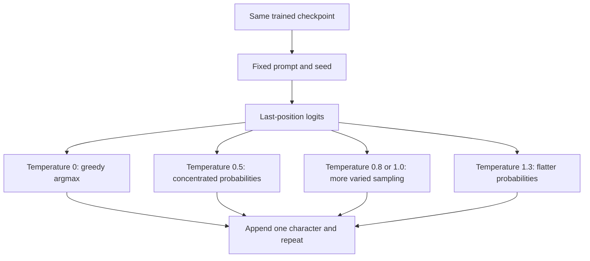

# Real-book generation: a temperature comparison

[Documentation index](README.md) · [Previous](15-real-books-training.md) · [Next](17-context-length-experiment.md)

Driver: [`scripts/compare_temperatures.py`](../scripts/compare_temperatures.py). Complete, unfiltered [samples and measurements](results/real-books-temperature-comparison.json).

## A fixed comparison

We used the final 2000-update Frankenstein checkpoint from chapter 15. No additional training or model selection was performed. The checkpoint SHA-256 matches the archived training and validation reports. The reserved test book was not opened or used.

The grid was fixed before inspecting output: prompts `the creature ` and `i felt `, temperatures 0, 0.5, 0.8, 1.0, and 1.3, and seeds 42 and 123. Every sample contains 200 newly generated character tokens. Prompts include a trailing space. All 20 combinations are retained, including both identical greedy outputs for each prompt. Each combination was generated twice with a fresh same-seed generator, and the resulting token sequences matched exactly on this runtime.

The CPU runtime uses one thread, deterministic algorithms, Python 3.13.15, and PyTorch 2.14.1. The model has 16080 parameters and sees at most the last 16 characters at each generation step. It preserves the full prompt in the output but loses access to earlier characters when they leave the context window.

```bash
python scripts/compare_temperatures.py
```

This writes `runs/real-books-2000/temperature-comparison.json`. To reproduce without replacing the existing report:

```bash
python scripts/compare_temperatures.py --output runs/real-books-2000/temperature-comparison-repeat.json
```

The script refuses to overwrite existing reports. The archived JSON in `docs/results/` contains all continuations, seeds, prompt strings, checkpoint and driver hashes, runtime metadata, and simple descriptive measurements. No training corpus text is required to run the comparison once the checkpoint exists.

## What temperature changes

For temperature greater than zero, the generator samples from `softmax(last_logits / temperature)`. Lower temperature concentrates probability on the strongest predictions; higher temperature flattens it. At zero, the implementation takes argmax instead of sampling. The model weights do not change across this grid.

The same seed is reset for each sample. This controls the random-number stream but does not force outputs to match: changing the distribution changes selected tokens, and each selected token changes the following input. At zero, seeds have no effect because argmax is deterministic.



## Actual samples

The following are the full outputs for prompt `the creature ` and seed 42, one per temperature. Newlines and spelling errors are preserved; only the invisible trailing spaces are not guaranteed to be apparent in Markdown. The JSON preserves the exact strings. Samples for the second seed and prompt are also available there, rather than selecting only favorable generations.

### Temperature 0

```text
the creature the the the the the the the the the the the the the the the the the the the the the the the the the the the the the the the the the the the the the the the the the the the the the the the the the the 
```

### Temperature 0.5

```text
the creature wher i nof and on lichat tho in sou and the suld my to the mistand the mon i to my no scurtento i in the to in lid angered to a conthe a of the thous in to to le and the thaure mon
that my a the prest
```

### Temperature 0.8

```text
the creature wheco her paor of lich the beints the alound my underom deress and the monce ons she coctutejtes tingres yon and deas onger of the the a of thous feling to to le and heebleaured
solve stregeing the se
```

### Temperature 1

```text
the creature whrappent paooul clich exo onints the ale tould underom
deresstacr the monce ons llencectatejtes
tingres yonin lude sheree tour conthe a of thous feeling my dald dul grebleaured
solve strlening thas d
```

### Temperature 1.3

```text
the creature whrapirnof and o clicr exerreints the
ave darvotundernct heesstacr thoomf mistel llencscuptejvespring hatterian colasgerse tome ceaththanopped expour ingo so sleidul grebleaured
solve strlreing tnoms

```

## Repetition and diversity measurements

The table averages over the two prompts and two seeds at each temperature. Each continuation has the same 200-character length; the prompt is excluded. Greedy samples are duplicated across seeds and do not represent four independent random observations.

A repeated-character-4-gram fraction is `1 - distinct_4grams / total_4grams`, where overlapping four-character spans include spaces and newlines. For 200 characters there are 197 spans. It measures duplicate spans, not meaning or fluency. Word counts use lowercase letter runs matched by `[a-z]+`, so malformed strings also count as words.

| Temperature | Mean letter-run count | Mean distinct letter runs | Repeated character 4-grams |
| --- | ---: | ---: | ---: |
| 0 | 50.50 | 2.50 | 95.94% |
| 0.5 | 47.25 | 28.00 | 21.45% |
| 0.8 | 41.75 | 31.75 | 10.53% |
| 1 | 33.75 | 32.75 | 3.05% |
| 1.3 | 28.75 | 27.75 | 0.76% |

Greedy decoding collapses into very repetitive continuations: `the the the` for one prompt and repeated `the see` for the other. Temperature 0.5 reduces those loops and produces common short words such as `and`, `the`, `my`, and `to`, alongside malformed words. At 0.8 and 1.0, outputs are more varied but still lack reliable sentence structure. At 1.3, duplicate character spans are rare, while outputs include many unrecognizable constructions. Greater distinctness is therefore not evidence of better language.

These are descriptive observations from this fixed small grid. They do not establish that one temperature is universally best. Even the distinct-letter-run count is not monotonic: higher temperatures can form longer malformed strings with fewer spaces. There is no human quality rating, dictionary correctness score, or statistical confidence interval here.

## What the model appears to have learned

The strongest evidence comes from the independent validation comparison in chapter 15: with the same data and scoring protocol, mean NLL fell from 3.483504 to 2.086953 and perplexity from 32.573658 to 8.060321. That indicates improved next-character prediction on a different prepared book. Temperature cannot cause that improvement because validation scores use the original logits with no sampling adjustment.

The generated samples provide narrower qualitative evidence. Common short words, spaces between many letter runs, and fragments such as `feeling`, `under`, or `tion` are consistent with learned local spelling and frequency patterns. The frequent greedy choice `the` suggests that a locally high-probability continuation can dominate decoding and trap this model in a loop.

These observations do not show comprehension of Frankenstein, knowledge of its plot, or the ability to explain feelings or creatures. The prompt words themselves were supplied by us. The continuations do not consistently maintain a subject or meaningful narrative, and many words are malformed. We have not performed a memorization audit, so neither verbatim copying nor its absence can be concluded from these samples.

The model's 16-character context, small parameter count, and brief training are plausible constraints on coherence, but this experiment does not isolate their causal contributions. Once different prompts have left the active context, identical recent suffixes and matching random-generator states can produce identical future continuations; prompt influence is not unlimited.

## Why lower validation loss can coexist with poor prose

Validation supplies the correct preceding characters at each prediction. Free-running generation supplies the model's own previous choices, including errors. Once it creates an unusual fragment, that fragment becomes the next context. Good enough local predictions to lower teacher-forced loss do not guarantee stable long-form output.

The corpus profile removed punctuation, digits, and uppercase letters before training. The model's vocabulary cannot generate them, so their absence is a preprocessing consequence rather than proof that the model failed to learn punctuation. It can emit newlines because they remain in the alphabet. There is no end-of-sequence token: all samples stop at the requested length.

## Reproduce a single sample

```bash
python src/generate.py --checkpoint runs/real-books-2000/primary/checkpoint.pt --prompt "the creature " --max-new-tokens 200 --temperature 0.5 --seed 42
```

Changing temperature alone does not retrain the model or repair missing capabilities. A useful next controlled experiment would increase context length or the training budget while freezing corpus partitions and the prompt/seed/temperature grid. Compare validation metrics and the complete generation grid together, and keep the reserved test for the final model decision.
