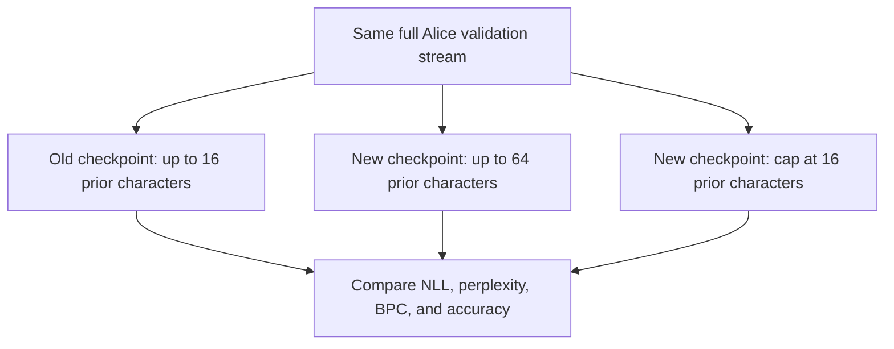

# Context-length experiment: 16 versus 64 characters

[Documentation index](README.md) · [Previous](16-real-books-generation.md)

Driver: [`scripts/run_context_experiment.py`](../scripts/run_context_experiment.py). Full [training/evaluation report](results/context-64-experiment.json), [new generation grid](results/context-64-temperature-comparison.json), and [previous generation grid](results/real-books-temperature-comparison.json).

## Result first

Increasing context capacity to 64 did not improve this experiment. Full validation perplexity increased from **8.0603** for the old context-16 model to **11.1037** for the new model using 64-character windows. The new model also scored worse with a common 16-character evaluation cap: **10.3066**. Generated samples showed fewer repeated character spans but no convincing gain in coherence.

Both new training runs were reproducible on the recorded runtime: histories and every final weight tensor were identical. Reloaded logits matched the in-memory model. The reserved test book was not read or evaluated.

## Fixed budget and changes

Both experiments train from random initialization on the same prepared Frankenstein text and use Alice for validation. Vocabulary, normalization, split hashes, width 24, three attention heads, two blocks, FFN expansion four, learning rate 0.003, AdamW weight decay 0.01, gradient clipping at 1.0, seed 42, and 2000 update steps are unchanged.

| Setting | Previous model | New model |
| --- | ---: | ---: |
| Context capacity | 16 | 64 |
| Sequences per training batch | 8 | 2 |
| Target tokens per update | 128 | 128 |
| Updates | 2000 | 2000 |
| Total sampled training targets | 256000 | 256000 |
| Parameters | 16080 | 17232 |

Reducing batch sequence count keeps the token budget equal. It does not keep the sampled windows identical: the new run sees fewer, longer windows with more correlated positions per sequence. The positional table adds `(64 - 16) * 24 = 1152` parameters. Its larger random initialization also consumes more random draws before subsequent layers are initialized, so the same seed does not produce identical shared weights across model sizes. This is a fixed-token-budget comparison of two configurations, **not** an isolated causal estimate of context length alone.

Equal token budgets also do not guarantee equal compute. Attention score computation grows quadratically with sequence length for a fixed sequence batch size; here sequence batch size is reduced. We did not run a controlled performance benchmark. Both new loops completed locally; their raw timings are in the experiment JSON and should not be used to infer general throughput.

## Reproduce

From the repository root with the project environment activated and the earlier corpus/checkpoint available:

```bash
python scripts/run_context_experiment.py
```

This trains the context-64 model twice, using batches of two sequences, then evaluates the old model and reloaded new model on every validation target. It verifies train/validation hashes against the preparation report and the old checkpoint, and checks the old model/training settings before comparing. It rejects an existing output directory; use a fresh path for another run:

```bash
python scripts/run_context_experiment.py --output-dir runs/context-64-repeated
```

The driver never opens test text. Full checkpoints and raw histories are under `runs/context-64-2000/primary/` and `repeat/`, with `experiment.json` at the experiment root. Tracked report copies in `docs/results/` identify both checkpoints and the exact source files by SHA-256. The recorded base commit is `fbc8f54`; the context driver and train/evaluation interface additions were working-tree changes identified by their source hashes.

The trainer CLI also now exposes `--context-length` and `--batch-size`, retaining the original defaults 16 and 8:

```bash
python src/train.py --train-file data/prepared/gutenberg/train.txt --validation-file data/prepared/gutenberg/validation.txt --context-length 64 --batch-size 2 --steps 2000 --seed 42 --output-dir runs/context-64-manual
```

This manual command uses the trainer's default periodic evaluation interval of 25; the experiment driver uses 200. Training batches remain independent of evaluation randomness, but the recorded histories use different intervals. Prefer the driver when reproducing the published report.

## Full-stream validation

All three evaluations score exactly **135522** targets once, without sampling or temperature, using ground-truth preceding characters. Windows restart absolute positions at zero. The validation data and vocabulary are identical across checkpoints.

| Checkpoint / evaluation cap | Mean NLL | Perplexity | Bits per character | Next-character accuracy |
| --- | ---: | ---: | ---: | ---: |
| Old model / 16 | 2.086953 | 8.060321 | 3.010837 | 37.45% |
| New model / 64 | 2.407277 | 11.103687 | 3.472967 | 27.32% |
| New model / 16 | 2.332787 | 10.306627 | 3.365500 | 30.90% |

The native-window comparison answers how each model scores with its configured context. The common-cap comparison reduces the difference in available evaluation history: both models receive at most 16 preceding characters. It does not undo different training, parameterization, or initialization. Within the new checkpoint, using all 64 positions performs worse than capping input at 16; more available history is not automatically useful history.

The evaluator now accepts an optional cap no larger than the checkpoint's capacity:

```bash
python src/evaluate.py --checkpoint runs/context-64-2000/primary/checkpoint.pt --validation-file data/prepared/gutenberg/validation.txt --context-length 16 --batch-size 128 --output runs/context-64-2000/capped16-evaluation.json
```

Without `--context-length`, evaluation uses native capacity. The JSON records both the actual evaluation cap and model capacity. The report does not truncate the validation text, drop targets, or change the tokenizer.



The new run's sampled periodic validation loss decreased from 3.4904 to 2.2790. That indicates learning relative to its initial state, but does not beat the earlier checkpoint. Those periodic values average positions within fixed sampled windows; do not compare them directly with full-stream NLL. In particular, full rolling-window evaluation scores later positions much more often than the early prefixes present in training-window averages. This position/context distribution difference is a plausible issue to investigate, not a cause established by this run.

## Generation with the same grid

The same driver from chapter 16 generated all 20 combinations for the new checkpoint: two prompts, five temperatures, two seeds, and 200 new characters per sample. Each combination was run twice and matched exactly for its seed. The previous grid is retained in full and its checkpoint hash matches the baseline in this experiment.

```bash
python scripts/compare_temperatures.py --checkpoint runs/context-64-2000/primary/checkpoint.pt --output runs/context-64-2000/temperature-comparison.json
```

Use a new output filename to repeat. Native context capacities are used for generation: 16 for the old model, 64 for the new one. Thus these samples compare practical native generation, not a controlled equal-window generation ablation.

The following are the first 120 continuation characters for prompt `the creature `, seed 42. They exclude the prompt and are explicitly truncated here; all complete outputs and both prompts/seeds are in the linked JSON reports.

### Temperature 0

Previous context-16 model:

```text
the the the the the the the the the the the the the the the the the the the the the the the the the the the the the the 
```

New context-64 model:

```text
and the and and the and and the ande ande and and and the the the the the the the the the the the the the the the the th
```

### Temperature 0.5

Previous context-16 model:

```text
wher i nof and on lichat tho in sou and the suld my to the mistand the mon i to my no scurtento i in the to in lid anger
```

New context-64 model:

```text
whed i nof and o cof o the thinthe and f he the tofe ofof he sthis the me mis the the s thinthese in the tonin myof she 
```

### Temperature 0.8

Previous context-16 model:

```text
wheco her paor of lich the beints the alound my underom deress and the monce ons she coctutejtes tingres yon and deas on
```

New context-64 model:

```text
whechiger panoul clico the teisth the ave tould unde o tre misthar wavomond s th f nd scustof ve tin she yonin lto ashe 
```

### Temperature 1.3

Previous context-16 model:

```text
whrapirnof and o clicr exerreints the
ave darvotundernct heesstacr thoomf mistel llencscuptejvespring hatterian colasger
```

New context-64 model:

```text
whrchignk panouf clico e o beisth tie
aves whig undevocoff msstacrcenvomond

ong f nd scuptojovomy anghe y anan tolasger
```

Greedy decoding still falls into loops dominated by `the` and `and`. At sampled temperatures, common words and malformed fragments remain mixed together. There is no sustained narrative or clear semantic response to the prompt in either grid. Less repetition in the new model is not evidence that its prose is better.

Mean repeated-character-4-gram fractions across the same four prompt/seed combinations per temperature are:

| Temperature | Old model | New model |
| --- | ---: | ---: |
| 0 | 95.94% | 92.39% |
| 0.5 | 21.45% | 15.86% |
| 0.8 | 10.53% | 4.44% |
| 1 | 3.05% | 2.41% |
| 1.3 | 0.76% | 0.38% |

These measurements exclude the prompt and count duplicate overlapping four-character spans, including whitespace. Greedy rows include duplicated seed outputs. Neither this fraction nor letter-run diversity measures grammatical correctness, comprehension, or human preference. Increasing randomness or producing malformed strings can reduce repetition while making text worse.

## Interpretation and next step

The defensible conclusion is specific: under this corpus, optimizer, initialization procedure, and fixed 256000-target budget, the context-64 configuration did not beat the context-16 checkpoint in validation or visibly improve generation coherence. This does not imply longer context is generally harmful.

Possible follow-ups include a larger training budget for the longer model, evaluation by absolute position within windows, a better-matched position distribution, and repeated training seeds to estimate run-to-run variability. Those are hypotheses to test rather than explanations already demonstrated here. Exact repetition of seed 42 verifies reproducibility, not robustness across independent seeds.

Keep context 16 as the better-performing baseline from this comparison. Freeze this result instead of tuning until it looks favorable, and continue to reserve the test book for the final decision.

## Checks

The 20-test suite passes, including a new test that compares capped-context evaluation with a manual short-window reference and rejects invalid caps. Original trainer defaults remain covered by the repeated synthetic training test. Documentation links, complete generation grids, checkpoint hashes, source hashes, and archived metric consistency were also checked.
