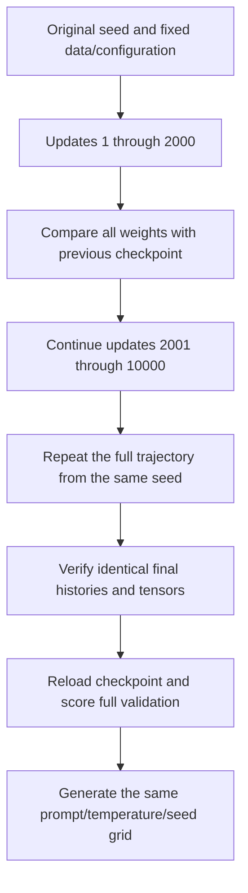

# Longer training for the context-64 model

[Documentation index](README.md) · [Previous](17-context-length-experiment.md) · [Next](19-matched-budget-contexts.md)

Driver: [`scripts/run_long_context_experiment.py`](../scripts/run_long_context_experiment.py). Complete [training and evaluation report](results/context-64-long-training.json) and [20-sample generation grid](results/context-64-long-temperature-comparison.json).

## Answer

Training longer improved full-stream validation: the context-64 model's perplexity fell from **11.1037** at 2000 updates to **6.9486** at 10000. Next-character accuracy rose from **27.32%** to **41.43%**. Both long runs produced identical histories and weights on this runtime.

Generation still does not produce reliable prose. It shows more recognizable local combinations, but malformed words and repetitive greedy loops remain. The validation improvement is much stronger evidence than subjective impressions of individual samples.

## Extend the same trajectory

The corpus, normalization, vocabulary, model dimensions, optimizer, batch size, context, initialization seed, evaluation windows, and learning rate were kept fixed relative to the earlier context-64 run. Only the training duration increased from 2000 to 10000 updates. The fixed learning rate remained 0.003; no scheduler, checkpoint search, or new data was introduced.

| Setting | Context-64 short run | Context-64 long run |
| --- | ---: | ---: |
| Updates | 2000 | 10000 |
| Sequences per batch | 2 | 2 |
| Characters per sequence | 64 | 64 |
| Sampled target tokens | 256000 | 1280000 |
| Parameters | 17232 | 17232 |
| Seed | 42 | 42 |

The long run has five times the total target-token budget, or 1024000 additional sampled targets after update 2000. Windows are sampled with replacement, so these counts are not unique corpus coverage or exact epochs.

The trainer still has no general checkpoint-resume interface. Instead, the experiment reruns from the original seed and continues the same uninterrupted loop to 10000 updates. A read-only `on_step` observer checks every model tensor at update 2000 against the saved earlier checkpoint and aborts if any differ. Both long runs passed that check. Their periodic histories through update 2000 also match the earlier run exactly. This confirms the common training prefix without claiming to have loaded a resumable optimizer workflow.

The observer runs after each optimizer update and any scheduled evaluation. It must not mutate model state or random generators. A regression test verifies that a read-only observer leaves the training trajectory unchanged.



## Reproduce

From the repository root with the project environment activated:

```bash
python scripts/run_long_context_experiment.py
```

This requires the prepared train/validation files and `runs/context-64-2000/primary/checkpoint.pt`. It verifies their hashes and the previous model/training configuration, runs training twice with seed 42, then evaluates the previous and final checkpoints. It refuses to overwrite an existing experiment directory. To repeat:

```bash
python scripts/run_long_context_experiment.py --output-dir runs/context-64-10000-repeat
```

Runtime: Python 3.13.15, PyTorch 2.14.1, CPU, one thread, deterministic algorithms. The recorded base commit is `3320afd`; working-tree driver and source hashes are saved in the experiment report. Raw books and checkpoints remain Git-ignored. The driver reads train and validation only; the reserved test book remains untouched by training, generation, and model evaluation.

## Validation compared with all previous models

All rows below score the same 135522 next-character targets, one target per rolling window, on the full Alice validation text. The first character is unscored. Context positions restart within each window, and there is no temperature adjustment.

| Model / evaluation context | Mean NLL | Perplexity | BPC | Accuracy |
| --- | ---: | ---: | ---: | ---: |
| Context 16, 2000 updates / 16 | 2.086953 | 8.060321 | 3.010837 | 37.45% |
| Context 64, 2000 updates / 64 | 2.407277 | 11.103687 | 3.472967 | 27.32% |
| Context 64, 2000 updates / 16 | 2.332787 | 10.306627 | 3.365500 | 30.90% |
| Context 64, 10000 updates / 64 | 1.938541 | 6.948605 | 2.796723 | 41.43% |
| Context 64, 10000 updates / 16 | 1.930491 | 6.892897 | 2.785110 | 41.98% |

The long model now beats the older context-16 checkpoint in validation, but it used five times as many training targets. This is not evidence that context 64 outperforms context 16 at equal compute or training duration; we have not trained the context-16 model for 10000 updates.

Within the new checkpoint, capping history at 16 still scores slightly better than using the native 64-character window. Therefore, the result supports the value of additional optimization for this model, not a claim that it has learned to exploit all of its longer context. Absolute-position usage and the difference between training-window averages and last-position rolling evaluation remain possible follow-up investigations.

The periodic sampled losses provide the following view of progress:

| Update | Sampled training loss | Sampled validation loss |
| --- | ---: | ---: |
| 0 | 3.5170 | 3.4904 |
| 2000 | 2.2676 | 2.2790 |
| 4000 | 2.0713 | 2.1037 |
| 6000 | 1.9229 | 1.9675 |
| 8000 | 1.8087 | 1.8820 |
| 10000 | 1.7804 | 1.8449 |

These fixed-window estimates are not the full-stream metrics above. The final checkpoint was the predefined update 10000, rather than a checkpoint chosen by searching validation results. The observed training/validation estimates both improve over this interval; they do not establish the absence of overfitting on other data or under longer training.

## Generation compared with the previous checkpoints

The generation grid is unchanged: prompts `the creature ` and `i felt `, temperatures 0, 0.5, 0.8, 1.0, and 1.3, seeds 42 and 123, 200 new character tokens each. Every combination was generated twice and reproduced exactly on the recorded runtime. All 20 outputs are archived, without filtering.

```bash
python scripts/compare_temperatures.py --checkpoint runs/context-64-10000/primary/checkpoint.pt --output runs/context-64-10000/temperature-comparison.json
```

Use another output filename if the report already exists. Native model contexts are used. The snippets below show the first 150 continuation characters, excluding the prompt, for `the creature ` and seed 42. They are explicitly truncated; complete strings are in the linked reports.

### Temperature 0

Context 64, 2000 updates:

```text
and the and and the and and the ande ande and and and the the the the the the the the the the the the the the the the the the the the the the the the 
```

Context 64, 10000 updates:

```text
and the some and the she supen the some the supsed the sair the sair the sair the sair the sair the sair the sair the sair the sair the sair the sair 
```

### Temperature 0.5

Context 64, 2000 updates:

```text
whed i nof and o cof o the thinthe and f he the tofe ofof he sthis the me mis the the s thinthese in the tonin myof she the ous me the ane ine cthour 
```

Context 64, 10000 updates:

```text
and and the of of lict i and i the sender the gaun event hersear and almonce and the cocentencess i had the suill i she greseme the she sopeed the suc
```

### Temperature 0.8

Context 64, 2000 updates:

```text
whechiger panoul clico the teisth the ave tould unde o tre misthar wavomond s th f nd scustof ve tin she yonin lto ashe ge tous ce the anofite esifut 
```

Context 64, 10000 updates:

```text
when i not and on lic at the inte the ale the gaunder cour misel remavonce i hel she cocentention i hild you and deasgered to a compashe of the siced 
```

### Temperature 1.3

Context 64, 2000 updates:

```text
whrchignk panouf clico e o beisth tie
aves whig undevocoff msstacrcenvomond

ong f nd scuptojovomy anghe y anan tolasgerge tous cesthe anofity esk utu
```

Context 64, 10000 updates:

```text
whre i no paooul clicrye of iistionsed for duvolundenccede
mistacritavoncempares alnd scuptejeventions a yoar i coldsherce tome comnes anotily evicue 
```

At temperature 0.5, the long model includes local combinations such as `i had`, `he was`, and `the could` in the complete grid, alongside malformed words. Some fragments look more English-like than the shorter run, but that does not make the continuation grammatically correct. At 0.8 and 1.0, recognizable fragments and malformed constructions still mix. At 1.3, irregular spelling remains common. Greedy decoding moves from loops dominated by `the` toward loops such as `the sair`; it has not solved repetition.

Mean repeated-character-4-gram fractions over the same four prompt/seed combinations at each temperature are:

| Temperature | Context 16 / 2000 | Context 64 / 2000 | Context 64 / 10000 |
| --- | ---: | ---: | ---: |
| 0 | 95.94% | 92.39% | 80.96% |
| 0.5 | 21.45% | 15.86% | 25.89% |
| 0.8 | 10.53% | 4.44% | 8.63% |
| 1 | 3.05% | 2.41% | 6.22% |
| 1.3 | 0.76% | 0.38% | 1.65% |

The long model repeats fewer spans under greedy decoding, yet more spans under positive-temperature sampling than the context-64 short run. Repeated common words can increase this measure even when character prediction improves. Conversely, nonsense can be very diverse. This metric is descriptive and excludes the prompt; it is not a fluency score. Greedy outputs are duplicated across seeds, not independent observations.

The defensible qualitative conclusion is limited: the long model shows some more recognizable local patterns, while no sample establishes reliable narrative coherence or comprehension. The stronger conclusion is quantitative improvement in held-out next-character prediction. No automatic spelling benchmark, human quality rating, memorization audit, or semantic evaluation was performed.

## Saved evidence and verification

Local artifacts are under `runs/context-64-10000/`: primary and repeat checkpoints/metrics, `experiment.json`, and `temperature-comparison.json`. The tracked report copies in `docs/results/` retain source/data/checkpoint hashes, the full loss history, evaluation metrics, and every generated sample.

Both long runs had identical final weights and periodic histories. Both matched the old checkpoint at update 2000, and the reloaded final checkpoint reproduced in-memory logits exactly. Re-evaluating the previous checkpoint reproduced its archived full-validation metrics. These checks verify reproducibility on this environment, not robustness across independent training seeds or runtime versions.

```bash
PYTHONPATH=src python -m unittest discover -s tests -v
```

The 21 tests include the new read-only step-observer check. Archived hashes, common training prefix, generation-grid completeness, documentation examples, and links were also checked.

## What to try next

This result shows that the earlier context-64 run was not a sufficient test of the model's eventual performance. More training improved validation on this task. To assess the benefit of context capacity itself, the next comparison should train context 16 for the same 10000-update, 1280000-target budget and evaluate native and common context caps with the same generation grid. Keep the test book reserved until the final model choices are frozen.

The subsequent matched-budget comparison is recorded in [chapter 19](19-matched-budget-contexts.md).
