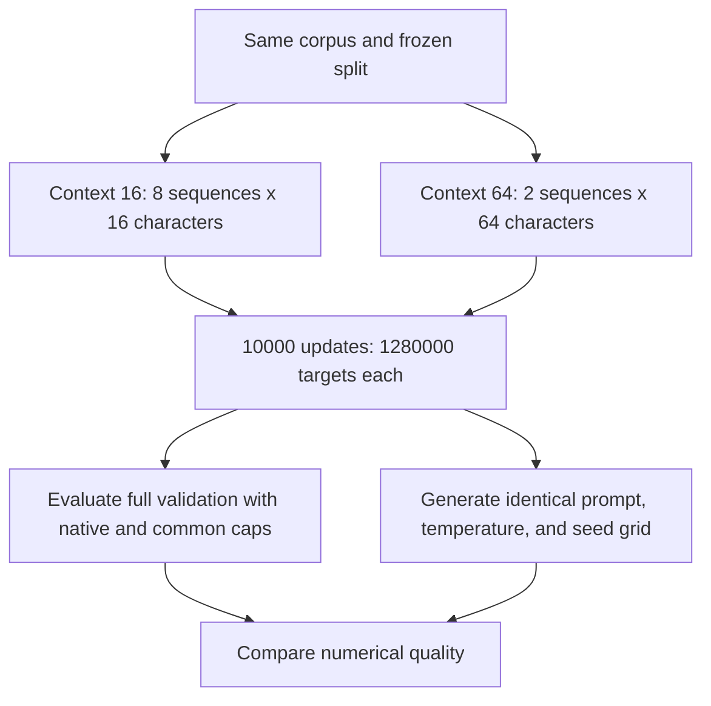

# Context 16 versus 64 with matched long-training budgets

[Documentation index](README.md) · [Previous](18-longer-context-training.md)

Driver: [`scripts/run_matched_budget_experiment.py`](../scripts/run_matched_budget_experiment.py). Full [matched-budget evaluation and history](results/matched-budget-context-experiment.json), [context-16 generation grid](results/context-16-long-temperature-comparison.json), and [context-64 generation grid](results/context-64-long-temperature-comparison.json).

## Result

With **10000 updates and 1280000 sampled next-token targets per model**, context 16 scored slightly better on full validation: perplexity **6.7127** versus **6.9486** for context 64. Next-character accuracy was **42.59%** versus **41.43%**. The context-64 model also scored slightly worse when evaluated with a common 16-character cap: perplexity **6.8929**.

The new context-16 training was repeated exactly. Histories and final weights matched bitwise on this environment, and both runs matched the earlier context-16 checkpoint at update 2000. Both generation grids still contain malformed words and loops; neither establishes coherent prose or comprehension. The reserved test was not read or evaluated.

## What is matched, and what is not

Both models train from scratch on the same normalized Frankenstein text, using Alice for validation. Their token mappings and data hashes agree. Settings shared across models include width 24, three attention heads, two blocks, FFN expansion four, seed 42, AdamW learning rate 0.003, weight decay 0.01, gradient clipping at 1.0, and deterministic single-threaded CPU training.

| Setting | Context-16 model | Context-64 model |
| --- | ---: | ---: |
| Training updates | 10000 | 10000 |
| Sequences per batch | 8 | 2 |
| Characters per sequence | 16 | 64 |
| Target tokens per update | 128 | 128 |
| Total sampled targets | 1280000 | 1280000 |
| Trainable parameters | 16080 | 17232 |

Equal token/update budgets are not equal compute, identical parameter counts, or identical data batches. Longer attention windows cost more per sequence, the positional table has 1152 additional weights, and the random-number stream initializes later layers differently after the larger table. Different window lengths and batch sequence counts also change gradient correlations and the sampled positions. This is a matched-token-budget comparison of complete configurations, not a pure causal isolation of context capacity.

We repeated seed 42 to verify determinism, not to estimate variation across independent training seeds. A small single-seed difference should not be generalized to all corpora, models, or budgets.

## Execution and reproducibility

The previous context-64 long-training experiment was committed as `ff446cc` before this experiment. Its final checkpoint was reused as the reference, rather than retraining it again. Its recorded repeated runs and hashes remain available in chapter 18. The new driver checks the reference checkpoint's architecture, training configuration, vocabulary, and corpus hashes, then re-evaluates it using the same current evaluator.

```bash
python scripts/run_matched_budget_experiment.py
```

Run from the repository root with the project environment activated. Required inputs are the prepared corpus, `runs/real-books-2000/primary/checkpoint.pt`, and `runs/context-64-10000/primary/checkpoint.pt`. Existing output directories are rejected; another reproduction can use:

```bash
python scripts/run_matched_budget_experiment.py --output-dir runs/context-16-10000-repeat
```

The driver reruns the original context-16 initialization and batch stream through update 10000. At update 2000, the trainer's read-only observer compares every weight tensor against the earlier checkpoint. Both new runs passed, and their histories through that step also matched the earlier run. No general optimizer-resume interface was used. The final checkpoint reproduced in-memory logits exactly after reload.

The runtime was Python 3.13.15 and PyTorch 2.14.1 on CPU with one thread and deterministic algorithms. The base commit and exact driver/training/evaluation/model source hashes are included in the JSON report. This establishes reproducibility on the recorded runtime, not cross-runtime or cross-seed robustness.

## Full-validation comparison

Each row scores the same **135522** targets once, with ground-truth history and no temperature adjustment. The first validation character is unscored. Absolute positions restart within each rolling window. Batch size for full-stream evaluation is 128 windows.

| Model / evaluation cap | Mean NLL | Perplexity | BPC | Accuracy |
| --- | ---: | ---: | ---: | ---: |
| Context 16, 2000 updates / 16 | 2.086953 | 8.060321 | 3.010837 | 37.45% |
| Context 16, 10000 updates / 16 | 1.903997 | 6.712669 | 2.746886 | 42.59% |
| Context 64, 10000 updates / 64 | 1.938541 | 6.948605 | 2.796723 | 41.43% |
| Context 64, 10000 updates / 16 | 1.930491 | 6.892897 | 2.785110 | 41.98% |

At 2000 updates, the native-window perplexities were 8.0603 for context 16 and 11.1037 for context 64. At 10000 updates, both improve and the gap narrows substantially. The earlier statement that more training helped context 64 remains true, but its advantage over the old 2000-update context-16 checkpoint was not an equal-budget context advantage.

The common-cap comparison also favors the context-16-trained model: 6.7127 versus 6.8929. It equalizes available evaluation history but does not equalize training windows or parameterization. For context 64, using the full 64-character history still does not improve over its own 16-character evaluation cap in this setup.

The new context-16 model's periodic sampled losses were:

| Update | Training loss | Validation loss |
| --- | ---: | ---: |
| 0 | 3.5080 | 3.5602 |
| 2000 | 2.0828 | 2.0712 |
| 4000 | 1.9837 | 1.9532 |
| 6000 | 1.9030 | 1.9326 |
| 8000 | 1.8778 | 1.9232 |
| 10000 | 1.8304 | 1.9126 |

These fixed sampled-window estimates are not full-stream metrics. In particular, comparing final sampled validation loss 1.9126 for context 16 with 1.8449 for context 64 would give a different ordering than full-stream evaluation. The two training-window protocols mix prefix lengths differently. Use the identical full-stream protocol above for checkpoint comparison. Final checkpoints were fixed at update 10000 rather than selected by a validation sweep.



## Generation under the same grid

Both long checkpoints use prompts `the creature ` and `i felt `, temperatures 0, 0.5, 0.8, 1.0, and 1.3, seeds 42 and 123, and 200 new characters. All 20 outputs per checkpoint are retained. Every combination was generated twice from the same sampling seed and matched exactly on this environment. The existing context-64 grid's checkpoint hash matches the reference evaluated here.

```bash
python scripts/compare_temperatures.py --checkpoint runs/context-16-10000/primary/checkpoint.pt --output runs/context-16-10000/temperature-comparison.json
```

Choose a new output filename if it already exists. Generation uses each model's native context. The snippets below show the first 150 continuation characters, excluding the prompt, for `the creature ` and seed 42. They are explicitly truncated; complete samples for both prompts and seeds are linked above.

### Temperature 0

Context 16, 10000 updates:

```text
and the and the and the and the and the and the and the and the and the and the and the and the and the and the and the and the and the and the and th
```

Context 64, 10000 updates:

```text
and the some and the she supen the some the supsed the sair the sair the sair the sair the sair the sair the sair the sair the sair the sair the sair 
```

### Temperature 0.5

Context 16, 10000 updates:

```text
when i not and of like the being and the he succurse of dest stant inst was the retures the joy i i had the in mude she of the into me and incees of t
```

Context 64, 10000 updates:

```text
and and the of of lict i and i the sender the gaun event hersear and almonce and the cocentencess i had the suill i she greseme the she sopeed the suc
```

### Temperature 0.8

Context 16, 10000 updates:

```text
when i not and of lic at the into the all to me undern the mistand the monmed the leforcust justinly the your me deadge of towat the
prote incousious 
```

Context 64, 10000 updates:

```text
when i not and on lic at the inte the ale the gaunder cour misel remavonce i hel she cocentention i hild you and deasgered to a compashe of the siced 
```

### Temperature 1.3

Context 16, 10000 updates:

```text
whem i no paooul clicoue of distingse
al he umuturae of
de
essenclievel fries al she iscuptejovepting he yorsum to asgenge towa compathered to evicue 
```

Context 64, 10000 updates:

```text
whre i no paooul clicrye of iistionsed for duvolundenccede
mistacritavoncempares alnd scuptejeventions a yoar i coldsherce tome comnes anotily evicue 
```

Context 16 produces recognizable local fragments such as `i had`, `he could`, and `the fear` in its complete sampled outputs, but mixes them with malformed constructions. Context 64 also produces recognizable fragments and spelling errors. Neither consistently maintains a grammatical sentence, subject, or narrative. Greedy context-16 output is especially repetitive (`and the and the`); the context-64 model also falls into loops (`the sair`).

Mean repeated-character-4-gram fractions over the same four prompt/seed combinations at each temperature are:

| Temperature | Context 16 / 10000 | Context 64 / 10000 |
| --- | ---: | ---: |
| 0 | 94.92% | 80.96% |
| 0.5 | 22.84% | 25.89% |
| 0.8 | 14.72% | 8.63% |
| 1 | 7.61% | 6.22% |
| 1.3 | 3.05% | 1.65% |

The winner under this descriptive repetition measure varies with temperature; it does not establish fluency. The fraction excludes prompts, includes whitespace, and counts duplicate overlapping four-character spans. Greedy samples are duplicated across seeds and are not independent observations. Random or malformed output can be diverse, while common valid phrases can repeat.

The generation comparison therefore does not establish a clear coherence winner, despite the modest quantitative validation advantage for context 16. No human preference study, dictionary correctness benchmark, semantic test, or memorization audit was performed. A 16- or 64-character horizon is still very short for narrative generation, and the preprocessing prevents uppercase letters and punctuation altogether.

## Artifacts and checks

New local artifacts are under `runs/context-16-10000/`: primary and repeat checkpoints/metrics, `experiment.json`, and `temperature-comparison.json`. The tracked JSON copies retain complete histories, evaluation results, generations, runtime and configuration details, and data/source/checkpoint hashes. Corpus files and checkpoints remain Git-ignored.

The 21-test suite passes. Additional experiment checks verified identical repeated weights and histories, exact step-2000 checkpoint matches, reload equivalence, unchanged full-validation metrics for the context-64 reference, equal target budgets, complete generation grids, archived source hashes, documentation examples, and links. The driver never reads test text.

## Conclusion and next decision

Keep the context-16 10000-update checkpoint as the better **validation-loss baseline from this single-seed comparison**. More context was not a demonstrated benefit at this budget and scale, and neither model yet generates coherent prose. This is a model-development result, not a final held-out test score.

A useful next study would repeat both configurations with independent training seeds, or investigate position-wise validation behavior before increasing model size. Keep corpus assignments and the generation grid frozen, and preserve the untouched test for final model decisions.
