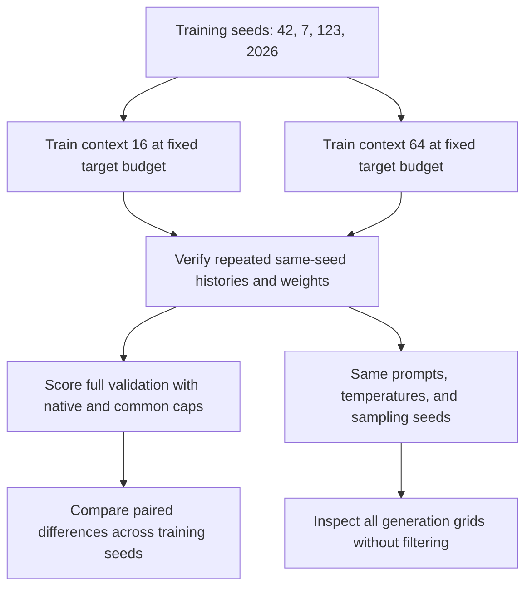

# Context-length comparison across training seeds

[Documentation index](README.md) · [Previous](19-matched-budget-contexts.md)

Driver: [`scripts/run_multiseed_experiment.py`](../scripts/run_multiseed_experiment.py). Complete [results, histories, and all 160 generated samples](results/multiseed-context-experiment.json).

## Result

The context-16 validation advantage persists across **all four examined training seeds**, including all three newly chosen seeds. Native-window mean perplexity is **6.6336 ± 0.0581** for context 16 and **7.1198 ± 0.1729** for context 64 (arithmetic mean ± sample standard deviation across four trained models). The common 16-character evaluation cap also favors the context-16-trained model in all four pairs.

All six new configurations reproduced exactly in their second training run, and both seed-42 primary/repeat checkpoints were reverified. Generated text still contains malformed words and loops. The result supports keeping context 16 as the better validation-loss baseline in this study, not a universal conclusion about context length or a clear superiority in generated prose.

## Experimental design

Chapter 19 found a small context-16 advantage for training seed 42. This study tests whether that ordering persists across three additional seeds fixed before their results were inspected: **7, 123, and 2026**. The four-seed comparison also includes the previously inspected seed 42. It is an exploratory robustness check, not an untouched confirmatory benchmark.

For every training seed, both context configurations receive **10000 optimizer updates and 1280000 sampled next-token targets**. Context 16 uses eight sequences per batch; context 64 uses two. Both therefore have 128 target tokens per update. The data, normalization, vocabulary, model width, head count, block count, FFN expansion, optimizer settings, and learning rate remain fixed.

| Setting | Context 16 | Context 64 |
| --- | ---: | ---: |
| Sequence length | 16 | 64 |
| Sequences per batch | 8 | 2 |
| Updates | 10000 | 10000 |
| Sampled targets per model | 1280000 | 1280000 |
| Parameters | 16080 | 17232 |
| Embedding width / heads / blocks | 24 / 3 / 2 | 24 / 3 / 2 |
| AdamW learning rate / weight decay | 0.003 / 0.01 | 0.003 / 0.01 |
| Gradient norm cap | 1.0 | 1.0 |

Both use the prepared Frankenstein training text and Alice validation text from chapter 14. Train and validation hashes are checked against the preparation report and every loaded checkpoint. The driver never opens the reserved test text.

## Training seeds versus sampling seeds

A **training seed** controls initial model weights, randomly sampled training windows, and the fixed periodic evaluation windows. Changing it produces a different trained model. For each of the six new models (three seeds times two contexts), we run training twice from scratch and compare final weight tensors and periodic histories exactly. Seed 42 reuses and rechecks the previous primary and repeat checkpoints.

A **sampling seed** controls stochastic token choices during generation from an already trained model. For each checkpoint, the unchanged generation grid uses two prompts, five temperatures, and sampling seeds 42 and 123. These sampling seeds are not additional independent trained models. Greedy decoding ignores the sampling seed.



## Reproduce

From the repository root with the environment activated, prepared corpus available, and the two seed-42 long-training primary/repeat checkpoints retained:

```bash
python scripts/run_multiseed_experiment.py
```

The output defaults to `runs/multiseed-context-10000/`. Existing directories are rejected to preserve evidence. A new full reproduction can use:

```bash
python scripts/run_multiseed_experiment.py --output-dir runs/multiseed-context-repeat
```

The driver completes six new primary runs and six identical-seed repeats, re-evaluates the two seed-42 models, and regenerates the same 20-sample grid for all eight checkpoints. Per-model histories, logs, checkpoints, evaluations, and generations are saved as they complete; the aggregate report is written only after the complete study succeeds. There is no automatic partial-run resume command. Use a fresh output path after a failed study, retaining partial artifacts for diagnosis.

The environment uses Python 3.13.15, PyTorch 2.14.1, CPU, one thread, and deterministic algorithms. Reports include source, data, and checkpoint hashes. Exact reproducibility is checked on this runtime, not promised across versions or hardware.

## Scoring and aggregation

Every checkpoint is evaluated over all **135522** next-character targets once. The native-window comparison uses up to 16 or 64 preceding ground-truth characters respectively. A second comparison caps the context-64 model at 16, giving both models the same maximum available evaluation history. Absolute positions restart within each sliding window; no temperature scaling is used in validation.

The paired difference is:

$$\Delta_s=\mathrm{NLL}_{64,s}-\mathrm{NLL}_{16,s}$$

A positive difference favors context 16; a negative difference favors context 64. Pairing uses the same numeric training seed for both configurations, but different positional-table sizes consume different initialization draws and different window lengths sample different training examples. This does not create identical shared initial weights or exactly matched minibatches across architectures.

We report each seed, arithmetic mean and sample standard deviation across seeds, and the count of wins. Perplexity means are arithmetic means of per-model perplexities, rather than the exponential of mean NLL or a pooled ensemble score. Each seed has equal weight. Standard deviation describes seed variability; it is not a confidence interval. The report includes separate summaries for all four seeds and just the three newly chosen seeds, because seed 42 motivated this experiment.

Four seeds and a single validation book are a small sample. There is no significance claim or broad statement about all context lengths. Equal token budgets do not imply equal FLOPs, identical parameter counts, or identical gradient correlations. Validation has already been used for development; the test remains reserved.

## Per-seed full-validation results

| Training seed | Context 16 PPL | Context 64 PPL | Context 64 capped at 16 PPL | Native paired NLL difference |
| --- | ---: | ---: | ---: | ---: |
| 42 | 6.712669 | 6.948605 | 6.892897 | +0.034544 |
| 7 | 6.628373 | 7.073960 | 6.909681 | +0.065061 |
| 123 | 6.620508 | 7.360044 | 7.255821 | +0.105894 |
| 2026 | 6.572946 | 7.096692 | 6.869765 | +0.076667 |

Every native paired difference is positive, so context 16 wins 4/4 pairs, with no ties. On just the new seeds (7, 123, 2026), it wins 3/3. It also wins every common-cap comparison. The seed-42 scores and its complete generation grids reproduce the earlier archived results exactly.

## Across-seed averages

All four seeds, mean ± sample standard deviation:

| Evaluation condition | NLL | Perplexity | Accuracy |
| --- | ---: | ---: | ---: |
| Context 16 / native 16 | 1.892123 ± 0.008742 | 6.633624 ± 0.058108 | 42.974203 ± 0.412701% |
| Context 64 / native 64 | 1.962664 ± 0.024123 | 7.119825 ± 0.172878 | 40.641372 ± 0.621179% |
| Context 64 / cap 16 | 1.943087 ± 0.025920 | 6.982041 ± 0.183252 | 41.295694 ± 0.617771% |

The accuracy standard deviation is in percentage points. Across all four seeds, the paired native NLL difference (64 minus 16) is **+0.070541 ± 0.029513** nats per character. For the three new seeds only it is **+0.082540 ± 0.021041**. These are descriptive across-seed dispersions, not confidence intervals or significance tests.

The new-seeds-only mean perplexities are **6.6073 ± 0.0300** for context 16 and **7.1769 ± 0.1590** for context 64. This subset excludes the seed-42 result that motivated the investigation. Complete BPC, accuracy, NLL, and common-cap summaries are retained in the JSON.

The native context-64 models also score worse than their own 16-character evaluation cap in every examined seed. That is consistent with the earlier finding that merely providing a larger available history does not improve this model's current predictions. It does not identify whether position usage, training distribution, initialization, or other optimization effects are responsible.

## Generation across training seeds

Every trained checkpoint uses the same 20-combination grid: prompts `the creature ` and `i felt `, temperatures 0, 0.5, 0.8, 1.0, and 1.3, and sampling seeds 42 and 123. Each continuation has 200 new character tokens and is generated twice to verify exact same-seed sampling. There are **160 retained samples** across eight trained checkpoints, all included in the report.

The snippets below show the first 150 continuation characters, excluding the prompt, for the fixed combination `the creature `, temperature 0.8, sampling seed 42. Every training seed is shown for both contexts; snippets are explicitly truncated here, and the JSON retains complete strings.

### Training seed 42

Context 16:

```text
when i not and of lic at the into the all to me undern the mistand the monmed the leforcust justinly the your me deadge of towat the
prote incousious 
```

Context 64:

```text
when i not and on lic at the inte the ale the gaunder cour misel remavonce i hel she cocentention i hild you and deasgered to a compashe of the siced 
```

### Training seed 7

Context 16:

```text
when i nothe our clicried my into the all to my under conful saver the monself a lind scurtejeved in the veary lid angers and a conters to seepervour 
```

Context 64:

```text
whom i no pasoul clice the being my and the the unferning he sancrient mond the my no scuptent to in the your me deasher plasuaines my another expred 
```

### Training seed 123

Context 16:

```text
when i not and of lice the reply and tale to muture to the mistand the monted the for scuptentere i friend and lude she greature that the brecouse upo
```

Context 64:

```text
wher i no pasoul i i rat threings the appp whick
myet inderesss wriend monded the the scupt joysering was on and dissge the of the the anotsed eviced 
```

### Training seed 2026

Context 16:

```text
whom i no pasoul cloccature in the senate thus the exping he sanch the monch only the scupted voicing was insun the shorture was the should the should
```

Context 64:

```text
whed i no pasoul clict the reid some to the shous feelind he stacritaionc misere the couse to vony they the in lide she gresturine the ase ity expouri
```

Across these examples, both contexts produce recognizable local fragments and malformed words. Their continuations do not reliably maintain grammar, a subject, or a story. At temperature zero, every training seed exhibits strong repetition, though the repeated words and onset of loops differ. Positive temperatures trade those loops for more variation without consistently producing coherent sentences. A model's lower validation loss is therefore not sufficient to claim that its generated prose is visibly better.

The following table first averages the repeated-character-4-gram fraction within each model's four prompt/sampling-seed combinations at a temperature, then reports the mean ± sample standard deviation over the four **training seeds**. This avoids treating all correlated samples as independently trained models.

| Temperature | Context 16 repetition | Context 64 repetition |
| --- | ---: | ---: |
| 0 | 92.77% ± 1.73 pp | 86.17% ± 3.94 pp |
| 0.5 | 24.71% ± 4.12 pp | 27.98% ± 3.86 pp |
| 0.8 | 13.52% ± 1.44 pp | 9.90% ± 1.51 pp |
| 1 | 6.50% ± 0.78 pp | 6.28% ± 1.22 pp |
| 1.3 | 2.73% ± 0.98 pp | 1.14% ± 0.70 pp |

The fraction excludes the prompt and counts duplicate overlapping four-character spans including whitespace. Greedy sampling seeds yield duplicate outputs. Context 64 has less greedy repetition on average, while the ordering changes at temperature 0.5. Neither result proves better language: malformed output can be highly diverse, and meaningful common phrases can repeat. No human rating, grammar benchmark, semantic test, or memorization audit was performed.

To inspect any newly trained checkpoint individually, pass its saved path to the existing generation CLI, for example:

```bash
python src/generate.py --checkpoint runs/multiseed-context-10000/seed-7/context-16/primary/checkpoint.pt --prompt "the creature " --temperature 0.8 --seed 42 --max-new-tokens 200
```

## Artifacts and checks

Local new checkpoints, logs, and per-model reports are under `runs/multiseed-context-10000/seed-SEED/context-CONTEXT/`. Seed 42 references the existing long-training primary/repeat checkpoints; its evaluations and generations are regenerated within the study output. Raw corpus data and checkpoints remain Git-ignored. The tracked aggregate JSON preserves all eight evaluation sets, all new and reused histories, every sample, metadata, source hashes, data hashes, checkpoint hashes, and reproducibility outcomes.

The 21-test suite passes. The completed experiment additionally verified primary/repeat equality for all eight model configurations, exact generation repeats, the fixed per-model training budget, previous seed-42 score/sample equivalence, per-seed corpus/configuration checks, complete sample grids, and archived source/checkpoint integrity. Documentation examples and local links were checked. The study never read the reserved test text.

## What this supports

The small context-16 advantage from chapter 19 was not reversed by the three additional seeds tested here. It persists in validation across all four pairs under this corpus, model family, optimizer, and fixed target budget. Context 16 remains the preferred validation-loss baseline for the next development experiment.

This study does not establish that short context is generally better, that either model understands the books, or that the observed effect transfers to larger models and datasets. It also does not isolate context capacity from parameter count, initialization differences, or training-window structure. A useful next investigation is position-wise validation behavior or a broader training corpus, keeping frozen splits and the complete generation grid. Reserve final test scoring until model-development choices are settled.
