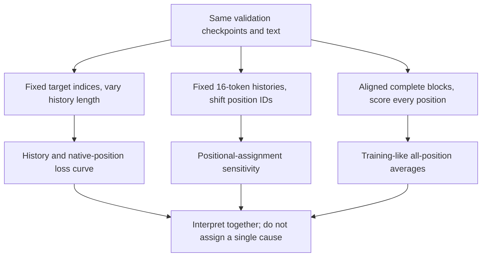

# Diagnose context length: loss by position and available history

[Documentation index](README.md) · [Previous](20-multiseed-contexts.md)

Drivers: [`scripts/analyze_positions.py`](../scripts/analyze_positions.py) and [`scripts/analyze_window_positions.py`](../scripts/analyze_window_positions.py). Helpers: [`src/position_diagnostics.py`](../src/position_diagnostics.py) and [`src/window_diagnostics.py`](../src/window_diagnostics.py). Full [controlled-prefix results](results/position-diagnostics.json) and [window-position results](results/window-position-diagnostics.json).

## Findings

The evidence does **not** support a simple explanation in which the context-64 model works well at early positions and then collapses at late ones. It already has higher loss than context 16 on identical one-character histories in all four seeds. With identical target characters, extending history beyond roughly 8–16 characters does not improve the context-64 model's average loss in this diagnostic.

Learned position IDs do affect predictions: shifting a fixed 16-character history toward late position IDs increases loss. However, that intervention changes the relationship between absolute positions and available history, and one seed is much more sensitive than the others. It is a useful clue, not proof that position embeddings are the main cause of the context-64 disadvantage.

No model was retrained or modified permanently. All four paired 10000-update checkpoints from chapter 20 were used. The reserved test was not read.

## Why position and context are coupled

In the native model, the token at zero-based position j can attend to j+1 input tokens, including itself. Moving to later positions therefore changes both the learned absolute position representation and the amount of available history. A raw loss-by-position plot cannot separate these effects automatically. Different columns of a natural window also predict different target characters, which can have different difficulty.

We used three complementary diagnostics:

1. **Identical targets, increasing history:** score the same fixed validation targets using prefixes of lengths 1 through 16 or 64. The last position ID is L-1 for history length L.
2. **Fixed history, shifted position IDs:** keep the exact same 16 input tokens and targets, but shift every input position ID by 0, 16, 32, or 48 in the context-64 checkpoint.
3. **Every position in complete windows:** score aligned 64-input validation blocks, using one 64-token forward for context 64 or four separately reset 16-token forwards for context 16. This resembles the all-position training objective.



## Reproduce

From the repository root with the environment activated:

```bash
python scripts/analyze_positions.py
python scripts/analyze_window_positions.py
```

The drivers load the eight checkpoint paths from the archived multi-seed study, verify their hashes, and read only Alice validation. Outputs default to `runs/position-diagnostics/report.json` and `windows.json`. Both refuse to overwrite an existing report; pass another `--output` path to repeat.

The controlled analysis uses **2117 fixed target indices**, `64, 128, ...`, spanning the validation book. All histories, models, offsets, and seeds score precisely these same target characters. Every target has at least 64 preceding tokens, so no padding or synthetic context is needed. This systematic subset is reproducible but is not every target in the book and could have stride-related sampling effects. Its losses should not be equated numerically with chapter 20's full-stream means.

Runtime: Python 3.13.15, PyTorch 2.14.1, deterministic single-threaded CPU. Checkpoint, validation, study, source, and target-index hashes are recorded in the reports. Means below average the four training-seed losses equally; reported dispersions are sample standard deviations over seeds, not confidence intervals over validation targets.

## 1. Native position versus available history, identical targets

Only the final logits of each prefix are scored. Position IDs start at zero. Both checkpoints receive the exact same tokens when the history length is at most 16.

| History length | Final position ID | Context-16 mean NLL | Context-64 mean NLL |
| --- | ---: | ---: | ---: |
| 1 | 0 | 2.462595 | 2.531668 |
| 2 | 1 | 2.115496 | 2.180070 |
| 4 | 3 | 1.903431 | 1.968737 |
| 8 | 7 | 1.885773 | 1.945018 |
| 12 | 11 | 1.889051 | 1.933253 |
| 16 | 15 | 1.906228 | 1.944632 |
| 24 | 23 | — | 1.952733 |
| 32 | 31 | — | 1.943035 |
| 40 | 39 | — | 1.954315 |
| 48 | 47 | — | 1.958933 |
| 56 | 55 | — | 1.962617 |
| 64 | 63 | — | 1.968524 |

The first few characters of history substantially reduce loss in both models. After that, the benefit largely levels off. Context 64 does not demonstrate an additional average predictive benefit between 16 and 64 characters on these targets; its loss rises from **1.944632** at length 16 to **1.968524** at length 64. That increase occurs in every seed. It is a loss difference, not a claim that each individual character becomes harder or that all language dependencies fit within 16 characters.

The context-64 disadvantage is present even at length one, when both models see only the current input character. Thus access to distant distracting tokens cannot be the sole explanation. The configurations also differ in training-window structure, learned positional-table size, and initialization, so the early gap does not identify which training difference caused it.

On this fixed target subset, the native last-position gap can be decomposed arithmetically:

$$L_{64}(64)-L_{16}(16)=[L_{64}(16)-L_{16}(16)]+[L_{64}(64)-L_{64}(16)]$$

$$0.062296=0.038405+0.023891$$

The first term is a between-checkpoint gap with identical 16-token input histories; the second is the change from extending the context-64 checkpoint's prefix to 64. This is an exact descriptive decomposition on matched targets, **not** a causal attribution to parameters versus context. Native position IDs also change when history length changes.

## 2. Hold token history fixed and move the position IDs

For each of the same 2117 targets, we supply its preceding 16 characters. In the context-64 checkpoint only, all position IDs are shifted together:

| Position IDs used | Final position ID | Mean NLL | Across-seed SD |
| --- | ---: | ---: | ---: |
| 0–15 | 15 | 1.944632 | 0.013120 |
| 16–31 | 31 | 1.956883 | 0.019463 |
| 32–47 | 47 | 2.019795 | 0.104944 |
| 48–63 | 63 | 2.052882 | 0.159284 |

The tokens, target indices, and attention-mask shape stay fixed. The diagnostic temporarily replaces the positional lookup output using the corresponding learned table rows; it changes no weights, removes its hook afterward, and restores the previous model mode even on failure.

The late-offset effect is heterogeneous:

| Training seed | NLL, IDs 0–15 | NLL, IDs 48–63 | Increase |
| --- | ---: | ---: | ---: |
| 42 | 1.946197 | 1.968151 | +0.021954 |
| 7 | 1.938099 | 2.291177 | +0.353079 |
| 123 | 1.962265 | 1.989495 | +0.027229 |
| 2026 | 1.931968 | 1.962705 | +0.030737 |

Seed 7 contributes a much larger increase than the others, which explains the large late-offset standard deviation. It would be misleading to describe the mean offset effect as equally strong for every trained model.

Crucially, a 16-token prefix assigned IDs 48–63 is not a native training window. During training those IDs normally accompany earlier tokens at IDs 0–47, whereas this intervention supplies none of them. All sixteen position vectors change, including those contributing to keys and values. Consequently, this measures sensitivity to positional assignment and history/position mismatch; it does not isolate a defect in the final position embedding, demonstrate that embeddings are generally broken, or quantify how much of the real native-window gap they cause. The larger offset loss is not directly comparable to natural length-64 input as if only one feature had changed.

## 3. All supervised positions in aligned complete windows

We also score **2117 nonoverlapping 64-input blocks**, covering **135488** next-character targets. Both models score the same targets. Context 64 processes each full block; context 16 resets its context and position IDs at each of the four 16-token chunks inside a block. The last 34 possible targets are omitted to keep every block complete.

At each block column, both models predict the same target characters, so their column-wise difference is paired. Comparisons *between* columns also change the target pool and, for context 16, reset its available history every sixteen positions. They must not be interpreted as position-only interventions.

Mean NLL by groups of block columns:

| Zero-based block columns | Context-16 actual IDs | Context-16 mean NLL | Context-64 mean NLL |
| --- | --- | ---: | ---: |
| 0–15 | 0–15 | 1.936525 | 1.998374 |
| 16–31 | 0–15 | 1.936176 | 1.945977 |
| 32–47 | 0–15 | 1.945415 | 1.962387 |
| 48–63 | 0–15 | 1.937554 | 1.947368 |
| All 64 columns | Four resets | 1.938918 | 1.963526 |

There is no monotonic late-block loss explosion: the context-64 group's average for columns 48–63 is lower than for columns 0–15, which include the hardest short prefixes. Its later groups are relatively flat. Nevertheless, context 16 has lower average loss in each of these paired column groups.

This helps interpret the earlier discrepancy between sampled training-window validation and full rolling-window evaluation. The all-position objective gives equal weight to positions, including short prefixes; full rolling evaluation overwhelmingly scores the final native position once the window fills. For context 16, the complete-window mean here is **1.938918**, while its block-ending loss on the matched diagnostic targets is **1.906228**. For context 64, those values are **1.963526** and **1.968524**. Pooling positions can therefore change the apparent gap.

The complete-window last-column losses agree with the controlled-prefix results: context 16's last column uses history 16, context 64's uses history 64, and both predict the same stride-64 target indices. This provides a cross-check between the independent implementations. The larger gap seen in the full-stream results remains a comparison under that protocol; this subset/window analysis does not replace it.

## What the training budget implies

At 10000 updates, context 16 trains on eight sequences per update and context 64 on two. Each absolute input position therefore appears **80000 times** in the context-16 batches versus **20000 times** in context-64 batches. Both process 1280000 total target tokens, but the larger positional table spreads those examples across four times as many positions. The final position is one of 16 equally supervised outputs in one model and one of 64 in the other.

Both positional embeddings are present in every update; this is not a claim that late embeddings are updated only every fourth step. Earlier positions also receive indirect gradients through later attention computations. Still, per-position example counts and the training/evaluation position mixture are legitimate differences to investigate. These counts are derived from the fixed batch settings, not measured proof that a particular gradient or embedding is undertrained.

## Supported conclusions and remaining hypotheses

The data support three narrower conclusions:

- The context-64 gap is already present with identical short histories, so it cannot be explained only by a failure at distant positions.
- More available history does not improve this checkpoint family's average loss beyond the early prefix lengths examined; native history and absolute position remain coupled in that curve.
- Learned positional assignment affects loss, especially for one seed, but shifted short prefixes are a distribution-changing intervention. This does not establish the dominant cause of the native gap.

A controlled follow-up could change the positional representation or the loss weighting/position-exposure schedule, one factor at a time, while retaining both contexts, frozen data, and multiple seeds. A stronger causal claim would need such a training ablation, not just inference-time perturbations. The present analysis does not train a replacement model, tune against the reserved test, or conclude that longer context is generally harmful.

## Verification

```bash
PYTHONPATH=src python -m unittest discover -s tests -v
```

All 25 tests pass. New tests compare prefix losses against individual manual forwards, compare shifted lookup with a direct embedding/block computation, check complete-window columns against manually reset prefixes, and verify invalid inputs and hook/mode cleanup. No gradients or permanent parameter changes are introduced.

The archived reports retain every position for every seed, complete target indices/block starts, validation and checkpoint hashes, source hashes, and aggregate values. Cross-report last-column agreement, identical targets, source/checkpoint integrity, documentation examples, and links were also checked.
