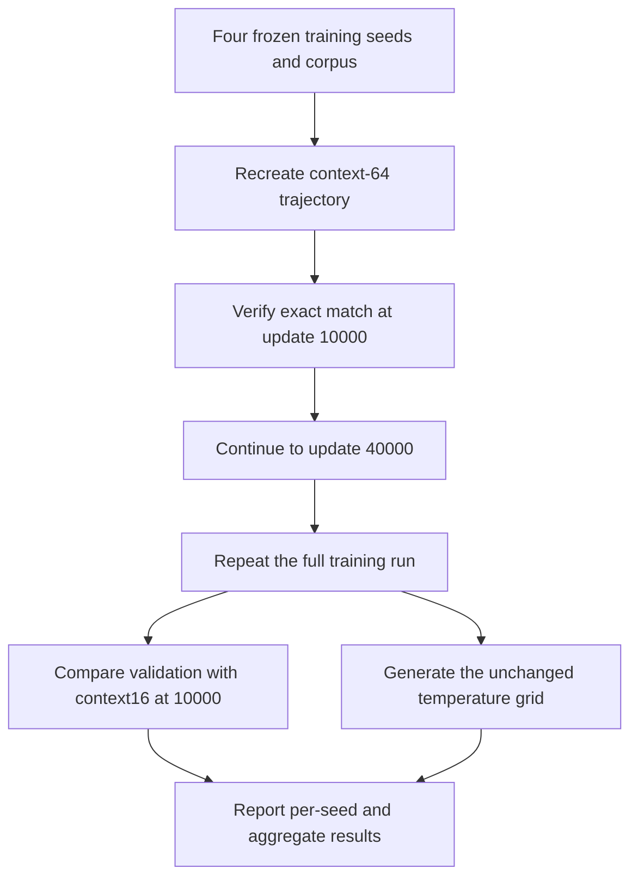

# Match examples per absolute position: context 64 at 40000 updates

[Documentation index](README.md) · [Previous](21-position-loss-diagnostics.md) · [Next](23-sinusoidal-positions.md)

Driver: [`scripts/run_position_exposure_experiment.py`](../scripts/run_position_exposure_experiment.py). Complete [metrics, histories, reproducibility checks, and generation grids](results/position-exposure-training.json).

## Result first

Matching the per-position example count improved context 64 relative to its own 10000-update checkpoints in all four seeds. Against context 16 at 10000 updates, it won **3 of 4 native-context pairs**: mean perplexity **6.5626 ± 0.1250**, compared with **6.6336 ± 0.0581** (mean ± sample SD across seeds). The advantage is small and one seed still favors context 16.

All four new context-64 checkpoints perform better when evaluation history is capped at 16 characters than when using all 64. Under that cap, their mean perplexity is **6.4612 ± 0.1196**, and they beat the context-16 references in all four pairs. Therefore the experiment supports the benefit of extra training, but does not demonstrate a benefit from consuming the full 64-character history. It cannot isolate positional exposure from the fourfold increase in tokens and optimizer steps.

Generation still contains malformed words and repetitive loops. Exact training repeats, historical-prefix checks, and checkpoint reload checks passed for every seed. The test remains reserved.

## Question and design

Chapter 21 found that each absolute position appeared in 80000 context-16 input sequences but only 20000 context-64 sequences at the matched 10000-update budget. This follow-up keeps the context-16 baseline at 10000 updates and extends each context-64 trajectory to **40000 updates**, with the same four training seeds: 42, 7, 123, and 2026.

At two sequences per update, context 64 now receives **80000 examples at each absolute position**, matching context 16's eight sequences per update for 10000 updates. This is an exposure-matched study, not a token-budget-matched study.

| Setting | Context-16 reference | New context-64 run |
| --- | ---: | ---: |
| Updates | 10000 | 40000 |
| Sequences per update | 8 | 2 |
| Input characters per sequence | 16 | 64 |
| Examples at each absolute input position | 80000 | 80000 |
| Sampled target tokens per model | 1280000 | 5120000 |
| Parameters | 16080 | 17232 |
| Training seeds | 42, 7, 123, 2026 | 42, 7, 123, 2026 |

The context-64 model has four times as many update steps and target tokens. The extra compute, optimizer evolution, repeated data sampling, and cumulative weight decay are inseparable from the exposure increase in this design. Even if it performs better, that would not by itself prove that positional underexposure caused its earlier disadvantage or that longer context is more efficient.

The data are unchanged: prepared Frankenstein training text and Alice validation text, using the fixed ASCII-letter normalization and training-only character vocabulary. The test book remains reserved. Width 24, three heads, two blocks, FFN expansion four, AdamW learning rate 0.003, weight decay 0.01, gradient clipping at 1.0, and single-threaded deterministic CPU execution are unchanged. The learning rate is constant; there is no scheduler or adaptive stopping rule. Final checkpoints are fixed at update 40000 rather than selected by validation search.

An example at an absolute input position is not an independent document or a unique corpus character. Training windows are sampled with replacement and can overlap. Position embeddings also receive indirect gradients through attention. All position rows occur in every update; this study does not mean each row previously received fewer optimizer calls.

## Execution and reproducibility

From the repository root with the project environment activated and prior study checkpoints available:

```bash
python scripts/run_position_exposure_experiment.py
```

The driver reads the frozen four-seed study to identify each context-16 reference and context-64 10000-update checkpoint. It verifies data and checkpoint hashes and the previous context-64 model/training configuration. Each long run starts at the original seed and follows the same batch stream; at update 10000, a read-only observer compares every weight tensor with the earlier checkpoint. No general optimizer-resume interface is used.

Each seed is trained twice through all 40000 updates. The driver compares final weights and histories, verifies that the periodic history through 10000 updates matches the earlier trajectory, and reloads the final checkpoint for evaluation. It also compares reloaded and in-memory logits on a fixed prompt.

Outputs default to `runs/position-exposure-40000/`. Existing output directories are rejected. To reproduce into a fresh directory:

```bash
python scripts/run_position_exposure_experiment.py --output-dir runs/position-exposure-repeat
```

Per-seed primary/repeat logs and checkpoints are retained. Per-seed result files are written as each comparison finishes; the aggregate report is written after every seed completes. There is no automatic partial-run resume command. The script never opens test text.

## Comparison protocols

For each seed, evaluation compares:

- The saved context-16 10000-update reference, independently re-evaluated and checked against its archived metrics.
- The earlier context-64 10000-update result from the frozen study.
- The new context-64 40000-update checkpoint using its full 64-character context.
- The new checkpoint with evaluation history capped at 16 characters.

Every full evaluation scores all 135522 next-character validation targets once. The first validation character is unscored; preceding characters are ground truth; no generation temperature is applied. Position IDs restart within each rolling window. The common 16-character cap equalizes available evaluation history without undoing different training histories.

The generation protocol is also frozen: prompts `the creature ` and `i felt `, temperatures 0, 0.5, 0.8, 1.0, and 1.3, sampling seeds 42 and 123, and 200 new character tokens. Each new generation is repeated from the same sampling seed and checked for exact equality. All outputs are retained, without discarding malformed or repetitive samples.

Averages give equal weight to each training seed. Reported dispersion is sample standard deviation across four trained models, not a confidence interval over validation characters. Arithmetic means of model perplexities are reported separately from mean NLL; no ensemble distribution is evaluated.



## Per-seed full-validation results

Every row uses the same validation book and target protocol. Lower perplexity is better.

| Training seed | Context 16 / 10000 | Context 64 / 10000 | Context 64 / 40000 | Context 64 / 40000, cap 16 |
| --- | ---: | ---: | ---: | ---: |
| 42 | 6.712669 | 6.948605 | 6.438006 | 6.288657 |
| 7 | 6.628373 | 7.073960 | 6.544549 | 6.478812 |
| 123 | 6.620508 | 7.360044 | 6.531686 | 6.518360 |
| 2026 | 6.572946 | 7.096692 | 6.736006 | 6.559056 |

The native-context ordering reverses in three seeds but not in seed 2026. This is not a consistent four-seed native-context win. The capped evaluation wins all four pairs, with a particularly small margin in seed 2026; neither win counts nor four-seed means establish statistical certainty.

## Aggregate metrics

Mean ± sample standard deviation over the four training seeds:

| Condition | Mean NLL | Perplexity | Next-character accuracy |
| --- | ---: | ---: | ---: |
| Context 16, 10000 / native 16 | 1.892123 ± 0.008742 | 6.633624 ± 0.058108 | 42.974203 ± 0.412701% |
| Context 64, 10000 / native 64 | 1.962664 ± 0.024123 | 7.119825 ± 0.172878 | 40.641372 ± 0.621179% |
| Context 64, 40000 / native 64 | 1.881246 ± 0.018951 | 6.562562 ± 0.125000 | 43.460102 ± 0.452193% |
| Context 64, 40000 / cap 16 | 1.865689 ± 0.018651 | 6.461221 ± 0.119617 | 44.303692 ± 0.448229% |

Accuracy dispersion is in percentage points. The paired NLL difference (context64/40000 minus context16/10000) is **−0.010877 ± 0.027185** nats per character. Its standard deviation is larger than the mean difference in magnitude. This is descriptive variability, not a significance calculation or confidence interval. With the common 16-character cap, the difference is **−0.026434 ± 0.027261**.

These numbers do not overturn chapter 20's result at an equal target-token budget. Chapter 20 asked what happens with 1280000 targets in both configurations; the present study gives context 64 5120000 targets. They answer different questions. Even a win at equal per-position exposure is not evidence of superior data or compute efficiency.

## Training histories and reproducibility

Both runs for every seed had identical final weights and histories. Both matched the corresponding earlier context-64 checkpoint tensor-for-tensor at update 10000, and their periodic histories through that point matched exactly. Reloaded final checkpoints reproduced the in-memory logits exactly. The context-16 references were independently re-evaluated and matched their archived full-stream metrics.

The sampled fixed-window losses at the endpoints were:

| Seed | Train loss, 10000 | Train loss, 40000 | Validation loss, 10000 | Validation loss, 40000 |
| --- | ---: | ---: | ---: | ---: |
| 42 | 1.7804 | 1.6315 | 1.8449 | 1.7842 |
| 7 | 1.8504 | 1.6866 | 1.8935 | 1.8364 |
| 123 | 1.8582 | 1.6623 | 1.9461 | 1.8442 |
| 2026 | 1.8702 | 1.6874 | 2.0010 | 1.9960 |

These are the same sampled windows within each seed, not all validation targets. Histories fluctuate and are retained in full. Endpoint improvements do not establish that loss decreased at every step, that 40000 is optimal, or that overfitting is absent. The checkpoint step was fixed before these results were inspected.

The environment was Python 3.13.15 and PyTorch 2.14.1 on deterministic single-threaded CPU. The base commit is `735a483`; the new driver and all model/training/evaluation source hashes identify the executed working-tree code. Exact equality was checked on this runtime, not claimed across hardware or PyTorch versions.

## Generation: same grid and budget-independent sampling

The study adds **80 new continuations**: four newly trained checkpoints times the unchanged 20-combination grid. Each continuation was generated twice and matched exactly for its sampling seed. The aggregate report also includes the 80 context-16 and 80 earlier context-64 reference samples, for 240 retained samples across the three model groups. No samples were filtered out.

The snippets below show the first 150 continuation characters, excluding the prompt, for `the creature `, temperature 0.8, and sampling seed 42. All four training seeds and both compared configurations are shown; the full strings and remaining temperatures are in the JSON.

### Training seed 42

Context 16, 10000 updates:

```text
when i not and of lic at the into the all to me undern the mistand the monmed the leforcust justinly the your me deadge of towat the
prote incousious 
```

Context 64, 40000 updates:

```text
when i not and on litt i thoughts the affectuve under inderess and the monce of my neasous the spect the voancilude should towards the and and expresi
```

### Training seed 7

Context 16, 10000 updates:

```text
when i nothe our clicried my into the all to my under conful saver the monself a lind scurtejeved in the veary lid angers and a conters to seepervour 
```

Context 64, 40000 updates:

```text
whom i no panoun cloce the being my endured the unfer courness and the monced the longs that to my frill you and dead his leturness and to see crecula
```

### Training seed 123

Context 16, 10000 updates:

```text
when i not and of lice the reply and tale to muture to the mistand the monted the for scuptentere i friend and lude she greature that the brecouse upo
```

Context 64, 40000 updates:

```text
when i no pasolude i reepection i have felt the unfer it had starry as monce onlifing scuptentess i happly and lide shore lefful of my noother eve dea
```

### Training seed 2026

Context 16, 10000 updates:

```text
whom i no pasoul cloccature in the senate thus the exping he sanch the monch only the scupted voicing was insun the shorture was the should the should
```

Context 64, 40000 updates:

```text
when i no pasoun cle of the distir senters which man occurress and the moners an alnels the joysition which i my dission a towas the strappiny every a
```

The new models sometimes produce recognizable combinations such as `i have felt`, `the being`, and `it had`, but these coexist with malformed words and incoherent continuations. Greedy decoding still enters loops dominated by short common words. Positive temperatures produce variety without reliably preserving grammar or a narrative. There is no demonstrated general coherence winner in this small qualitative grid.

Mean repeated-character-4-gram fractions, first averaged within each model's prompt/sampling-seed grid and then averaged over training seeds:

| Temperature | Context 16 / 10000 | Context 64 / 10000 | Context 64 / 40000 |
| --- | ---: | ---: | ---: |
| 0 | 92.77% ± 1.73 pp | 86.17% ± 3.94 pp | 87.44% ± 3.33 pp |
| 0.5 | 24.71% ± 4.12 pp | 27.98% ± 3.86 pp | 22.78% ± 2.17 pp |
| 0.8 | 13.52% ± 1.44 pp | 9.90% ± 1.51 pp | 12.66% ± 3.74 pp |
| 1 | 6.50% ± 0.78 pp | 6.28% ± 1.22 pp | 7.71% ± 2.91 pp |
| 1.3 | 2.73% ± 0.98 pp | 1.14% ± 0.70 pp | 2.38% ± 0.54 pp |

The ± values are across-training-seed sample SD in percentage points. The statistic excludes the prompt and counts duplicate overlapping four-character spans, including whitespace. At temperature 0.5, repetition decreases relative to the earlier context-64 model, while the ordering changes at other temperatures. A lower repetition fraction is not a grammar or coherence score; random malformed strings can be very diverse. Greedy outputs are identical across sampling seeds and do not count as independent trained models.

A single sample can be reproduced with:

```bash
python src/generate.py --checkpoint runs/position-exposure-40000/seed-42/primary/checkpoint.pt --prompt "the creature " --temperature 0.8 --seed 42 --max-new-tokens 200
```

## Artifacts and checks

For each seed, `runs/position-exposure-40000/seed-SEED/` contains `primary/` and `repeat/` checkpoints and metrics, both complete training logs, `generation.json`, and `result.json`. The experiment root contains `experiment.json`. Raw books and checkpoints remain Git-ignored; the tracked aggregate copy preserves all histories, metrics, generation grids, source/data/checkpoint hashes, and reproducibility outcomes.

```bash
PYTHONPATH=src python -m unittest discover -s tests -v
```

The 25-test suite passes. The completed experiment additionally checked identical repeated training for every seed, exact update-10000 prefix equivalence, checkpoint reload equality, reference-score equivalence, checkpoint/data integrity, and all sampling repeats. Archived budget arithmetic, aggregate statistics, complete sample grids, documentation examples, and links were verified. No test-text file was opened.

## Interpretation

Equalizing per-position example counts removes one numerical imbalance, and longer training improves context 64 over its earlier checkpoint in every examined seed. But its native-context advantage over context 16 is small and not universal across seeds. The extra fourfold token/update budget also strengthens shared token-processing weights, so this experiment cannot identify positional exposure as the unique reason for improvement.

Most importantly, every new checkpoint still scores better with a 16-character cap than with its full native context. The result does not demonstrate useful exploitation of the extra 48 characters. A follow-up aimed at that question should control the positional representation or training/evaluation position mixture directly, with multiple seeds, rather than infer long-history utility from additional training alone. Final test evaluation remains reserved until model-development decisions are fixed.

The subsequent equal-budget sinusoidal-position experiment is recorded in [chapter 23](23-sinusoidal-positions.md).
