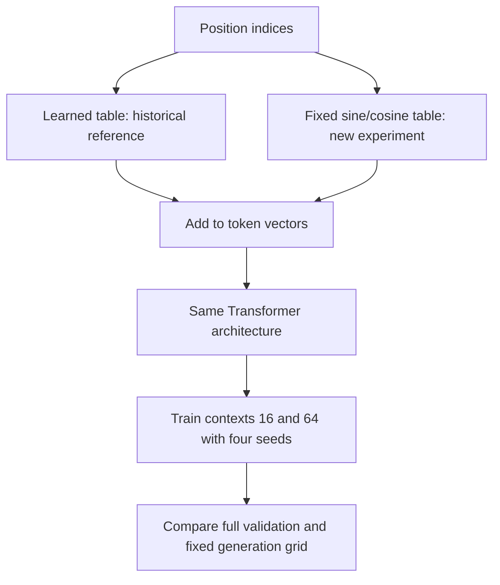

# Sinusoidal positions at matched token budgets

[Documentation index](README.md) · [Previous](22-position-exposure-training.md)

Implementation: [`src/sinusoidal_positions.py`](../src/sinusoidal_positions.py), optional configuration in [`src/gpt.py`](../src/gpt.py) and [`src/train.py`](../src/train.py). Driver: [`scripts/run_sinusoidal_experiment.py`](../scripts/run_sinusoidal_experiment.py). Tests: [`tests/test_sinusoidal.py`](../tests/test_sinusoidal.py). Complete [metrics, histories, and new/reference generation grids](results/sinusoidal-context-experiment.json).

## Result first

At the matched 1280000-target budget, sinusoidal positions do not provide a uniform improvement. Context-16 mean perplexity worsens from **6.6336** with learned positions to **6.8364** with sinusoidal positions; it worsens in all four seeds. Context-64 mean perplexity improves modestly from **7.1198** to **6.9990**, with an improvement in three seeds and a regression in one.

Within the sinusoidal pair, context 16 wins three of four native-window comparisons. A common 16-character evaluation cap gives the sinusoidal context-64 model mean perplexity **6.7706**, but the seed-level comparison against sinusoidal context 16 splits 2–2. The learned context-16 reference remains the best mean native-validation baseline among these four equal-budget configurations.

All eight new model configurations reproduced exactly in their second training run. Generation still contains malformed words and loops, without a clear coherent-prose winner. The learned default is retained and the test remains reserved.

## Fixed sinusoidal encoding

The fixed positional encoding uses the sine/cosine construction in section 3.5 of [Attention Is All You Need](https://arxiv.org/html/1706.03762v7#S3.SS5):

$$PE(p,2i)=\sin\left(p/10000^{2i/D}\right)$$
$$PE(p,2i+1)=\cos\left(p/10000^{2i/D}\right)$$

Here p is the absolute position, D the embedding width, and i indexes a feature pair. Different pairs use different frequencies. The vectors are added to token embeddings. At position zero, each complete pair is `(0, 1)`. These position values do not have to be learned.

Our experiment changes only the positional implementation within the existing small GPT. Unlike the original paper's embedding setup, this repository does not multiply token embeddings by the square root of width; adding that scaling simultaneously would introduce another change. This is not a reproduction of the original encoder-decoder model or its translation results.

## Implementation and checkpoint compatibility

`SinusoidalPositionEmbedding` precomputes a float32 `[context_length, embedding_dim]` table and registers it as a persistent buffer. It contributes no trainable parameters, moves with the model's device/dtype, and is included in checkpoints. An unmatched final sine channel is supported for odd embedding widths.

GPT accepts `positional_encoding="learned"` (the unchanged default) or `"sinusoidal"`. Existing learned-position checkpoint keys and default initialization order remain intact. New sinusoidal checkpoints record the option in `model_config`, so the existing checkpoint loader and generation/evaluation commands construct the correct model automatically.

The finite precomputed table and GPT input limit remain enforced. This implementation does not extend the context automatically, add a KV cache, or demonstrate extrapolation beyond training capacity. Absolute position indices still restart inside every cropped generation/evaluation window.

```python
import torch
from gpt import GPT

model = GPT(vocab_size=28, context_length=64, embedding_dim=24,
            num_heads=3, num_layers=2, positional_encoding="sinusoidal")
ids = torch.zeros(2, 12, dtype=torch.long)
assert model(ids).shape == (2, 12, 28)
assert sum(p.numel() for p in model.parameters()) == 15696
assert not model.position_embedding.table.requires_grad
```

## Study design

We return to the common **10000-update, 1280000-target** budget for both contexts, rather than giving context 64 the fourfold budget from chapter 22. Both sinusoidal configurations are trained from scratch with the four fixed seeds 42, 7, 123, and 2026, and each run is repeated exactly.

| Setting | Sinusoidal context 16 | Sinusoidal context 64 |
| --- | ---: | ---: |
| Context capacity | 16 | 64 |
| Sequences per batch | 8 | 2 |
| Updates | 10000 | 10000 |
| Target tokens per update | 128 | 128 |
| Total sampled targets | 1280000 | 1280000 |
| Trainable parameters | 15696 | 15696 |

The learned-position references at the same token budget have 16080 parameters for context 16 and 17232 for context 64. Removing the learned table removes 384 or 1536 parameters respectively. All other architecture settings remain width 24, three heads, two blocks, and FFN expansion four. AdamW learning rate 0.003, weight decay 0.01, gradient norm cap 1.0, fixed corpus/splits, and periodic evaluation every 200 updates are unchanged.

Within the sinusoidal pair for a given seed, table construction consumes no random draws, so both context capacities start with identical trainable weights and identical first-16 sinusoidal vectors. Tests verify that their logits match exactly on the same short input before training. Learned versus sinusoidal runs at the same numeric seed do not share all initial weights: learned table initialization consumes random draws before later modules are initialized. The positional signal also has a different scale/distribution. This is a comparison of configured implementations, not a perfectly parameter-matched causal isolation of a single formula.

Equal token budgets do not mean identical minibatches, gradient correlations, or compute: longer windows use fewer sequences, and attention computation differs. Data are the same prepared Frankenstein train text and Alice validation text. The test book remains reserved.



## Reproduce

From the repository root with the environment activated and prepared corpus/reference study available:

```bash
python scripts/run_sinusoidal_experiment.py
```

The driver trains both contexts twice for each seed, checks exact primary/repeat weights and histories, then evaluates each primary checkpoint and generates the unchanged temperature grid. It verifies data hashes and saved configurations. Outputs default to `runs/sinusoidal-context-10000/`; existing experiment directories are rejected. A new reproduction can use:

```bash
python scripts/run_sinusoidal_experiment.py --output-dir runs/sinusoidal-context-repeat
```

A single manual training command is also available:

```bash
python src/train.py --train-file data/prepared/gutenberg/train.txt --validation-file data/prepared/gutenberg/validation.txt --positional-encoding sinusoidal --context-length 64 --batch-size 2 --steps 10000 --seed 42 --output-dir runs/sinusoidal-manual
```

The manual trainer keeps its default evaluation interval of 25; the study driver uses 200. The training sampler is independent of evaluation randomness, but the history reporting interval differs.

Full validation scores all 135522 next-character targets once, using ground-truth history, with native context and an additional 16-character cap for context 64. Generation uses prompts `the creature ` and `i felt `, five temperatures (0, 0.5, 0.8, 1.0, 1.3), sampling seeds 42 and 123, and 200 new tokens. Every combination is generated twice to check same-seed equality. No favorable samples are selected or unfavorable ones discarded.

## Per-seed full-validation results

Each checkpoint scores the same 135522 targets. Lower perplexity is better.

| Training seed | Learned 16 | Sinusoidal 16 | Learned 64 | Sinusoidal 64 | Sinusoidal 64, cap 16 |
| --- | ---: | ---: | ---: | ---: | ---: |
| 42 | 6.712669 | 6.978383 | 6.948605 | 6.810386 | 6.643700 |
| 7 | 6.628373 | 6.734864 | 7.073960 | 6.756926 | 6.766378 |
| 123 | 6.620508 | 6.800529 | 7.360044 | 7.422927 | 6.948067 |
| 2026 | 6.572946 | 6.831813 | 7.096692 | 7.005755 | 6.724234 |

Seed 42 favors the longer sinusoidal context, while seeds 7, 123, and 2026 favor the shorter one. The sinusoidal context-64 result varies more across seeds than the learned context-64 reference, with seed 123 contributing a relatively high native loss. Reporting only seed 42 would have overstated the case for a longer sinusoidal context.

## Aggregate comparison

Arithmetic mean ± sample standard deviation over four training seeds; accuracy dispersion is in percentage points:

| Condition | Mean NLL | Perplexity | Accuracy |
| --- | ---: | ---: | ---: |
| Learned 16 / native 16 | 1.892123 ± 0.008742 | 6.633624 ± 0.058108 | 42.974203 ± 0.412701% |
| Sinusoidal 16 / native 16 | 1.922176 ± 0.014995 | 6.836397 ± 0.102918 | 42.183372 ± 0.703931% |
| Learned 64 / native 64 | 1.962664 ± 0.024123 | 7.119825 ± 0.172878 | 40.641372 ± 0.621179% |
| Sinusoidal 64 / native 64 | 1.945081 ± 0.042593 | 6.998999 ± 0.302178 | 41.287208 ± 1.605328% |
| Sinusoidal 64 / cap 16 | 1.912454 ± 0.018930 | 6.770595 ± 0.128797 | 42.209383 ± 0.636492% |

The paired sinusoidal-minus-learned NLL difference is **+0.030054 ± 0.010955** for context 16 (zero sinusoidal wins) and **−0.017583 ± 0.022421** for context 64 (three sinusoidal wins). This is descriptive sample dispersion, not a confidence interval or statistical significance claim. Mean perplexity is an arithmetic mean of per-model perplexities, not an ensemble score or the exponential of average NLL.

Replacing the learned representation narrows the mean native-context gap: sinusoidal context64-minus-context16 NLL is **+0.022904 ± 0.047635**, compared with **+0.070541 ± 0.029513** for the learned references. The narrower gap comes from both worse short-context results and modestly better long-context results; it is not evidence that context 64 has become uniformly better.

Three of four sinusoidal context-64 models score better with the 16-character cap than with full history. Seed 7 shows a very small gain from using all 64 instead. Thus the fixed representation does not establish reliable use of the extra 48 characters across seeds. Unlike the learned reference study's 4/4 short-context wins, the two sinusoidal models at a common cap split 2–2; the aggregate difference should not be presented as a uniform paired advantage.

The learned references were imported from the frozen chapter-20 report and checked for matching corpus hashes. Separately, the updated code re-evaluated the seed-42 learned context-16 checkpoint and reproduced its archived full-stream metrics exactly. References were not retrained with a new initialization convention. The 40000-update learned context-64 result from chapter 22 has four times the target budget and is not included as an equal-budget encoding control here.

## Generation comparison

The study records **160 new sinusoidal samples**, plus 160 frozen learned-reference samples in the aggregate report. Every new prompt/temperature/sampling-seed combination is generated twice and matches exactly. All outputs are retained, including malformed and repetitive continuations.

The following snippets show the first 150 continuation characters for prompt `the creature `, temperature 0.8, sampling seed 42. The prompt is excluded and snippets are explicitly truncated; complete strings for all temperatures and both prompts/seeds are in the linked JSON.

### Training seed 42

Sinusoidal context 16:

```text
when i no pand of locrain moditty the ald to mothered it her sat return which the the scurt joved i happpy and leditshe greature the the of the the to
```

Sinusoidal context 64:

```text
whom i not and o clic at the immbenied from the

not of delesss worther convered alnd scupt joyse i happty and loose gey pressed of
my anot the sporin
```

### Training seed 7

Sinusoidal context 16:

```text
whom i notherr of lice i those the senters which my to maddess and the monstered alndescuptejustining had in and dearge the our conter and it feeling 
```

Sinusoidal context 64:

```text
wher i no pand o clic were this so served to me

myet cour mistand the monce onle the scupt joved in the worsunly
in gener tour come the of the with i
```

### Training seed 123

Sinusoidal context 16:

```text
when i not and on the were thist on a all to my under in had stace the monthered the cocust justitinuty the in lide she greefor to the noot the spouri
```

Sinusoidal context 64:

```text
when i no panoun i scrat thought of and the sught fevent her stacre ass freathed lind scuptejeved i him the in lineashe greatured him hangerey eviced 
```

### Training seed 2026

Sinusoidal context 16:

```text
when i nof and of licontly being and the had vising to the mistance as mone the relouse that to i in the visian the she gresome conjescome it the frie
```

Sinusoidal context 64:

```text
wher i no passure licouin my inte the
ave to my fore of deless a rears mondeartles not curtention in the worduil dead onge towey the
the of the was th
```

Both sinusoidal contexts emit recognizable short fragments mixed with misspellings and broken syntax. Some outputs include common combinations such as `served to me` or `it feeling`, but these do not form a reliably coherent narrative. Greedy decoding remains strongly repetitive. The examples do not demonstrate comprehension, faithful recall of a book, or better semantic quality than the learned reference grids.

Mean repeated-character-4-gram fractions are aggregated first over the prompt/sampling-seed combinations within a trained model, then over training seeds:

| Temperature | Learned 16 | Sinusoidal 16 | Learned 64 | Sinusoidal 64 |
| --- | ---: | ---: | ---: | ---: |
| 0 | 92.77% ± 1.73 pp | 93.65% ± 2.25 pp | 86.17% ± 3.94 pp | 83.95% ± 7.02 pp |
| 0.5 | 24.71% ± 4.12 pp | 27.98% ± 6.62 pp | 27.98% ± 3.86 pp | 24.49% ± 4.45 pp |
| 0.8 | 13.52% ± 1.44 pp | 13.13% ± 1.02 pp | 9.90% ± 1.51 pp | 9.87% ± 1.25 pp |
| 1 | 6.50% ± 0.78 pp | 7.65% ± 0.99 pp | 6.28% ± 1.22 pp | 5.58% ± 1.99 pp |
| 1.3 | 2.73% ± 0.98 pp | 2.28% ± 0.81 pp | 1.14% ± 0.70 pp | 1.90% ± 0.52 pp |

The ± values are across-training-seed sample SD in percentage points. The statistic excludes prompts and counts duplicate overlapping four-character spans including whitespace. It is not a correctness or fluency score; highly irregular strings can be diverse, while correct common words can repeat. Greedy sampling-seed duplicates do not constitute independent trained models. No human quality rating, semantic benchmark, or memorization audit was performed.

To inspect a saved sinusoidal checkpoint, use the existing CLI without another encoding flag; the checkpoint carries the configuration:

```bash
python src/generate.py --checkpoint runs/sinusoidal-context-10000/seed-42/context-64/primary/checkpoint.pt --prompt "the creature " --temperature 0.8 --seed 42 --max-new-tokens 200
python src/evaluate.py --checkpoint runs/sinusoidal-context-10000/seed-42/context-64/primary/checkpoint.pt --validation-file data/prepared/gutenberg/validation.txt --output runs/sinusoidal-validation.json
```

## Verification and artifacts

Each seed/context directory under `runs/sinusoidal-context-10000/` contains primary/repeat checkpoints, training logs, metrics, generations, and a per-model result. The root aggregate report and its tracked copy in `docs/results/` preserve all histories, model configurations, evaluations, source/data/checkpoint hashes, and full new/reference generation grids. Corpus files and checkpoints remain Git-ignored.

The 29-test suite passes. New tests cover the formula at even and odd widths, non-trainable buffer behavior, CPU dtype conversion, identical trainable initialization across context capacities, causal prefix behavior, checkpoint reload and generation, and unchanged learned defaults. The position-shift diagnostic also now accepts either a learned table or the fixed sinusoidal buffer, with an independent direct-computation test. The main study does not claim to have rerun the full position-loss analysis for the sinusoidal checkpoints.

Every new configuration had identical primary/repeat final states and histories. All eight new checkpoints recorded `positional_encoding: sinusoidal` and loaded through the existing inference path. A separate legacy checkpoint reproduced archived full validation exactly. Budgets, parameter counts, four-seed summaries, complete sample grids, source/checkpoint hashes, documentation examples, and links were checked.

The recorded base commit is `dee1a6f`; new feature and driver sources are identified by their working-tree hashes. Runtime is Python 3.13.15, PyTorch 2.14.1, CPU, one thread, deterministic algorithms. Exact reproduction is verified here, not promised across runtime versions or independent hardware.

## Interpretation

This straightforward sinusoidal replacement is not a uniform improvement for our small character model. It helps context 64 on average at this budget while hurting context 16, and it does not reliably create a benefit from using a longer native history. Keep the learned context-16 configuration as the stronger mean native-validation reference among the four equal-budget options tested here; do not replace the default solely because fixed positions remove trainable rows.

The result is specific to the normalization, small corpus, architecture, scale of the added positional signal, fixed learning rate, and training budget. It does not prove sinusoidal positions are generally inferior, nor identify a single cause of the earlier learned-context gap. A follow-up could inspect position/history curves for the new checkpoints or vary the positional signal scale under a fixed protocol, keeping the test reserved and reporting all seeds.
