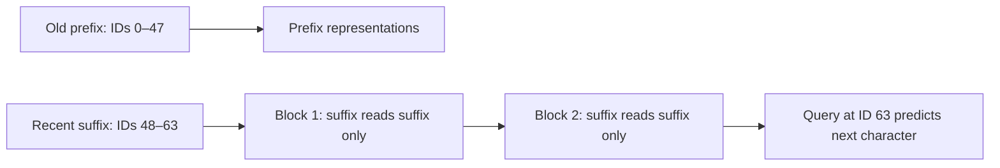

# Does distant history help when position IDs stay fixed?

[Documentation index](README.md) · [Previous](24-sinusoidal-position-diagnostics.md) · [Next](26-fixed-position-history-curve.md)

Driver: [`scripts/analyze_history_ablation.py`](../scripts/analyze_history_ablation.py). Evaluator: [`src/history_ablation.py`](../src/history_ablation.py). Full measured results and provenance: [JSON report](results/history-ablation.json).

## Controlled intervention

Freeze the eight context-64 checkpoints trained for 10000 updates (four seeds per encoding) from chapters 20 and 23. Score every one of the **135522 next-character validation targets** twice. The full condition uses the usual preceding window of up to 64 characters. The masked condition keeps the exact same input tensor and position IDs but prevents every suffix query from reading keys older than the last 16 characters, in every head of every block. No training or test-set access occurs. Checkpoint and validation hashes are checked against the archived studies; native losses reproduce the archived full-validation references within 1e-6.

For a window of length L, let c = max(0, L − 16). Query i may read key j exactly when:

$$
A_{ij} = [j \leq i] \land ([i < c] \lor [j \geq c]).
$$

The model intersects this additional boolean permission mask with its ordinary causal mask. For L=64 the retained suffix has IDs **48–63**, and the scored final query still has ID **63**. Prefix queries remain causally valid but cannot send information into suffix representations. At the beginning of the book, windows have their natural shorter lengths; windows of at most 16 characters are unchanged. Only the final query predicts the next target.



A sliding 16-key mask at every query would still allow indirect access to earlier tokens across multiple layers. Isolating the entire final suffix avoids that leakage. LayerNorm and FFN operate independently at each position; residual connections preserve this isolation. Tests verify that changing every old-prefix token cannot change the masked suffix output, and that it matches a direct 16-token forward calculation using IDs 48–63.

This differs from the earlier `--context-length 16` evaluation, which cropped tokens **and reset their IDs to 0–15**. Those two interventions answer different questions.

## Results

Define:

$$
\Delta = \mathrm{NLL}_{masked} - \mathrm{NLL}_{full}.
$$

Positive delta means removing distant history worsens prediction: that history has a net benefit for this frozen model under the intervention. Negative delta means masking improves prediction. NLL is in natural-log units per character; lower perplexity is better.

| Encoding | Seed | Full PPL | Masked PPL | Δ NLL |
| --- | ---: | ---: | ---: | ---: |
| learned | 42 | 6.948605 | 6.956627 | +0.001154 |
| learned | 7 | 7.073960 | 9.668370 | +0.312439 |
| learned | 123 | 7.360044 | 7.475250 | +0.015532 |
| learned | 2026 | 7.096692 | 7.103844 | +0.001007 |
| sinusoidal | 42 | 6.810386 | 6.891473 | +0.011836 |
| sinusoidal | 7 | 6.756926 | 6.946940 | +0.027733 |
| sinusoidal | 123 | 7.422927 | 8.153309 | +0.093850 |
| sinusoidal | 2026 | 7.005755 | 7.017231 | +0.001637 |

Means ± sample standard deviation across four seeds (mean PPL is the arithmetic mean of per-seed perplexities):

| Encoding | Full PPL | Masked PPL | Δ NLL |
| --- | ---: | ---: | ---: |
| learned | 7.119825 ± 0.172878 | 7.801023 ± 1.263880 | +0.082533 ± 0.153422 |
| sinusoidal | 6.998999 ± 0.302178 | 7.252238 ± 0.602914 | +0.033764 ± 0.041472 |

## Reproduce and verify

From the repository root, with the existing corpus and eight checkpoints available:

```bash
source .venv/bin/activate
python scripts/analyze_history_ablation.py --output runs/history-ablation/report.json
PYTHONPATH=src python -m unittest discover -s tests -v
```

Choose a new output path when repeating an existing run. Evaluation uses deterministic CPU operations, one thread, and batch size 128. The report records Python/PyTorch versions, checkpoint hashes, validation hash, study hashes, code commit, and source hashes for the uncommitted analysis implementation. A separate repeated evaluation of the first 256 validation targets was exactly identical, and its native loss matched the existing evaluator within 5e-16. No checkpoint is rewritten. All 32 tests pass, including mask validation, causal behavior with an unrestricted additional mask, suffix isolation across two blocks for both encodings, equivalence to direct shifted-ID suffix computation, and preservation of model state and training mode.

## Interpretation and limitations

**Distant history contributes positively to next-character log loss in all four seeds of both encodings when position IDs are held fixed.** Removing it raises mean NLL by 0.082533 for learned positions and 0.033764 for sinusoidal positions. The effect is heterogeneous: learned seed 7 is a large outlier (+0.312439), whereas learned seeds 42 and 2026 change by only about 0.001. For learned positions the median paired delta is +0.008343; for sinusoidal positions it is +0.019785. The larger learned mean is therefore not evidence of uniformly stronger use of distant history.

This resolves an ambiguity in chapter 24: extending a 16-token input to 64 changes both token history and absolute IDs. The earlier observation that cropped/reset evaluation often improves does **not** imply that the older tokens carry no useful information. Here, with positions unchanged, the full history has lower loss in all eight frozen checkpoints. It can partly compensate for difficulties associated with predicting at late positional IDs.

The ablation also does not overturn the separate trained-model comparison: the learned context-16 model family still had lower native validation perplexity than learned context 64 at the matched training budget (chapter 20). A context-64 checkpoint benefiting from its own additional history and a separately trained context-16 checkpoint scoring better overall can both be true. Accuracy is archived too; it need not move in the same direction as log loss, since it ignores probability changes that leave the top-ranked token unchanged.

This is an inference intervention on frozen models, with a history/position distribution different from training. It measures the net contribution of the removed history under this protocol, not which specific old characters matter or whether the model understands long-range language. Four seeds and one validation book do not establish statistical significance or generalization to other corpora. The two encoding families also differ in parameterization and initialization; their numeric seed labels do not imply identical starting trainable weights across encodings. The test book stays reserved.
