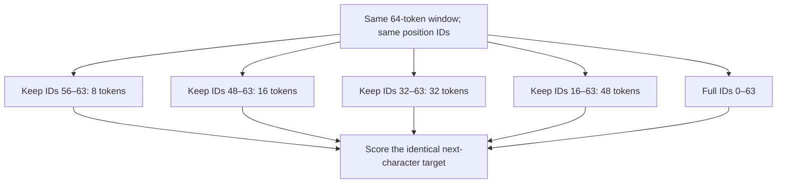

# How much history helps with fixed position IDs?

[Documentation index](README.md) · [Previous](25-fixed-position-history-ablation.md)

Reproduction driver: [`scripts/analyze_history_curve.py`](../scripts/analyze_history_curve.py). Evaluator: [`src/history_ablation.py`](../src/history_ablation.py). [Full results and provenance](results/history-length-curve.json).

## Protocol

Use the same frozen context-64 checkpoints from chapters 20 and 23: learned and sinusoidal positional encodings, seeds 42, 7, 123, and 2026, each trained for 10000 updates and 1280000 target characters. Evaluate all **135522 next-character targets** in the validation book. No new training, generation, or test-set evaluation occurs.

For each target, the input remains its preceding window of up to 64 tokens, with the native position IDs. Isolate the final k tokens for k in {8,16,32,48}, using the mask from chapter 25 in every head and block. Include the ordinary unmasked 64-token window as the reference. The final query keeps position ID 63 in every full-sized window.

| Retained history | Position IDs in a full-sized window |
| ---: | --- |
| 8 | 56–63 |
| 16 | 48–63 |
| 32 | 32–63 |
| 48 | 16–63 |
| 64 (full) | 0–63 |

Early targets have their naturally shorter windows. For a window length L, cutoff c=max(0,L−k); the allowed attention entries are:

$$
A_{ij}=[j\leq i]\land([i<c]\lor[j\geq c]).
$$

Prefix queries may read their own causal prefix, but suffix queries cannot read prefix keys in **any layer**. This prevents indirect access through earlier suffix representations. Feed-forward layers and LayerNorm are positionwise. Removing rows from the input and resetting positions would be a different experiment.



## Measured validation curve

Lower NLL and perplexity are better. Values are arithmetic means ± sample SD across four training seeds. Mean perplexity is the mean of individual seed perplexities, not the exponential of mean NLL. Excess NLL is NLL(k)−NLL(full); a positive value favors full history.

| Encoding | Kept tokens | NLL | PPL | Excess NLL over full |
| --- | ---: | ---: | ---: | ---: |
| learned | 8 | 2.036331 ± 0.129909 | 7.712786 ± 1.053838 | +0.073668 |
| learned | 16 | 2.045197 ± 0.152135 | 7.801023 ± 1.263880 | +0.082533 |
| learned | 32 | 2.027471 ± 0.124581 | 7.640762 ± 1.002200 | +0.064807 |
| learned | 48 | 1.987650 ± 0.051180 | 7.305583 ± 0.377806 | +0.024986 |
| learned | 64 (full) | 1.962664 ± 0.024123 | 7.119825 ± 0.172878 | +0.000000 |
| sinusoidal | 8 | 1.957953 ± 0.037714 | 7.088636 ± 0.271980 | +0.012873 |
| sinusoidal | 16 | 1.978845 ± 0.080062 | 7.252238 ± 0.602914 | +0.033764 |
| sinusoidal | 32 | 1.968768 ± 0.074455 | 7.177095 ± 0.552820 | +0.023687 |
| sinusoidal | 48 | 1.950912 ± 0.053387 | 7.042732 ± 0.384211 | +0.005831 |
| sinusoidal | 64 (full) | 1.945081 ± 0.042593 | 6.998999 ± 0.302178 | +0.000000 |

## Marginal contribution of additional history

Define gain(a→b)=NLL(a)−NLL(b). Positive gain means that allowing the additional history improves log loss. Each pair scores identical targets with the same trained weights and positional IDs; it permits extra content and changes attention normalization. Gains describe the complete inference intervention rather than an additive attribution to individual tokens.

| Encoding | More history | NLL gain ± sample SD | Seeds improved |
| --- | --- | ---: | ---: |
| learned | 8 → 16 | -0.008866 ± 0.023441 | 3/4 |
| learned | 16 → 32 | +0.017726 ± 0.027631 | 4/4 |
| learned | 32 → 48 | +0.039822 ± 0.076800 | 4/4 |
| learned | 48 → 64 | +0.024986 ± 0.049214 | 3/4 |
| sinusoidal | 8 → 16 | -0.020891 ± 0.042503 | 2/4 |
| sinusoidal | 16 → 32 | +0.010077 ± 0.007615 | 4/4 |
| sinusoidal | 32 → 48 | +0.017856 ± 0.022234 | 4/4 |
| sinusoidal | 48 → 64 | +0.005831 ± 0.012381 | 2/4 |

## Per-seed perplexity

| Encoding | Seed | 8 | 16 | 32 | 48 | 64 (full) |
| --- | ---: | ---: | ---: | ---: | ---: | ---: |
| learned | 42 | 6.962159 | 6.956627 | 6.949076 | 6.948089 | 6.948605 |
| learned | 7 | 9.253523 | 9.668370 | 9.117606 | 7.808570 | 7.073960 |
| learned | 123 | 7.520553 | 7.475250 | 7.398983 | 7.368536 | 7.360044 |
| learned | 2026 | 7.114908 | 7.103844 | 7.097384 | 7.097135 | 7.096692 |
| sinusoidal | 42 | 6.906753 | 6.891473 | 6.845288 | 6.801108 | 6.810386 |
| sinusoidal | 7 | 6.948251 | 6.946940 | 6.857601 | 6.782290 | 6.756926 |
| sinusoidal | 123 | 7.491846 | 8.153309 | 7.999013 | 7.602478 | 7.422927 |
| sinusoidal | 2026 | 7.007695 | 7.017231 | 7.006477 | 6.985052 | 7.005755 |

## Interpretation

**Both encodings benefit consistently from 16→32 and 32→48 retained characters: every one of the four seeds improves in both intervals.** The mean gains are respectively 0.017726 and 0.039822 NLL for learned positions, and 0.010077 and 0.017856 for sinusoidal positions. Thus useful information is not confined to the latest sixteen characters under this fixed-ID intervention.

The final 48→64 interval is less consistent: 3/4 learned seeds and 2/4 sinusoidal seeds improve. Its mean gain is +0.024986 learned and +0.005831 sinusoidal. The learned mean is dominated by seed 7 (+0.098801); its paired median is only +0.000608. For sinusoidal positions the paired median of this final gain is +0.001192, with two negative deltas. There is no uniform requirement to keep all 64 tokens, nor a universal saturation point proved by four seeds.

The 8→16 step worsens the mean for both encoding families, despite improving 3/4 learned and 2/4 sinusoidal seeds. Learned seed 7 and sinusoidal seed 123 have large non-monotonic changes. This does not mean the intervening tokens are intrinsically harmful: the mask alters attention normalization and the distribution of suffix representations across layers. The full 64-token condition still beats the 8-token condition in all eight checkpoints. Its mean NLL advantage is 0.073668 for learned positions and 0.012873 for sinusoidal positions; individual gains range from 0.001949 to 0.268584 and from 0.000277 to 0.027922, respectively.

The most repeatable conclusion is therefore the positive contribution of history beyond sixteen, especially through 48 retained characters. The magnitude and the final 16-character increment vary substantially by seed. These curves do not establish that sinusoidal positions use history better than learned positions; absolute validation quality and paired marginal history gains are different measurements.

These are frozen-model inference interventions, not retraining experiments. Isolated suffixes at late absolute positions differ from the training distribution. Positive marginal gains show a net predictive benefit under this mask; they do not prove linguistic comprehension or identify which old tokens are informative. Four seeds and one validation book provide descriptive variation, not a significance claim. Differences between positional-encoding families also include initialization and parameter-count differences. The native context-16-versus-context-64 comparison remains a separate question. The test book stays reserved.

## Reproduce and verify

From the repository root with the existing prepared corpus and checkpoints:

```bash
source .venv/bin/activate
python scripts/analyze_history_curve.py --output runs/history-length-curve/report.json
PYTHONPATH=src python -m unittest discover -s tests -v
```

Use a new output path for a repeat. The driver uses deterministic CPU operations, one thread and batches of 128. It verifies checkpoint and validation hashes, checks native NLL against the original training studies, and checks the 16-token condition against chapter 25 within 1e-10. The report records hashes of source files and archived inputs, runtime versions and the base commit. The new source is initially uncommitted; hashes identify its exact content.

All 33 tests pass. Tests compare every retained length, for both encodings, against an independent direct-suffix computation with original position IDs, including short initial histories and full-sized windows. The legacy two-condition evaluator remains compatible. Checkpoint files are not changed.
