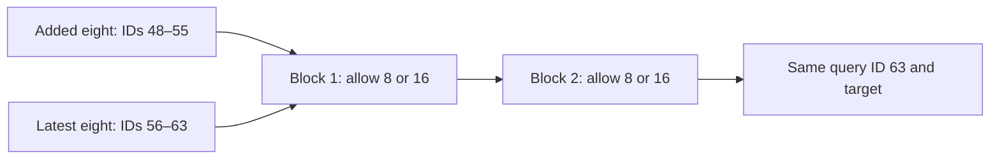

# Diagnosing non-monotonic 8-to-16 history curves

[Documentation index](README.md) · [Previous](26-fixed-position-history-curve.md)

Driver: [`scripts/analyze_nonmonotonic_history.py`](../scripts/analyze_nonmonotonic_history.py). Instrumentation: [`src/nonmonotonic_diagnostics.py`](../src/nonmonotonic_diagnostics.py). [Full report](results/nonmonotonic-history-diagnostics.json), including character decompositions, attention entropy and illustrative target contexts.

## Question and controlled setup

Why can a frozen context-64 checkpoint predict worse when its available suffix grows from eight to sixteen characters? Chapter 26 found this in learned seed 7 and sinusoidal seeds 123 and 2026. This follow-up uses the same eight checkpoints, original position IDs and **all 135522 validation targets**, without training or reading the test book.

The extra characters occupy IDs 48–55 in a full-sized window; the latest eight remain at 56–63. The target and its query ID 63 never change. All blocks share an outer isolation boundary at ID 48, even in mixed-layer conditions, so added-token representations cannot import IDs 0–47 indirectly. Within that boundary, each block permits either an eight- or sixteen-token suffix. Short initial windows retain the same natural position IDs and are included.

Four intervention conditions form a 2×2 design:

| Condition | First block | Second block |
| --- | --- | --- |
| 8_8 | Latest 8 | Latest 8 |
| 16_8 | Latest 16 | Latest 8 |
| 8_16 | Latest 8 | Latest 16 |
| 16_16 | Latest 16 | Latest 16 |

The diagonal conditions reproduce the earlier archived NLL within 1e-10. A second-block eight-token limit can still receive information from the added characters through first-block suffix representations in condition 16_8; that mediated path is intentional. The outer sixteen-token isolation prevents any older information from entering.



## Target-level effects

Let delta = NLL(16_16)−NLL(8_8). Positive means that adding the eight older characters hurts. The median and harmed fraction describe individual predictions rather than only the aggregate.

| Encoding | Seed | Mean delta | Targets harmed | Median delta |
| --- | --- | --- | --- | --- |
| learned | 42 | -0.000795 | 49.8% | -0.000176 |
| learned | 7 | +0.043855 | 56.2% | +0.019022 |
| learned | 123 | -0.006042 | 49.9% | -0.000135 |
| learned | 2026 | -0.001556 | 51.1% | +0.001272 |
| sinusoidal | 42 | -0.002215 | 51.0% | +0.001480 |
| sinusoidal | 7 | -0.000189 | 51.1% | +0.002296 |
| sinusoidal | 123 | +0.084609 | 58.0% | +0.032366 |
| sinusoidal | 2026 | +0.001360 | 49.8% | -0.000255 |

Separate positive and negative contributions, each summed over its corresponding targets and divided by the **total** target count; they add to the overall delta. The worst 1% column uses the 1356 most positive target deltas. The final column averages the remaining targets after that exploratory removal; this is a sensitivity analysis, not a replacement validation score.

| Encoding | Seed | Harm contribution | Benefit contribution | Worst 1% contribution | Remaining 99% mean delta |
| --- | --- | --- | --- | --- | --- |
| learned | 42 | +0.050248 | -0.051043 | +0.008207 | -0.009092 |
| learned | 7 | +0.108306 | -0.064451 | +0.010880 | +0.033308 |
| learned | 123 | +0.073547 | -0.079589 | +0.011839 | -0.018062 |
| learned | 2026 | +0.050394 | -0.051951 | +0.008445 | -0.010102 |
| sinusoidal | 42 | +0.048845 | -0.051060 | +0.007798 | -0.010114 |
| sinusoidal | 7 | +0.064148 | -0.064336 | +0.010118 | -0.010411 |
| sinusoidal | 123 | +0.184162 | -0.099554 | +0.023857 | +0.061366 |
| sinusoidal | 2026 | +0.057642 | -0.056282 | +0.008847 | -0.007563 |

## Which block carries the change?

The first four values below are measured NLL. To summarize a nonlinear two-block intervention symmetrically, define:

$$
D_1=\tfrac12[(N_{16,8}-N_{8,8})+(N_{16,16}-N_{8,16})],
$$
$$
D_2=\tfrac12[(N_{8,16}-N_{8,8})+(N_{16,16}-N_{16,8})].
$$

These paired intervention allocations sum exactly to the total delta; they average two orderings of changing the masks. They are not intrinsic parameter or token attributions. Interaction is I=N(16,16)−N(16,8)−N(8,16)+N(8,8); a large magnitude means that the effect of changing one block depends on the other block's mask.

| Encoding | Seed | N(8,8) | N(16,8) | N(8,16) | N(16,16) | D1 | D2 | Interaction |
| --- | --- | --- | --- | --- | --- | --- | --- | --- |
| learned | 42 | 1.940490 | 1.940668 | 1.938823 | 1.939695 | +0.000525 | -0.001320 | +0.000694 |
| learned | 7 | 2.225004 | 2.252403 | 2.238179 | 2.268860 | +0.029040 | +0.014816 | +0.003282 |
| learned | 123 | 2.017640 | 2.010842 | 2.017712 | 2.011598 | -0.006456 | +0.000414 | +0.000683 |
| learned | 2026 | 1.962192 | 1.960338 | 1.962616 | 1.960636 | -0.001917 | +0.000361 | -0.000126 |
| sinusoidal | 42 | 1.932500 | 1.932975 | 1.930403 | 1.930285 | +0.000179 | -0.002394 | -0.000593 |
| sinusoidal | 7 | 1.938490 | 1.946194 | 1.932681 | 1.938301 | +0.006662 | -0.006851 | -0.002084 |
| sinusoidal | 123 | 2.013815 | 2.039507 | 2.088257 | 2.098424 | +0.017929 | +0.066679 | -0.015524 |
| sinusoidal | 2026 | 1.947009 | 1.953354 | 1.942916 | 1.948369 | +0.005899 | -0.004539 | -0.000893 |

## Attention redistribution

Allowing additional keys changes the softmax denominator. If a head's query and the latest-eight key/value vectors are fixed, then:

$$
\alpha_j^{16}=(1-m)\alpha_j^8,\quad j\in\text{latest eight},
$$
$$
o^{16}=(1-m)o^8+m\bar v_{added},
$$

where m is the attention probability mass assigned to the added eight and the conditional mean value is defined when m>0. More available information therefore does not mathematically guarantee lower prediction loss: it changes a learned mixture. In the first block the final-query input and retained key/value vectors are fixed across masks. In the second block the same fixed-input comparison holds between 8_8 and 8_16; changing the first block can also change second-block queries, keys and values.

The table reports mean final-query attention mass on the added eight in condition 16_16, separately for all three heads of each block. Entropies and all four conditions are in the JSON. Attention probability alone is **not** a measure of predictive importance or a proof of distraction.

| Encoding | Seed | Block 1 head masses | Block 2 head masses |
| --- | --- | --- | --- |
| learned | 42 | 0.104 / 0.170 / 0.003 | 0.142 / 0.118 / 0.112 |
| learned | 7 | 0.496 / 0.016 / 0.050 | 0.228 / 0.155 / 0.177 |
| learned | 123 | 0.154 / 0.296 / 0.142 | 0.033 / 0.153 / 0.044 |
| learned | 2026 | 0.106 / 0.115 / 0.030 | 0.130 / 0.081 / 0.088 |
| sinusoidal | 42 | 0.003 / 0.007 / 0.009 | 0.506 / 0.437 / 0.399 |
| sinusoidal | 7 | 0.045 / 0.024 / 0.036 | 0.328 / 0.454 / 0.377 |
| sinusoidal | 123 | 0.048 / 0.051 / 0.224 | 0.646 / 0.619 / 0.547 |
| sinusoidal | 2026 | 0.054 / 0.047 / 0.037 | 0.461 / 0.445 / 0.421 |

## Added-content order control

On the fixed stride-64 subset of 2117 targets spanning the validation book, reverse only the added eight tokens (IDs 48–55). Keep their multiset, the latest eight, target and IDs unchanged, with masks 16_16. This tests sensitivity to the arrangement of the added content; it is not a null input, a distribution-matched corruption, or an isolated test of normalization. A positive value means reversal worsens loss.

| Encoding | Seed | Targets | Original NLL | Reversed NLL | Reversed minus original |
| --- | --- | --- | --- | --- | --- |
| learned | 42 | 2117 | 1.968151 | 1.970384 | +0.002233 |
| learned | 7 | 2117 | 2.291178 | 2.295509 | +0.004331 |
| learned | 123 | 2117 | 1.989495 | 1.987475 | -0.002020 |
| learned | 2026 | 2117 | 1.962705 | 1.972159 | +0.009454 |
| sinusoidal | 42 | 2117 | 1.919310 | 1.918656 | -0.000654 |
| sinusoidal | 7 | 2117 | 1.966051 | 1.966429 | +0.000378 |
| sinusoidal | 123 | 2117 | 2.102528 | 2.112133 | +0.009605 |
| sinusoidal | 2026 | 2117 | 1.957624 | 1.957873 | +0.000249 |

## Diagnosis

The non-monotonic mean is driven by **different seed-specific pathways**, rather than a uniform failure of one positional encoding.

- **Learned seed 7:** delta is +0.043855 NLL; 56.2% of targets worsen and the median delta is +0.019022. The symmetric block allocation is +0.029040 from block 1 and +0.014816 from block 2 (about 66% and 34%). Both single-block expansions already worsen loss relative to 8_8. In block 1, head 1 assigns about 0.496 probability to the added eight; its entropy is 2.771 nats, close to log(16)=2.773, indicating nearly uniform final-query attention across the sixteen allowed keys on average. Expanding the mask substantially changes this learned mixture. This observation does not by itself prove that this head causes the loss increase.
- **Sinusoidal seed 123:** delta is +0.084609; 58.0% of targets worsen and the median is +0.032366. Here block 2 dominates the symmetric allocation (+0.066679, about 79%), versus +0.017929 from block 1. Its three second-block heads place about 0.646, 0.619 and 0.547 mass on the added eight under 16_16. The negative interaction (−0.015524) means that adding the two single-block effects would overestimate the combined penalty. This is a different localization from learned seed 7.
- **Sinusoidal seed 2026:** the small +0.001360 aggregate penalty is a balance of +0.005899 from block 1 and −0.004539 from block 2. Only 49.8% of targets worsen, its median is slightly negative, and removing the most harmed 1% changes the remaining mean to −0.007563. This weak mean reversal is sensitive to the upper tail, unlike the two large failures.

For learned seed 7 and sinusoidal seed 123, the remaining 99% of targets still have positive mean penalties (+0.033308 and +0.061366). Their reversals are therefore not explained only by a tiny set of catastrophic predictions. Grouping by target character also shows heterogeneous effects: the largest positive contributions include `e` (+0.014343 to total NLL) and `h` (+0.009672) for learned seed 7, and space (+0.024791) and `t` (+0.011917) for sinusoidal seed 123. These are descriptive target-frequency decompositions, not explanations of linguistic relationships.

Other seeds exhibit compensation or improvement. For example, sinusoidal seed 7 has a +0.006662 block-1 allocation canceled by −0.006851 from block 2. Attention mass alone cannot classify beneficial versus harmful use: sinusoidal seed 42 also puts substantial second-block mass on the added characters, yet its total loss improves.

Reversing the added eight makes the two large-failure checkpoints slightly worse on the same 2117 control targets (+0.004331 learned seed 7 and +0.009605 sinusoidal seed 123). Thus the original content arrangement is not wholly ignored even in these failures. Reversal effects vary in sign across the other seeds. This control does not establish how much of the original 8→16 change is caused by content, position sensitivity or softmax normalization; those mechanisms remain coupled in the model.

**Supported diagnosis:** the loss increases arise from checkpoint-specific changes in attention mixtures and the representations passed between blocks. The fixed-ID, fixed-target protocol and exact archived endpoint agreement rule out a position reset or changed evaluation targets as explanations. Mixed-layer interventions locate the dominant changes differently in the learned and sinusoidal outliers, while per-target analysis distinguishes broad degradation from a tail-sensitive near-tie. Softmax has no monotonic-improvement guarantee when keys are added. These findings do not identify why training produced these behaviors, or prove that positional encoding alone caused them; that would require additional controlled training or more selective activation interventions.

## Reproduction and verification

```bash
source .venv/bin/activate
python scripts/analyze_nonmonotonic_history.py --output runs/nonmonotonic-history/report.json
PYTHONPATH=src python -m unittest discover -s tests -v
```

Use a fresh output path for repeats. Evaluation uses deterministic CPU operations, one thread, batches of 128 and frozen weights. The driver verifies checkpoint/validation hashes and agreement with both archived diagonal conditions. The report records base commit, source hashes identifying the uncommitted instrumentation, archive hash, runtime versions, target counts, and the subset target-index hash. Temporary observation hooks are removed after each block. Production model code is unchanged.

All 35 tests pass, including exact diagonal agreement, full isolation from the older prefix in all four mixed-mask conditions, attention bounds and zero added-key mass when masked, independent verification of the reversal, short-window behavior, hook cleanup and unchanged model state.

These measurements locate effects under specific inference interventions, not a unique learned causal mechanism. Isolation at late positional IDs differs from training; attention and loss correlations do not establish why a particular head learned its behavior. Four seeds and one validation book limit generalization. Numeric seeds across encoding families do not imply identical initial parameters. The reserved test book is not inspected.
