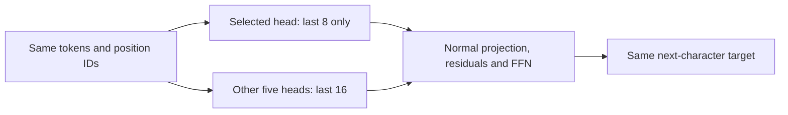

# Which attention heads contribute to the 8-to-16 penalty?

[Documentation index](README.md) · [Previous](27-nonmonotonic-history-diagnostics.md)

Driver: [`scripts/analyze_head_history.py`](../scripts/analyze_head_history.py). Intervention: [`src/head_diagnostics.py`](../src/head_diagnostics.py). [Full measured results](results/head-history-diagnostics.json).

## Intervention and reference

Freeze the two context-64 checkpoints selected by the earlier diagnosis: **learned seed 7** and **sinusoidal seed 123**, each trained for 10000 steps. Evaluate all **135522 next-character validation targets**. No training or test evaluation occurs. The baseline confines every head in both blocks to the last sixteen tokens, retaining the original position IDs.

For each of six heads, isolate the latest eight tokens for that head only, in every query. All other heads retain the sixteen-token mask. In a full window the added eight occupy IDs 48–55, and the latest eight retain IDs 56–63. Intersect the selected head's eight-token permission mask with the common sixteen-token outer boundary. This prevents an unselected head from importing older history indirectly through the selected head's prefix representations. Prefix queries remain valid. Natural shorter windows at the beginning of the book are included.

The intervention removes **access to the added tokens**, not the whole head or its output. It changes the head's softmax normalization and, in block 1, downstream representations. It therefore measures a conditional net contribution under this mask, rather than a context-independent importance score.

Names below use **one-based block and head numbers**. Reported improvement is:

$$
G_h=\mathrm{NLL}_{baseline16}-\mathrm{NLL}_{masked,h}.
$$

Positive G means blocking added history in that head improves prediction, so that access contributes to the penalty conditional on all other heads retaining access. Negative G means masking hurts, so that head's added-history access has a net benefit in this setting.



## Individual heads, ranked by benefit from masking

Lower NLL and PPL are better. These are individual checkpoint measurements, not averages over seeds. The fraction improved is the proportion of targets with lower NLL than baseline16; it need not track the mean because magnitudes differ.

| Checkpoint | Head masked | NLL | PPL | Improvement G | Targets improved |
| --- | --- | ---: | ---: | ---: | ---: |
| learned 7 | block1_head1 | 2.241213 | 9.404729 | +0.027647 | 54.5% |
| learned 7 | block2_head1 | 2.259034 | 9.573840 | +0.009825 | 55.4% |
| learned 7 | block2_head2 | 2.264380 | 9.625156 | +0.004480 | 52.7% |
| learned 7 | block2_head3 | 2.266393 | 9.644547 | +0.002467 | 52.6% |
| learned 7 | block1_head2 | 2.268870 | 9.668473 | -0.000011 | 51.4% |
| learned 7 | block1_head3 | 2.270828 | 9.687422 | -0.001969 | 50.5% |
| sinusoidal 123 | block2_head1 | 2.077448 | 7.984065 | +0.020976 | 54.1% |
| sinusoidal 123 | block2_head3 | 2.077878 | 7.987503 | +0.020546 | 53.5% |
| sinusoidal 123 | block2_head2 | 2.078194 | 7.990028 | +0.020230 | 53.4% |
| sinusoidal 123 | block1_head3 | 2.091871 | 8.100057 | +0.006553 | 54.1% |
| sinusoidal 123 | block1_head1 | 2.094138 | 8.118441 | +0.004286 | 52.4% |
| sinusoidal 123 | block1_head2 | 2.098997 | 8.157981 | -0.000573 | 49.6% |

## Controls and joint effects

`block1_all` and `block2_all` mask the added eight in all three heads of that block. `all8` masks them in all six heads. These controls reproduce chapter 27's mixed-layer and diagonal results within 1e-10.

| Checkpoint | Condition | NLL | PPL | Improvement vs baseline16 |
| --- | --- | ---: | ---: | ---: |
| learned 7 | baseline16 | 2.268860 | 9.668370 | -0.000000 |
| learned 7 | block1_all | 2.238179 | 9.376244 | +0.030681 |
| learned 7 | block2_all | 2.252403 | 9.510562 | +0.016457 |
| learned 7 | all8 | 2.225004 | 9.253523 | +0.043855 |
| sinusoidal 123 | baseline16 | 2.098424 | 8.153309 | -0.000000 |
| sinusoidal 123 | block1_all | 2.088257 | 8.070834 | +0.010167 |
| sinusoidal 123 | block2_all | 2.039507 | 7.686816 | +0.058917 |
| sinusoidal 123 | all8 | 2.013815 | 7.491846 | +0.084609 |

Sum of the three individual improvements compared with the actual joint intervention:

| Checkpoint | Block | Sum of individual gains | Joint block gain |
| --- | --- | ---: | ---: |
| learned 7 | block1 | +0.025668 | +0.030681 |
| learned 7 | block2 | +0.016772 | +0.016457 |
| sinusoidal 123 | block1 | +0.010266 | +0.010167 |
| sinusoidal 123 | block2 | +0.061751 | +0.058917 |

## Diagnosis

**Learned seed 7 has one prominent individual contributor: block 1, head 1.** Restricting its access to the latest eight reduces NLL by **0.027647** and PPL from **9.668370 to 9.404729**, improving 54.5% of targets. This closes about 63% of the original 8→16 NLL gap relative to the all-eight condition, but does not eliminate it. The earlier observation of this head's nearly uniform sixteen-key attention is now complemented by a direct intervention showing that its added-history access has a detrimental net effect under the baseline mask.

All three block-2 heads in the learned checkpoint also contribute to the penalty, with individual improvements of +0.009825, +0.004480 and +0.002467 when masked. Block-1 head 3 instead has a beneficial net contribution from added history (masking worsens NLL by 0.001969); head 2's effect is near zero (a 0.000011 worsening when masked). This is not a uniformly harmful first block.

**Sinusoidal seed 123 distributes the largest individual effects across all three block-2 heads.** Their improvements from masking are **+0.020976, +0.020230 and +0.020546 NLL**. No single head dominates this block. Jointly restricting its three heads reduces PPL from **8.153309 to 7.686816**, a **0.058917 NLL** improvement. Block-1 heads 1 and 3 make smaller detrimental contributions (+0.004286 and +0.006553 improvement when masked), while head 2's added-history access has a small beneficial effect (masking worsens NLL by 0.000573).

No single-head intervention recovers the all-eight reference in either checkpoint. Effects also interact: the learned block-1 sum of individual gains is 0.025668, whereas the joint gain is 0.030681. For sinusoidal block 2, the individual sum is 0.061751, versus a joint gain of 0.058917. Consequently these conditional scores should not be added as independent shares of the original penalty, and the head ranking can change under a different mask on the other heads.

The results support the earlier block-level distinction with finer localization: **one standout head in learned block 1, versus three similarly contributing heads in sinusoidal block 2**. They do not establish a general rule about learned versus sinusoidal positions, or show that these heads are detrimental with full native 64-token history.

The checkpoints were selected for their reversals in earlier validation experiments. Rankings here are exploratory diagnostics on that same validation book, not an independently tested architecture change or evidence for permanent pruning. Access to older tokens in a first-block head can affect the later keys, queries and values of many heads; effects are conditional and can interact. Neither attention probability alone nor this intervention establishes why training produced the behavior. Findings for two selected seeds do not generalize to either encoding family as a whole.

## Reproduce and verify

```bash
source .venv/bin/activate
python scripts/analyze_head_history.py --output runs/head-history/report.json
PYTHONPATH=src python -m unittest discover -s tests -v
```

Choose a fresh output path for repeats. The driver checks checkpoint and validation hashes, verifies four controls against archived full-validation results, and records source hashes, the base commit, archive hash, runtime versions, deterministic CPU settings, one thread, batch size 128 and token counts. Source hashes identify the initially uncommitted analysis. No checkpoint is rewritten, production model code is unchanged and the test book remains reserved.

All 37 tests pass. New tests compare each single-head condition with an independent native-GPT forward hook, check mixed-block and diagonal controls exactly, verify isolation from the older prefix for every selected head, validate short-window behavior, and check unchanged model state and hook cleanup.
