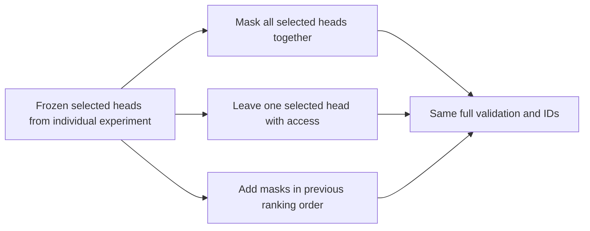

# Joint masks and interactions among selected attention heads

[Documentation index](README.md) · [Previous](28-head-history-diagnostics.md) · [Next](30-exhaustive-head-mask-diagnostics.md)

Driver: [`scripts/analyze_joint_head_history.py`](../scripts/analyze_joint_head_history.py). Reused intervention: [`src/head_diagnostics.py`](../src/head_diagnostics.py). [Full measured results](results/joint-head-history-diagnostics.json).

## Frozen selection and protocol

Keep the two context-64 checkpoints from chapter 28, learned seed 7 and sinusoidal seed 123, with the same weights, corpus and native position IDs. Score all **135522 validation next-character targets**. Every head remains inside the final sixteen-token boundary; selected heads additionally isolate the latest eight at **all queries**. Thus the removed access is to IDs 48–55 in full-sized windows; the retained eight keep IDs 56–63, and the final query retains ID 63. Natural shorter windows at the book's beginning are included. No training or test evaluation occurs.

Select heads exclusively by the **previously archived positive individual NLL improvement when masked**. Selection is frozen before this experiment; the new joint scores do not alter membership:

| Checkpoint | Selected heads (one-based block/head numbers) |
| --- | --- |
| Learned seed 7 | B1H1, B2H1, B2H2, B2H3 |
| Sinusoidal seed 123 | B1H1, B1H3, B2H1, B2H2, B2H3 |

The remaining heads retain their sixteen-token access. The intervention restricts token access; it does not remove heads or zero their outputs. All selected-head masks remain inside the common outer boundary, preventing indirect leakage from older tokens across blocks.

Measure the full joint mask, all-eight control, selected heads in each block separately, all leave-one-selected-head-out masks, and a cumulative path using the **previous individual ranking**. Identical mask sets are evaluated once and recorded under aliases. Baseline/all-eight and any matching individual or whole-block masks are checked against the chapter-28 archive within 1e-10. Individual rows below are the archived measurements, explicitly marked; new scores use the same validation targets and verified checkpoints.



## Validation comparison

Gain G(S)=NLL(baseline16)−NLL(mask set S). Positive gain means the mask improves prediction. `joint_selected` blocks all previously detrimental heads, `all8` blocks all six, and `selected_block1/2` block only the selected heads in that block. NLL is in nats per target; lower NLL and PPL are better.

| Encoding | Seed | Mask | NLL | PPL | Gain | Targets improved |
| --- | --- | --- | --- | --- | --- | --- |
| learned | 7 | baseline16 | 2.268860 | 9.668370 | -0.000000 | 0.0% |
| learned | 7 | joint_selected | 2.228418 | 9.285167 | +0.040442 | 55.4% |
| learned | 7 | all8 | 2.225004 | 9.253523 | +0.043855 | 56.2% |
| learned | 7 | selected_block1 | 2.241213 | 9.404729 | +0.027647 | 54.5% |
| learned | 7 | selected_block2 | 2.252403 | 9.510562 | +0.016457 | 55.6% |
| learned | 7 | block1_head1 (individual) | 2.241213 | 9.404729 | +0.027647 | 54.5% |
| learned | 7 | block2_head1 (individual) | 2.259034 | 9.573840 | +0.009825 | 55.4% |
| learned | 7 | block2_head2 (individual) | 2.264380 | 9.625156 | +0.004480 | 52.7% |
| learned | 7 | block2_head3 (individual) | 2.266393 | 9.644547 | +0.002467 | 52.6% |
| learned | 7 | block1_head2 (individual) | 2.268870 | 9.668473 | -0.000011 | 51.4% |
| learned | 7 | block1_head3 (individual) | 2.270828 | 9.687422 | -0.001969 | 50.5% |
| sinusoidal | 123 | baseline16 | 2.098424 | 8.153309 | -0.000000 | 0.0% |
| sinusoidal | 123 | joint_selected | 2.016729 | 7.513707 | +0.081695 | 58.0% |
| sinusoidal | 123 | all8 | 2.013815 | 7.491846 | +0.084609 | 58.0% |
| sinusoidal | 123 | selected_block1 | 2.088352 | 8.071599 | +0.010072 | 54.0% |
| sinusoidal | 123 | selected_block2 | 2.039507 | 7.686816 | +0.058917 | 56.4% |
| sinusoidal | 123 | block2_head1 (individual) | 2.077448 | 7.984065 | +0.020976 | 54.1% |
| sinusoidal | 123 | block2_head3 (individual) | 2.077878 | 7.987503 | +0.020546 | 53.5% |
| sinusoidal | 123 | block2_head2 (individual) | 2.078194 | 7.990028 | +0.020230 | 53.4% |
| sinusoidal | 123 | block1_head3 (individual) | 2.091871 | 8.100057 | +0.006553 | 54.1% |
| sinusoidal | 123 | block1_head1 (individual) | 2.094138 | 8.118441 | +0.004286 | 52.4% |
| sinusoidal | 123 | block1_head2 (individual) | 2.098997 | 8.157981 | -0.000573 | 49.6% |

## Interaction relative to individual gains

Define the joint interaction residual:

$$
R=G(S)-\sum_{h\in S}G(\{h\}).
$$

Positive R means the joint gain is larger than the sum predicted from baseline individual measurements; negative R means it is smaller. This residual aggregates all interaction orders; it does not identify individual pairs or imply independent head importance. Cross-block residual replaces the individual sum by the two measured selected-block gains. The final column is NLL(joint)−NLL(all8): positive favors masking all six, negative favors the selected mask.

| Encoding | Seed | Sum individual gains | Joint gain | Joint minus individual sum | Cross-block residual | Joint minus all8 NLL |
| --- | --- | --- | --- | --- | --- | --- |
| learned | 7 | +0.044419 | +0.040442 | -0.003978 | -0.003662 | +0.003414 |
| sinusoidal | 123 | +0.072590 | +0.081695 | +0.009105 | +0.012706 | +0.002914 |

## Conditional head effects

Leave one selected head unmasked while masking all the other selected heads. The resulting conditional gain for masking h is:

$$
C_h=\mathrm{NLL}(S\setminus\{h\})-\mathrm{NLL}(S).
$$

Positive C means its mask still helps after the other masks are present. Negative C means it now hurts: the sign of its intervention effect has changed with context. Individual gains and conditional gains answer different questions.

| Encoding | Seed | Head | Individual gain | Gain given other selected masks |
| --- | --- | --- | --- | --- |
| learned | 7 | block1_head1 | +0.027647 | +0.023985 |
| learned | 7 | block2_head1 | +0.009825 | +0.009232 |
| learned | 7 | block2_head2 | +0.004480 | +0.001351 |
| learned | 7 | block2_head3 | +0.002467 | +0.001916 |
| sinusoidal | 123 | block2_head1 | +0.020976 | +0.026798 |
| sinusoidal | 123 | block2_head3 | +0.020546 | +0.021144 |
| sinusoidal | 123 | block2_head2 | +0.020230 | +0.019516 |
| sinusoidal | 123 | block1_head3 | +0.006553 | +0.013578 |
| sinusoidal | 123 | block1_head1 | +0.004286 | +0.001906 |

## Cumulative path in the prior ranking

Add masks in descending order of **archived individual gain**, without optimizing the order on new scores. Each incremental gain compares adjacent masks in this one path. These are order-dependent conditional measurements, not Shapley values or a search over all possible head subsets.

| Encoding | Seed | Step | Head added | NLL after mask | Incremental gain |
| --- | --- | --- | --- | --- | --- |
| learned | 7 | 1 | block1_head1 | 2.241213 | +0.027647 |
| learned | 7 | 2 | block2_head1 | 2.231587 | +0.009626 |
| learned | 7 | 3 | block2_head2 | 2.230334 | +0.001252 |
| learned | 7 | 4 | block2_head3 | 2.228418 | +0.001916 |
| sinusoidal | 123 | 1 | block2_head1 | 2.077448 | +0.020976 |
| sinusoidal | 123 | 2 | block2_head3 | 2.056179 | +0.021269 |
| sinusoidal | 123 | 3 | block2_head2 | 2.039507 | +0.016672 |
| sinusoidal | 123 | 4 | block1_head3 | 2.018635 | +0.020872 |
| sinusoidal | 123 | 5 | block1_head1 | 2.016729 | +0.001906 |

## Interpretation

**The selected joint mask improves both checkpoints substantially, but its interaction differs by checkpoint.**

- **Learned seed 7:** NLL falls from **2.268860 to 2.228418**, PPL from **9.668370 to 9.285167**. The joint gain is **0.040442**, smaller than the individual sum **0.044419** by **0.003978**. The cross-block residual is also negative (−0.003662): combining the selected block masks yields less gain than adding their baseline effects. The joint mask closes about 92.2% of the original baseline16-versus-all8 NLL gap.
- **Sinusoidal seed 123:** NLL falls from **2.098424 to 2.016729**, PPL from **8.153309 to 7.513707**. Here the joint gain **0.081695** exceeds the individual sum **0.072590** by **0.009105**. The positive cross-block residual (+0.012706) locates a substantial net interaction across blocks. The joint mask closes about 96.6% of the baseline16-versus-all8 gap.

**Every selected mask still has positive conditional gain when all the other selected masks are present.** There is no sign reversal among the selected heads in the measured leave-one-out comparisons. Their strengths change: learned B2H2 drops from an individual gain of 0.004480 to 0.001351 conditional on the other masks, while sinusoidal B1H3 grows from 0.006553 to 0.013578. All steps along the frozen ranked cumulative path improve NLL; this establishes monotonic improvement only for that measured order, not for every possible subset or order.

**Blocking all six heads still scores slightly better than the selected mask.** For learned seed 7, the additional joint restriction of the two excluded block-1 heads improves NLL by **0.003414** (PPL 9.285167→9.253523), although their individual baseline masks had small negative gains. This establishes a context-dependent change for their group; the experiment does not isolate which excluded head changes sign. For sinusoidal seed 123, only B1H2 is excluded, so the comparison directly demonstrates its sign reversal: masking it alone had gain **−0.000573**, but masking it after the other five yields **+0.002914** (PPL 7.513707→7.491846).

Thus the prior individual ranking identifies useful interventions but does not define an intrinsically harmful subset or guarantee that preserving the individually beneficial heads is best. Joint changes propagate through attention normalization, projections, residual streams, FFNs and later-block representations. The measured positive or negative interaction residual is a net predictive effect of this complete computation, not proof of a particular internal mechanism. The all-eight reference here is the fixed-ID suffix intervention, not native full-context evaluation.

These are selected-checkpoint diagnostics on the same validation book used to select the heads. The most favorable observed mask is not an independently validated model improvement or a recommended permanent architecture change. This experiment does not enumerate every head subset or isolate the learning dynamics that produced these interactions. It also does not establish effects under the native full 64-token history, other seeds or another corpus. The test book remains reserved.

## Reproduction and verification

```bash
source .venv/bin/activate
python scripts/analyze_joint_head_history.py --output runs/joint-head-history/report.json
PYTHONPATH=src python -m unittest discover -s tests -v
```

Choose a fresh output path for a repeat. The driver checks checkpoint/validation hashes and archived controls, uses deterministic CPU operations, one thread and batch size 128, and records source hashes, archive hash, base commit, runtime versions, condition membership, aliases and token counts. Source hashes identify the initially uncommitted script. Production model and intervention implementations are unchanged; checkpoint files are not rewritten.

All 38 tests pass. The added test independently compares the selected joint masks and every leave-one-out variant with native GPT forwards using per-head mask hooks, for both positional encodings. It also checks isolation from the older prefix and hook cleanup. Existing tests verify unchanged model state, individual and block controls, and short-history behavior.
