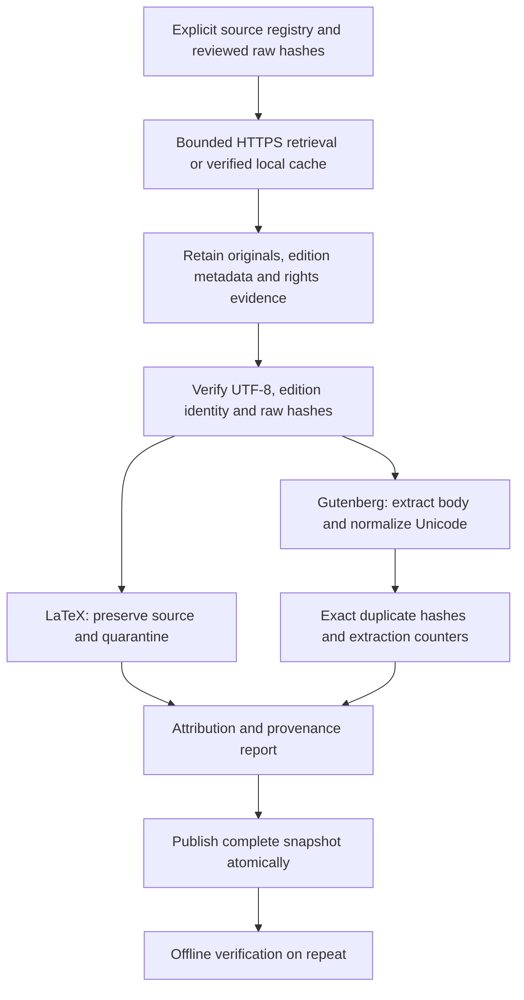

# Licensed-source registry and development ingestion pilot

[Documentation index](README.md) · [Previous](32-next-stage-plan.md) · [Next](34-editorial-cleaning-and-near-duplicates.md)

Registry: [`configs/corpus_v2_sources.json`](../configs/corpus_v2_sources.json). Driver: [`scripts/ingest_corpus_pilot.py`](../scripts/ingest_corpus_pilot.py). Implementation: [`src/corpus_pilot.py`](../src/corpus_pilot.py). [Measured report](results/corpus-v2-ingestion-pilot.json) and [inspection notes](results/corpus-v2-pilot-review.json). Tests: [`tests/test_corpus_pilot.py`](../tests/test_corpus_pilot.py).

## What was actually ingested

The pilot contains **14 documents from two source families**, covering fiction, narrative/explanatory nonfiction, historical science and formal methods. Twelve Gutenberg books have Unicode-preserving text extractions totaling **6394563 characters**; two Open Logic LaTeX sections are retained as raw source and **quarantined from prose preparation**. There are thirteen provisional split groups because the two Open Logic sections share a single source-lineage family. This is an ingestion/rights/extraction pilot, not a prepared training benchmark.

All items are **development-exposed**. No model was loaded, no training occurred, no new test was created or read, and the legacy test file was not accessed by this pilot. Do not later assign these inspected items or their related groups to a supposedly untouched test. A new test still requires fresh document families and a frozen split manifest.

| ID | Source edition / section | Author(s) | Domain / topic | Rights basis | Extracted characters | Status |
| --- | --- | --- | --- | --- | ---: | --- |
| pg35 | [The Time Machine](https://www.gutenberg.org/ebooks/35) | Wells, H. G. (Herbert George), 1866-1946 | fiction / science-fiction | LicenseRef-PG-PD-US | 179579 | extracted |
| pg1661 | [The Adventures of Sherlock Holmes](https://www.gutenberg.org/ebooks/1661) | Doyle, Arthur Conan, 1859-1930 | fiction / detective-fiction | LicenseRef-PG-PD-US | 561758 | extracted |
| pg74 | [The Adventures of Tom Sawyer, Complete](https://www.gutenberg.org/ebooks/74) | Twain, Mark, 1835-1910 | fiction / coming-of-age | LicenseRef-PG-PD-US | 392360 | extracted |
| pg120 | [Treasure Island](https://www.gutenberg.org/ebooks/120) | Stevenson, Robert Louis, 1850-1894 | fiction / adventure | LicenseRef-PG-PD-US | 362944 | extracted |
| pg2701 | [Moby Dick; Or, The Whale](https://www.gutenberg.org/ebooks/2701) | Melville, Herman, 1819-1891 | fiction / literary-fiction | LicenseRef-PG-PD-US | 1217780 | extracted |
| pg205 | [Walden, and On The Duty Of Civil Disobedience](https://www.gutenberg.org/ebooks/205) | Thoreau, Henry David, 1817-1862 | nonfiction / nature-essays | LicenseRef-PG-PD-US | 632651 | extracted |
| pg20203 | [Autobiography of Benjamin Franklin](https://www.gutenberg.org/ebooks/20203) | Franklin, Benjamin, 1706-1790 | nonfiction / autobiography | LicenseRef-PG-PD-US | 432867 | extracted |
| pg1232 | [The Prince](https://www.gutenberg.org/ebooks/1232) | Machiavelli, Niccolò, 1469-1527 | nonfiction / political-history | LicenseRef-PG-PD-US | 282276 | extracted |
| pg16643 | [Essays by Ralph Waldo Emerson](https://www.gutenberg.org/ebooks/16643) | Emerson, Ralph Waldo, 1803-1882 | nonfiction / philosophical-essays | LicenseRef-PG-PD-US | 535734 | extracted |
| pg833 | [The Theory of the Leisure Class](https://www.gutenberg.org/ebooks/833) | Veblen, Thorstein, 1857-1929 | nonfiction / economic-social-theory | LicenseRef-PG-PD-US | 642451 | extracted |
| pg14474 | [The Chemical History of a Candle](https://www.gutenberg.org/ebooks/14474) | Faraday, Michael, 1791-1867 | science-history / chemistry | LicenseRef-PG-PD-US | 221701 | extracted |
| pg1228 | [On the Origin of Species By Means of Natural Selection Or, the Preservation of Favoured Races in the Struggle for Life](https://www.gutenberg.org/ebooks/1228) | Darwin, Charles, 1809-1882 | science-history / natural-history | LicenseRef-PG-PD-US | 932462 | extracted |
| olp-set-basics | [Sets: basics](https://github.com/OpenLogicProject/OpenLogic/blob/1e960beff9ed7835bf3e3f1335e21af3439cd107/content/sets-functions-relations/sets/basics.tex) | Open Logic Project contributors | formal-methods / set-theory | CC-BY-4.0 | — | LaTeX quarantine |
| olp-recursion-intro | [Recursive functions: introduction](https://github.com/OpenLogicProject/OpenLogic/blob/1e960beff9ed7835bf3e3f1335e21af3439cd107/content/computability/recursive-functions/introduction.tex) | Open Logic Project contributors | formal-methods / computability | CC-BY-4.0 | — | LaTeX quarantine |

The two Open Logic sources are pinned to Git commit `1e960beff9ed7835bf3e3f1335e21af3439cd107`; both sections remain one related-document group. Raw text, source/license pages, metadata HTML, pinned repository grant/license files and full notices are stored locally under `data/raw/corpus-v2-pilot/`. Corpus files remain Git-ignored; tracked files contain the registry, checksums and provenance reports rather than copies of the books.

## License verification and its scope

For **each Gutenberg edition**, the pipeline verified the publisher's item-page fields against the reviewed registry: title, author, English language, contributors and the exact copyright statement **“Public domain in the USA.”** Metadata HTML is retained with a hash. Complete downloaded originals retain their Gutenberg notices; shared [license](https://www.gutenberg.org/policy/license) evidence is also retained. The registry includes edition release/update metadata, translators/editors/illustrators where listed, source URLs and source-byte hashes.

This verifies that edition's stated rights basis; it is **not** a worldwide copyright determination, an assertion about all editions of the work, or blanket approval to redistribute a branded Gutenberg edition. The intended jurisdiction and distribution conditions still matter. Raw notices are never replaced with a generic CC label. Underlying text and Gutenberg trademark/license material are distinguished in the registry.

For **Open Logic**, the pinned repository README applies CC BY 4.0 to the Open Logic Text; the pinned license text and [project license page](https://openlogicproject.org/olp-license/) are retained. Individual source paths, commit, contributors/project attribution and file-history links are recorded. The pilot does not compile source, fetch figures or strip mathematical expressions into misleading prose. Licensing evidence and format suitability are separate decisions: a licensed file can still require a renderer before use as training text.

The first discovery pass also caught an incorrectly proposed edition ID: Gutenberg 219 is Heart of Darkness, not the intended Emerson essays. The reviewed registry uses verified edition **16643** and records the rejected candidate/reason. This correction came from source metadata, not a held-out score. Acquired snapshot timestamps are recorded from successful initial download file writes; per-item ingestion timestamps distinguish later use of the reviewed local cache.

No NC/SA textbook collection, arbitrary web crawl, images or unreviewed platform-wide corpus was added. No external grant is inferred from a repository's software license or from the fact that a download succeeded.

## Extraction and provenance pipeline



The source registry records stable IDs, author/work/lineage groups, title, contributors, language, domain/topic, edition or revision, source/download URLs, raw SHA-256, rights evidence and scope, attribution and development-only usage. Every output document records original-byte and metadata hashes, ingestion time, transformation, status and eligibility for future test. The snapshot manifest inventories and hashes all raw/evidence/text/attribution files.

Raw decoding is strict UTF-8. Gutenberg body boundaries are mandatory. The existing Unicode normalizer applies NFC, standardizes line endings and whitespace and **preserves capitalization and punctuation**. It does not lowercase, remove non-ASCII characters or fit a tokenizer. Raw originals remain unchanged. The LaTeX sources have no prepared prose path and are excluded from extracted-character totals.

The downloader accepts canonical reviewed Gutenberg item/text URLs and pinned Open Logic raw source URLs rather than crawling links. Raw source bytes must match the registry. HTTPS-only redirects, a timeout and a 12 MB per-download limit bound retrieval. Failures do not publish partial snapshots. Existing snapshots are reused only if registry, file inventory and all file hashes match; raw bytes are also compared with reviewed expected hashes. The reuse check is offline and does not rewrite local corpus files.

## Measured quality findings and remaining work

- **Volume:** 6394563 normalized characters, beyond the plan's approximate 1–3 million-character pilot range because complete reviewed books were retained rather than truncating documents. Document count remains within the requested 10–20.
- **Composition:** fiction contributes about **42.45%**, nonfiction **39.50%** and historical science **18.05%** of extracted characters. Formal-methods source is present but contributes **zero prepared prose** until conversion is reviewed. This does not yet realize the proposed balanced, modern educational training mixture.
- **Concentration:** the largest single book, Moby Dick, contributes about **19.04%**. A future training sampler must address concentration before claiming the planned 10% author cap; this pilot does not silently rebalance the snapshot.
- **Identity/encoding:** fourteen raw hashes and twelve normalized text hashes are unique. UTF-8 decoding, title/author/contributor evidence and boundary checks passed. This is exact-duplicate screening, **not** a completed near-duplicate or contamination audit.
- **Editorial remnants:** Moby Dick retains a transcriber note, and Origin of Species begins with an edition-selection notice inside the Gutenberg body boundaries. These were flagged in the report and inspected, not silently mistaken for authored prose or generically deleted.
- **Illustration placeholders:** Franklin has 39 and Faraday 38 `[Illustration` markers. The pipeline does not download images; caption/placeholder handling needs a versioned rule before final training preparation.
- **Formula handling:** Open Logic includes mathematical notation and custom macros. Quarantine is preferable to claiming an unvalidated plain-text conversion. Next work should preserve formula meaning and attribution with reviewed rendering tests.
- **Content scope:** much of the pilot is historical English prose. Scientific claims and social attitudes are not certified contemporary factual content; this is not QA training material.

Inspection sampled two fixed offsets (10% and 50%) in each extracted document, plus flagged front matter. It confirmed readable prose and preserved case/punctuation in those samples. That is not a full-document editorial or factual review. No sample selection or document acceptance used model loss, generated answers or a new test score.

## Test boundary and next milestone

The pilot's usage is frozen as **development-ingestion-only**, with `eligible_for_future_test=false`. Provisional author/work/lineage identifiers support later deduplication but are not a final split assignment. The old three novels and their legacy families remain excluded from the new registry. Since these fourteen items have been inspected, future untouched-test selection must use other related-document groups, including keeping all Open Logic source-lineage material out of that test under the current conservative grouping.

Before training: review a formula-preserving conversion for the quarantined files; define edition-specific front-matter/placeholder rules; add more independent modern explanatory sources with compatible documented rights; implement near-duplicate/lineage checks; then freeze real train/development/new-test manifests. Do not automatically split these already-inspected pilot files into a new “untouched” test. No new test metric is available or needed at this milestone.

## Reproduce and verify

```bash
source .venv/bin/activate
python scripts/ingest_corpus_pilot.py
PYTHONPATH=src python -m unittest discover -s tests -v
```

The default command downloads the explicitly registered items only when the snapshot is absent; with the recorded local snapshot it verifies and reuses it without network calls. On a fresh machine, Gutenberg edition changes can invalidate reviewed raw hashes: stop and review the new bytes/edition instead of bypassing the check. Metadata HTML may differ in dynamic counters, but verified identity, contributors, language and rights fields must still match. Reports record the actual evidence-byte hashes.

For the initial reviewed download cache, `--cache-dir data/raw/corpus-v2-pilot-bootstrap` reused discovery downloads while retaining all reviewed-hash and metadata checks. This cache is optional and not required by a fresh download or existing-snapshot verification. A different report path is required if its contents differ; existing reports are not silently overwritten.

**47 tests pass.** New tests cover Unicode/case/punctuation retention and provenance, offline idempotence, changed snapshot/source bytes, title/rights/author mismatch rejection, safe IDs/URLs, excluded legacy IDs, missing license evidence, atomic failure cleanup and LaTeX quarantine. Model code, historical checkpoints and historical split files are unchanged. Documentation links and source/registry/output hashes were checked.
