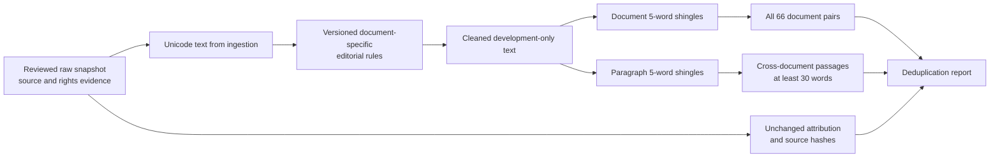

# Editorial cleaning and near-duplicate screening

[Documentation index](README.md) · [Previous](33-corpus-ingestion-pilot.md)

The ingestion pilot deliberately preserved source text conservatively. This stage applies a small, reviewed set of editorial removals and measures lexical overlap before any train, validation or test split exists. It does not train a model, choose a configuration or open a new test set.

## Why clean after ingestion?

Raw acquisition and editorial preparation answer different questions. The raw snapshot establishes exactly which edition was acquired and retains its notices. The cleaned snapshot asks which parts of that edition are useful prose for language-model training. Keeping these stages separate makes every removal reproducible and reversible.

The rules are frozen in [`configs/corpus_v2_cleaning_rules.json`](../configs/corpus_v2_cleaning_rules.json). They identify a stable fingerprint of the corpus ID, registry and document hashes while excluding acquisition timestamps. They apply only to named documents and leave every unspecified document byte-for-byte unchanged.



## Editorial policy

The default is preservation. Titles, contents, introductions, prefaces, footnotes, endnotes, case, punctuation, paragraph boundaries and Unicode remain. Four documents have explicit actions:

| Document | Action | Matches | Characters removed |
| --- | --- | ---: | ---: |
| `pg1228` | Remove the three-paragraph Project Gutenberg edition chooser before the selected 1859 text | 3 | 348 |
| `pg20203` | Remove the leading digitization credit | 1 | 108 |
| `pg20203` | Remove bracketed illustration blocks whose images are absent | 39 | 4,322 |
| `pg833` | Remove the leading digitization credit | 1 | 23 |
| `pg14474` | Remove bracketed illustration blocks whose images are absent | 38 | 972 |

The digitization credits are still present in the immutable raw snapshot and attribution records. The image captions/placeholders are removed only from the two editions reviewed for this rule. A generic markup stripper is not used. Transcriber notes, indexes and historical editorial material remain because removing them requires a separate content decision.

The result contains **6,388,790 characters**, down from 6,394,563: 5,773 characters, or about **0.0903%**, were removed. Four documents changed and eight retained their exact input text hash. The two Open Logic LaTeX sources remain quarantined; this stage does not attempt to render or clean them.

## Near-duplicate method

Comparison uses case-folded Unicode word tokens while ignoring punctuation and whitespace. This canonical form is used only for matching; it does not replace the saved prose.

For token sequence \(w_1, \ldots, w_n\), a five-word shingle is

\[
s_i = (w_i, w_{i+1}, \ldots, w_{i+4}).
\]

For shingle sets \(A\) and \(B\), the similarity is

\[
J(A,B) = \frac{|A \cap B|}{|A \cup B|}.
\]

The configured near-duplicate threshold is \(J \ge 0.80\), chosen before measuring this pilot and consistent with the next-stage plan. Every one of the 66 document pairs is compared. The passage screen considers 7,621 paragraphs of at least 30 words. An inverted index finds every cross-document paragraph pair sharing a shingle, applies only the necessary length-ratio bound, and then computes the exact hashed-shingle Jaccard score. SHA-256-derived 64-bit shingle identifiers make the result deterministic; the very small possibility of a hash collision remains a limitation.

## Measured overlap

- Document near-duplicates at or above 0.80: **0**.
- Cross-document paragraph near-duplicates at or above 0.80: **0**.
- Highest document-pair score: `pg1661` versus `pg205`, **0.0007511** (about 0.0751%).

These results rule out large lexical copies under the stated normalization and thresholds. They do not prove that semantic paraphrases, shorter quotations, repeated passages inside one document or contamination against sources outside this pilot are absent. The report stores identifiers, paragraph positions and scores rather than copying source passages.

## Provenance and isolation

Each cleaned record retains the title, authors, contributors, domain, source family, work/author/split groups, source URL, license statement and attribution from ingestion. It also records the input path/hash, output path/hash, character counts and ordered action log. `ATTRIBUTION.json` is copied byte-for-byte from the raw snapshot. The rules bind to a timestamp-independent content fingerprint; each local cleaned manifest additionally records the complete raw-manifest hash and cleaning-rules hash.

No split was assigned. All pilot families remain excluded from the future untouched test. The measured report records `new_test_created`, `new_test_read`, `legacy_test_read`, `model_loaded` and `training_performed` as `false`.

## Reproduce and verify

From the repository root:

```bash
PYTHONPATH=src python scripts/clean_corpus_pilot.py
PYTHONPATH=src python -m unittest discover -s tests -q
```

The first run writes the local ignored snapshot under `data/processed/corpus-v2-pilot-cleaned/` and the versioned report at [`docs/results/corpus-v2-cleaning-and-dedup.json`](results/corpus-v2-cleaning-and-dedup.json). Later runs verify hashes and reuse the existing snapshot without rewriting it. A changed input manifest, rules file, file inventory or content hash is rejected instead of silently replacing the result.

The implementation is in [`src/corpus_cleaning.py`](../src/corpus_cleaning.py), with the command-line entry point in [`scripts/clean_corpus_pilot.py`](../scripts/clean_corpus_pilot.py). Tests cover explicit removals, Unicode preservation, a synthetic near-duplicate, provenance retention, idempotent reuse and tamper detection.

[Documentation index](README.md) · [Previous](33-corpus-ingestion-pilot.md)
