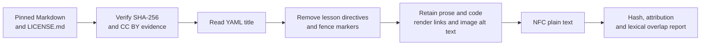

# Modern educational corpus expansion: wave 1

[Documentation index](README.md) · [Previous](34-editorial-cleaning-and-near-duplicates.md)

The original corpus-v2 pilot is dominated by historical books. This first expansion wave adds recent instructional prose about computing and data practice. It is a development-only source acquisition and rendering exercise: no model was loaded, no split was assigned and no new or legacy test was created or read.

Registry: [`configs/corpus_v2_expansion_sources.json`](../configs/corpus_v2_expansion_sources.json). Driver: [`scripts/ingest_corpus_expansion.py`](../scripts/ingest_corpus_expansion.py). Implementation: [`src/corpus_expansion.py`](../src/corpus_expansion.py). [Measured report](results/corpus-v2-expansion-wave1.json) and [review record](results/corpus-v2-expansion-wave1-review.json).

## Accepted sources

The registry pins fifteen English chapters from five official Software Carpentry and Data Carpentry lesson repositories. Each file and each repository `LICENSE.md` is fixed to a full Git commit and expected SHA-256 hash.

| Repository | Pinned commit | Chapters | Rendered characters | Development domain |
| --- | --- | ---: | ---: | --- |
| `swcarpentry/shell-novice` | `b91d85b848405a4a2fe0a297d8cedb71d68ab9bd` | 3 | 62,067 | Computing systems |
| `swcarpentry/git-novice` | `78b9c02a074e6712b9b013ef6e8a568a56d8cf37` | 3 | 56,038 | Software engineering |
| `swcarpentry/python-novice-inflammation` | `c789bb6f0e5fd719601498515a99380023c62891` | 3 | 61,705 | Scientific computing |
| `datacarpentry/sql-ecology-lesson` | `21aa6db422979046693ed77a94f69d4698477af2` | 3 | 31,531 | Data management |
| `datacarpentry/spreadsheet-ecology-lesson` | `7474f37ad2511f1ce43dfbc262f82cf1cf705387` | 3 | 29,808 | Data literacy |

The chapters cover filesystems, shell pipelines, search, version control, collaboration, merge conflicts, arrays, functions, defensive programming, SQL queries/aggregation/joins and spreadsheet quality. The selection adds **241,149 characters** across five evenly represented topics.

Five repositories do not mean five independent author groups. The material shares The Carpentries as rights holder, a lesson template and overlapping contributor communities. All fifteen chapters therefore use one conservative split group, `source-family:the-carpentries`. They must remain together in any later train/development assignment and are ineligible for the future untouched test.

## License and attribution

Every pinned `LICENSE.md` states that Carpentries instructional material is available under **Creative Commons Attribution 4.0** and requires credit to The Carpentries, a link to the license and an indication of changes. The repository files are the edition-specific evidence retained in the local snapshot. The [Carpentries license page](https://preview.carpentries.org/instructor-training/LICENSE.html) independently describes the same grant.

Each document record retains its repository, path, commit, commit date, blob URL, raw URL, file history, work/author/split groups, raw and rendered hashes, license evidence ID and attribution text. `ATTRIBUTION.json` states that Markdown was converted to plain text and links back to source history.

The Open Textbook Library was used only for discovery research and was not ingested: a catalog license label is not a substitute for verifying the linked edition and download. OpenStax was also deferred because its current general guidance includes noncommercial/share-alike terms; edition-specific conditions and the intended distribution need separate review. These decisions are recorded in the registry rather than silently discarded.

## Reviewed Markdown rendering

The renderer is specific to the reviewed Carpentries lesson format:



It removes YAML front matter, Carpentries directive delimiters, code-fence markers and link-definition lines. Code content is retained. Links become their labels, images become their alternative text, simple HTML tables retain their cell text, and Unicode is normalized to NFC. Each document records transformation counts and must have zero remaining Liquid tags, directives, fences or HTML tags. The raw Markdown remains unchanged beside the rendered text.

This is not a general Markdown or HTML sanitizer. A new source format must receive its own reviewed conversion and tests.

## Duplicate screen

The same frozen five-word-shingle method from chapter 34 compares all 105 document pairs and 506 cross-document paragraphs of at least 30 words.

- Whole-document near-duplicates at Jaccard ≥ 0.80: **0**.
- Cross-document paragraph near-duplicates at Jaccard ≥ 0.80: **3**.
- Highest whole-document score: Git conflicts versus GitHub remotes, **0.0085195**.

The three paragraph matches are reused instructional outputs: one exact 40-word CSV example, one exact 37-word NumPy array output and a formatting variant of the same array with Jaccard 0.9697. They are retained and reported because they are legitimate shared examples. Keeping the entire Carpentries family in one split group prevents these passages from crossing a future model-evaluation boundary. A later combined-corpus cleaning policy can remove or down-weight them before training.

## Reproduce

From the repository root:

```bash
PYTHONPATH=src python scripts/ingest_corpus_expansion.py
PYTHONPATH=src python -m unittest discover -s tests -q
```

The first command downloads only pinned HTTPS files when the local ignored snapshot is absent. Existing snapshots are verified and reused offline. Source, license, registry, renderer or inventory changes fail closed instead of updating results silently.

## What remains

This wave improves topical and chronological variety, but it is only one rights holder/source family and adds about 0.24 million characters. It does not satisfy the target of at least 100 documents and roughly 60 independent groups. The next acquisition wave needs unrelated authors and publishers in modern science, humanities, public policy and practical reference material with edition-specific reusable licenses. Only after those groups are cleaned and screened should a split manifest and new untouched test be frozen.

[Documentation index](README.md) · [Previous](34-editorial-cleaning-and-near-duplicates.md)
