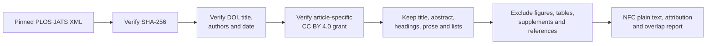

# Modern science and research practice: wave 2

[Documentation index](README.md) · [Previous](35-modern-educational-expansion-wave1.md) · [Next](37-open-textbook-expansion-wave3.md)

The second expansion wave adds recent scientific and professional guidance from independently authored articles in the PLOS Computational Biology *Ten Simple Rules* collection. It remains development-only: no train, validation or test split was assigned, no new or legacy test was read, and no model was loaded or trained.

Registry: [`configs/corpus_v2_science_sources.json`](../configs/corpus_v2_science_sources.json). Driver: [`scripts/ingest_corpus_science.py`](../scripts/ingest_corpus_science.py). Implementation: [`src/corpus_science.py`](../src/corpus_science.py). See the [measured report](results/corpus-v2-science-wave2.json) and [editorial review](results/corpus-v2-science-wave2-review.json).

## Accepted sources

The registry fixes twelve English articles by DOI and raw JATS XML SHA-256. Publication dates range from August 2025 through October 2026.

| Publication date | Article | Authors | Rendered characters |
| --- | --- | ---: | ---: |
| 2026-10-16 | Developing a reporting appraisal tool | 2 | 18,937 |
| 2026-10-15 | Building genomics capacity in the Global South | 23 | 21,363 |
| 2026-09-16 | Elevating Indigenous partnerships in research | 5 | 16,309 |
| 2026-08-17 | Using generative AI for environmental-science code | 22 | 26,145 |
| 2026-06-10 | Teaching data science | 2 | 34,771 |
| 2026-05-07 | Establishing a drug-discovery lab in resource-limited settings | 6 | 14,837 |
| 2026-04-24 | Neurodiverse mentoring | 15 | 16,847 |
| 2026-02-23 | Coordinating a large digital-health project | 3 | 32,130 |
| 2026-02-23 | Building a collaborative coding culture | 5 | 21,410 |
| 2025-12-08 | Research data management | 2 | 31,819 |
| 2025-11-06 | Accessible biomedical data resources | 4 | 24,163 |
| 2025-08-07 | Research with humans | 3 | 46,416 |

Together they contribute **305,147 rendered characters**, 92 unique authors and twelve topics across eleven development domains. No author name repeats across the selected records. Each DOI therefore has its own conservative author/work split group. Sharing a journal and article series still creates stylistic concentration, so these records improve author and topic diversity without representing a complete corpus.

## Article-specific license evidence

PLOS states that its research articles are published under Creative Commons licenses, and each accepted XML file provides stronger, article-specific evidence: its `permissions` element names the copyright holder, copyright year, license URL and the Creative Commons Attribution grant. The ingester requires the article license URL to be CC BY 4.0 and requires the grant text before accepting content. The raw XML and its expected hash preserve exactly what was reviewed.

The generated `ATTRIBUTION.json` records the DOI, complete author list, title, source, copyright holder, license, raw hash and transformations. The registry also links the human-readable article page. These records do not rely on a search result or journal-wide assumption to establish an individual article's terms.

## Reviewed XML rendering



The renderer keeps the article title, available abstract, section headings, paragraphs and list prose. Inline emphasis and citation numbers become plain text. It excludes figure and table content, supporting files, the bibliography and administrative front matter. Every accepted output has zero Unicode replacement characters. Raw XML remains unchanged beside the derived plain text.

This policy is intentionally specific to the reviewed PLOS JATS structure. It does not claim to render arbitrary XML. Equations would require an explicit representation rule before ingesting equation-heavy articles; none of the selected XML files contains display or inline formula elements.

## Duplicate screen

The frozen lexical method from chapter 34 compares case-folded five-word shingles:

- **66** complete document pairs screened; none reached Jaccard 0.80.
- **416** cross-document paragraphs of at least 30 words screened; none reached Jaccard 0.80.
- The highest document score was **0.0006383**, between the drug-discovery-lab and genomics-capacity articles.

This establishes that the selected articles are not close lexical copies under the declared method. It cannot detect paraphrased or semantic duplication. The records remain ineligible for the future untouched test because they were inspected while developing the corpus.

## Editorial findings and limitations

Opening and closing content, section structure, attribution and exclusions were reviewed for all twelve outputs. The articles retain substantive discussions of research practice, ethics, laboratories, data, software, teaching and collaboration. Author declarations inside the body are retained when they form part of the published article; this includes disclosed use of generative-AI tools in two articles.

The wave is recent and independently authored, but it comes from one English-language journal and one recurring editorial format. Scientific advice articles also differ from primary research papers and broad explanatory textbooks. Future waves still need independent sources in the humanities, public policy, general reference and longer-form nonfiction. No source inspected in this wave may later be placed in the untouched test.

## Reproduce

From the repository root:

```bash
PYTHONPATH=src python scripts/ingest_corpus_science.py
PYTHONPATH=src python -m unittest discover -s tests -q
```

When the ignored local snapshot already exists, the first command verifies and reuses it without network access. Registry, XML, renderer, attribution and inventory changes fail closed instead of silently changing the measured result.

[Documentation index](README.md) · [Previous](35-modern-educational-expansion-wave1.md) · [Next](37-open-textbook-expansion-wave3.md)
