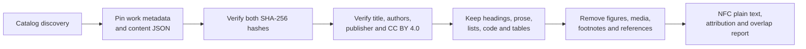

# Open textbooks and practical nonfiction: wave 3

[Documentation index](README.md) · [Previous](36-modern-science-expansion-wave2.md) · [Next](38-independent-publisher-expansion-wave4.md)

The third expansion wave adds independently authored textbook prose in public policy, civic communication, religion and education, media studies, data communication, biology, computer science, medical physics, open education and education technology. It remains development-only: no train, validation or test split was assigned, no new or legacy test was read, and no model was loaded or trained.

Registry: [`configs/corpus_v2_open_textbook_sources.json`](../configs/corpus_v2_open_textbook_sources.json). Driver: [`scripts/ingest_corpus_open_textbooks.py`](../scripts/ingest_corpus_open_textbooks.py). Implementation: [`src/corpus_open_textbooks.py`](../src/corpus_open_textbooks.py). See the [measured report](results/corpus-v2-open-textbooks-wave3.json) and [editorial review](results/corpus-v2-open-textbooks-wave3-review.json).

## Selection and measured result

The Open Textbook Library catalog was used for discovery. Content and work-level rights evidence come from the publishers' Pressbooks v2 and Manifold v1 API records. Each accepted work has a different author set and its own conservative work/author split group.

| Domain | Selected document | Rendered characters |
| --- | --- | ---: |
| Public policy | An Introduction to State and Local Government | 27,226 |
| Civic communication | Unproductive Public Discourse and the Politics of Polarization | 24,471 |
| Religion and education | Biblical and Theological Foundations | 35,345 |
| Media studies | The Myth of the Digital Panacea | 57,169 |
| Communication | Visualize Data With Purpose | 43,606 |
| Biology | Form and Function | 61,193 |
| Computer science | Algorithms, Big-O, and Complexity | 23,910 |
| Medical physics | Ultrasound Bioeffects and Safety | 19,991 |
| Open education | A Guide To Open Textbook Essential And Exemplary Features | 22,323 |
| Education technology | Personalized Website Design for Differentiated Instruction | 185,299 |

Together the ten documents contribute **500,533 rendered characters** from 24 unique named authors. They form ten independent work/author groups across three publisher identities and two delivery platforms. The registry pins both the content record and its separate license-evidence record by SHA-256.

## License and provenance checks

Every selected edition declares Creative Commons Attribution 4.0. For Pressbooks works, the ingester verifies the edition metadata's license name and URL. For Manifold works, it verifies the project rights statement and named rights holder. The generated attribution record preserves the work and document titles, authors, publisher, source URL, license, raw hashes and declared transformations.

Some editions identify exceptions for illustrations, screenshots, cover images or embedded media. The text renderer therefore excludes figures and their captions, standalone images, video/audio embeds and similar media. This keeps those assets outside the derived corpus rather than assuming the work-level license applies to each one. The original reviewed JSON remains in the immutable local snapshot for audit.



## Reproducible editorial cleaning

The HTML renderer preserves semantic text blocks, code and table cells, converts links to their visible labels, normalizes the result to NFC and rejects remaining HTML or Unicode replacement characters. A recognized trailing References, Bibliography, Works Cited, Sources or Further Reading section is removed. Pressbooks footnote containers are also excluded.

The measured audit records **31 standalone images**, **40 figures with captions** and **6 media embeds** removed across the ten documents. Seven documents had a recognized trailing references section removed. The other three had no matching trailing section after structural exclusions; this is recorded rather than inferred. Automated tests cover inequalities such as `0 < 1`, code, tables, media exclusion, both API formats, immutable hashes, attribution, offline reuse and snapshot tamper detection.

## Duplicate screen

The frozen lexical method from chapter 34 compares case-folded five-word shingles:

- **45** complete document pairs were screened; none reached Jaccard 0.80.
- **766** cross-document paragraphs of at least 30 words were screened; none reached Jaccard 0.80.
- The highest complete-document score was **0.0003594**, between the data-visualization and state-government documents.

This only establishes that the accepted outputs are not close lexical copies under the declared method. It cannot detect paraphrases, shared ideas or semantic duplication.

## What this wave changes and what remains

This wave improves topic and author independence over the previous journal-centered science wave and adds practical long-form prose. It does not yet meet the stage plan's scale or balance targets. Eight of ten records come from one Pressbooks host, institutional textbooks dominate the genre, only three publisher identities are represented, and all content is English. One document also contributes more than a third of the characters, so later split construction must measure character and token balance in addition to counting works.

All ten documents were inspected during corpus development and are permanently ineligible for the future untouched test. The next acquisition work should add unrelated publishers and genres before freezing any split. No conclusion about model quality follows from ingestion alone.

## Reproduce

From the repository root:

```bash
PYTHONPATH=src python scripts/ingest_corpus_open_textbooks.py
PYTHONPATH=src python -m unittest discover -s tests -q
```

When the ignored local snapshot already exists, the first command verifies and reuses it without network access. Registry, evidence, content, rendered text, attribution or inventory changes fail closed.

[Documentation index](README.md) · [Previous](36-modern-science-expansion-wave2.md) · [Next](38-independent-publisher-expansion-wave4.md)
