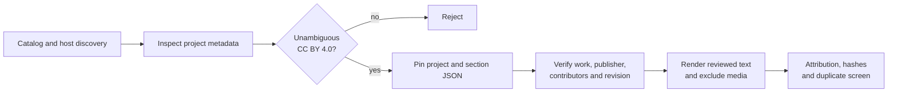

# Independent hosts and mixed practical prose: wave 4

[Documentation index](README.md) · [Previous](37-open-textbook-expansion-wave3.md)

The fourth expansion wave reduces the previous dependence on one Pressbooks host. It adds ten CC BY 4.0 works served by four independent Manifold installations and attributed to six publisher identities. The selected prose covers open pedagogy, community recipes, equity research, marketing analytics, electronics instrumentation, education-program reporting, history, international business and relational databases.

This remains development-only acquisition. No train, validation or test split was assigned, no new or legacy test was read, and no model was loaded or trained.

Registry: [`configs/corpus_v2_independent_sources.json`](../configs/corpus_v2_independent_sources.json). Driver: [`scripts/ingest_corpus_independent.py`](../scripts/ingest_corpus_independent.py). Shared implementation: [`src/corpus_open_textbooks.py`](../src/corpus_open_textbooks.py). See the [measured report](results/corpus-v2-independent-publishers-wave4.json) and [editorial review](results/corpus-v2-independent-publishers-wave4-review.json).

## Accepted documents

| Publisher identity | Document | Domain | Characters |
| --- | --- | --- | ---: |
| UHCC OER Group | Adapt, Create, and Share OERs with your Students | Open education | 37,974 |
| Open Education Network | The Party Cookbook | Practical reference | 13,768 |
| Rebus Community | Open Pedagogy | Education | 23,074 |
| Emerald Publishing | Supporting educators’ professional learning for equity pedagogy | Education research | 33,456 |
| Dr. Jose Mendoza | Becoming an AI-Augmented Marketing Analyst | Business analytics | 53,772 |
| University System of Georgia | Instrumentation | Engineering | 19,495 |
| University System of Georgia | Instruction Affected | Program evaluation | 22,374 |
| University System of Georgia | Early Republic | History | 50,838 |
| University System of Georgia | Global Demographics and Global Markets | International business | 12,200 |
| University System of Georgia | The Relational Model | Computer science | 24,249 |

The wave contributes **291,200 rendered characters**, 23 named individual or organizational contributors and ten conservative work/contributor groups. It adds six publisher identities and four delivery hosts, although five documents still come from one institutional publisher.

## License decisions

Each accepted project has a separately pinned project metadata record that explicitly states CC BY 4.0 or Creative Commons Attribution 4.0. The content section and license record have independent SHA-256 hashes. Contributor evidence comes from project creator metadata, the rights holder, or, for the selected equity-research article, the article byline retained in the content.

Several otherwise relevant candidates were rejected because their metadata paired a CC BY label with a link or phrase referring to a NonCommercial license. Catalog labels were never treated as sufficient evidence. The ingester checks the pinned project record again during every fresh build and offline verification.



## Rendering and duplicate screen

The shared renderer keeps headings, prose, lists, code and table cells while excluding figures, standalone images, embedded media, footnote containers and recognized trailing reference sections. It now distinguishes common HTML tags from mathematical tuple notation such as `<v 1, v 2>`, preventing valid technical prose from being flagged as leftover markup.

Across the ten documents, 48 standalone images and three media embeds were excluded. Two documents had a trailing reference section removed. The lexical duplicate screen found:

- **45** complete document pairs; none reached Jaccard 0.80.
- **469** cross-document paragraphs of at least 30 words; none reached Jaccard 0.80.
- A highest complete-document score of **0.0004296**, between marketing analytics and OER adaptation.

## Corpus status after four waves

The cleaned pilot and four modern expansion waves now contain 59 accepted development documents and **7,726,819 characters**. The modern waves contribute 47 of those documents and 1,338,029 characters. Conservative grouping yields 45 development groups before a final cross-wave grouping audit.

This is still not ready for split freezing. The historical pilot dominates character volume, English dominates language, institutional education remains overrepresented, and Manifold is the only provider in this wave. The next step is a cross-wave inventory and balance analysis: normalize publisher, author and work-family identities; screen overlap across every wave; then acquire specifically against the measured gaps before reserving a test.

## Reproduce

```bash
PYTHONPATH=src python scripts/ingest_corpus_independent.py
PYTHONPATH=src python -m unittest discover -s tests -q
```

An existing ignored snapshot is verified and reused offline. Changes to the registry, source records, rendered text, attribution or inventory fail closed.

[Documentation index](README.md) · [Previous](37-open-textbook-expansion-wave3.md)
