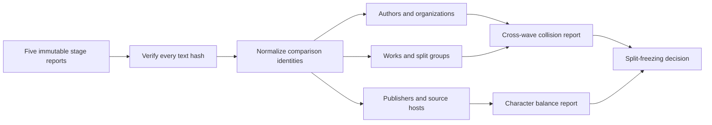

# Cross-wave identity, balance, and overlap audit

[Documentation index](README.md) · [Previous](38-independent-publisher-expansion-wave4.md)

The four acquisition waves were originally screened independently. This audit joins them with the cleaned pilot so that source identities, character balance and lexical overlap can be measured across the complete development collection before any split is frozen.

Driver: [`scripts/audit_corpus_v2.py`](../scripts/audit_corpus_v2.py). Implementation: [`src/corpus_audit.py`](../src/corpus_audit.py). Measured output: [`results/corpus-v2-cross-wave-audit.json`](results/corpus-v2-cross-wave-audit.json). Review record: [`results/corpus-v2-cross-wave-audit-review.json`](results/corpus-v2-cross-wave-audit-review.json).

## Verified inventory

The audit reads each committed stage report, opens the corresponding ignored snapshot and verifies every text hash and character count before analysis. It rejects any input report that records test access, model loading or training.

| Stage | Documents | Characters | Share |
| --- | ---: | ---: | ---: |
| Cleaned historical pilot | 12 | 6,388,790 | 82.68% |
| Open textbooks: wave 3 | 10 | 500,533 | 6.48% |
| Modern science: wave 2 | 12 | 305,147 | 3.95% |
| Independent hosts: wave 4 | 10 | 291,200 | 3.77% |
| Modern education: wave 1 | 15 | 241,149 | 3.12% |
| **Total** | **59** | **7,726,819** | **100%** |

The joined inventory has 152 normalized named contributors or organizations, 49 work families, 45 conservative split groups, 11 publisher identities, eight source hosts and 35 domain labels.

## Identity reconciliation

Names are normalized with Unicode NFKC, case folding, whitespace collapse and punctuation removal for comparison only. Saved provenance remains unchanged. Known publisher presentation variants are mapped to one display identity; for example, `The Open Education Network` and `Open Education Network` become one identity, and a funding note is removed from the Rod Library publisher label.



No exact content duplicate, cross-wave work-family collision, cross-wave split-group collision or normalized contributor collision was found. This supports the current conservative grouping, but it does not prove that differently named people or organizations are unrelated. Before split generation, ambiguous aliases should still receive manual review.

## Cross-wave lexical overlap

The same frozen five-word-shingle comparison used by the individual waves was rerun across stage boundaries:

- **1,384** cross-stage document pairs were screened; none reached Jaccard 0.80.
- **9,778** paragraphs of at least 30 words were indexed across all stages; no cross-stage pair reached Jaccard 0.80.
- The highest cross-stage document score was **0.0008083**, between the Carpentries spreadsheet-mistakes lesson and the OER-adaptation chapter.

This is a lexical near-duplicate screen. It cannot detect paraphrase, translated duplication, common factual content or semantic contamination.

## Balance diagnosis

Document counts make the corpus appear more diverse than its training-token mass. The historical pilot contributes 82.68% of all characters. Fiction, general nonfiction and historical science together contribute 82.68% as well because those labels cover the twelve long pilot books. The ten largest documents—all from the pilot—contribute 77.50% of the corpus, and the single largest book contributes 15.76%.

Publisher concentration is also high: Project Gutenberg supplies 82.68% of characters. Modern sources contribute only 17.32%, even though they account for 47 of 59 documents. Sampling documents uniformly would overrepresent short modern documents; concatenating everything and sampling tokens uniformly would reproduce the historical-volume imbalance. Split construction and training sampling therefore need explicit group and domain weights.

## Decision and next acquisition target

The corpus is **not ready for split freezing**. The next acquisition should target modern, independently published long-form prose outside institutional education and research guidance. Priority gaps are contemporary general nonfiction, public-interest reporting, practical manuals, arts and humanities, and globally authored English prose. Additional languages should be a separately designed stage because the current tokenizer and evaluation plan are English-first.

After acquisition, rerun this audit. Only then should a stable group manifest assign train, validation and a new untouched test, with character budgets and domain coverage reported alongside document counts.

## Reproduce

```bash
PYTHONPATH=src python scripts/audit_corpus_v2.py
PYTHONPATH=src python -m unittest discover -s tests -q
```

The command is offline and deterministic when the five verified snapshots are present. It does not create or inspect a test split.

[Documentation index](README.md) · [Previous](38-independent-publisher-expansion-wave4.md)
