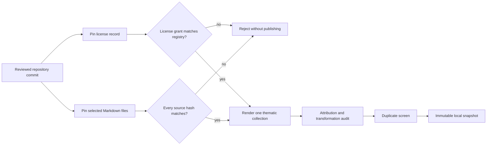

# Modern practical long-form prose: wave 5

[Documentation index](README.md) · [Previous](39-cross-wave-corpus-audit.md) · [Next](41-trying-the-final-model.md)

The cross-wave audit showed that document counts hid a large volume imbalance: twelve historical books supplied 82.68% of all characters. This fifth wave begins correcting that imbalance with ten modern long-form collections from six independently governed repositories. The texts cover research ethics, open culture, public communication, open-source governance, accessibility, project strategy and community events.

This is still development-only acquisition. No train, validation or test split was assigned, no new or legacy test was read, and no model was loaded or trained.

Registry: [`configs/corpus_v2_longform_sources.json`](../configs/corpus_v2_longform_sources.json). Ingestion driver: [`scripts/ingest_corpus_longform.py`](../scripts/ingest_corpus_longform.py). Implementation: [`src/corpus_longform.py`](../src/corpus_longform.py). Measured report: [`results/corpus-v2-longform-wave5.json`](results/corpus-v2-longform-wave5.json). Editorial review: [`results/corpus-v2-longform-wave5-review.json`](results/corpus-v2-longform-wave5-review.json). Post-wave audit: [`results/corpus-v2-cross-wave-audit-after-wave5.json`](results/corpus-v2-cross-wave-audit-after-wave5.json).

## Accepted collections

| Publisher | Collection | Domain | Source files | Characters |
| --- | --- | --- | ---: | ---: |
| The Turing Way Community | Ethical Research and Data Practice | Research ethics | 14 | 67,050 |
| Creative Commons | Opening Knowledge and Building Communities | Open culture | 6 | 46,062 |
| 18F | Voice, Tone, and Inclusive Language | Public communication | 2 | 12,740 |
| 18F | Plain Language and Structured Web Content | Public communication | 4 | 14,123 |
| GitHub | Starting and Sustaining an Open Source Project | Open source | 3 | 47,280 |
| GitHub | Open Source Community and Governance | Community governance | 3 | 41,993 |
| U.S. General Services Administration | Accessibility for Product Teams | Accessibility | 7 | 6,058 |
| U.S. General Services Administration | Accessibility for User Experience Teams | Accessibility | 10 | 8,712 |
| Mozilla Foundation | Open Project Strategy and Roadmaps | Open leadership | 3 | 17,569 |
| Mozilla Foundation | Designing and Running Open Community Events | Community practice | 4 | 34,052 |
| **Total** | **10 collections** | **8 domains** | **56** | **295,639** |

Related files from one repository share a conservative source-family group. The ten collections therefore add six split groups, not ten independent groups.

## Why repository-hosted sources

A repository commit gives the text and its license evidence one immutable revision. Each of the 56 Markdown files has a pinned raw URL and SHA-256 hash; each repository license is fetched from the same commit and hashed separately. A changed source, license, path, registry or rendered output fails closed.



The accepted grants are CC BY 4.0, CC0 1.0 and MIT. The GSA repository excludes identified Picons image assets from its public-domain dedication; this wave ingests only reviewed Markdown prose and does not copy those assets. Images in all sources are excluded and, where present, reduced to their text alternatives.

## Rendering and quality checks

The renderer concatenates reviewed files in registry order and preserves prose, headings, lists, tables and code. It removes YAML front matter, template expressions, directive markers, code-fence delimiters, HTML tags and link destinations. The output is normalized to Unicode NFC and LF line endings. Every collection must contain at least 5,000 rendered characters and must have no replacement characters or unresolved template markers.

The duplicate screen examined all 45 complete-document pairs and 624 paragraphs of at least 30 words. No document or cross-document paragraph reached the frozen Jaccard threshold of 0.80. The largest document score was 0.021315 between the two accessibility collections, which is expected because they come from one coordinated guide; both remain in the same split group.

## Balance after wave 5

The post-wave audit verifies 69 documents and **8,022,458 characters** across six acquisition stages. It finds no exact duplicate, cross-stage identity collision, cross-stage document near duplicate or cross-stage paragraph near duplicate.

| Measure | Before wave 5 | After wave 5 |
| --- | ---: | ---: |
| Modern characters | 1,338,029 | 1,633,668 |
| Modern character share | 17.32% | 20.36% |
| Historical pilot share | 82.68% | 79.64% |
| Publisher identities | 11 | 17 |
| Conservative split groups | 45 | 51 |
| Ten largest documents' share | 77.50% | 74.65% |

The direction is useful, but the effect is too small to freeze splits. The historical books still supply nearly four fifths of all characters. This wave also concentrates on English practical guidance, so it does not close the gaps in contemporary narrative nonfiction, public-interest reporting, arts and humanities, or globally authored prose.

## Decision

All ten collections enter the development-only acquisition pool. Splits remain unfrozen. The next acquisition should add substantially more modern long-form volume from additional publisher families, with priority on contemporary general nonfiction, public-interest reporting, arts and humanities, and geographically broader authorship. The same audit must run again before reserving a new untouched test.

## Reproduce

```bash
PYTHONPATH=src python scripts/ingest_corpus_longform.py
PYTHONPATH=src python scripts/audit_corpus_v2_wave5.py
PYTHONPATH=src python -m unittest discover -s tests -q
```

The ingestion command downloads only when the ignored snapshot is absent. Once present, it verifies and reuses the snapshot offline. The audit is offline and does not create or inspect a test split.

[Documentation index](README.md) · [Previous](39-cross-wave-corpus-audit.md) · [Next](41-trying-the-final-model.md)
