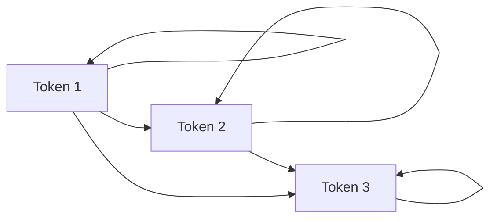
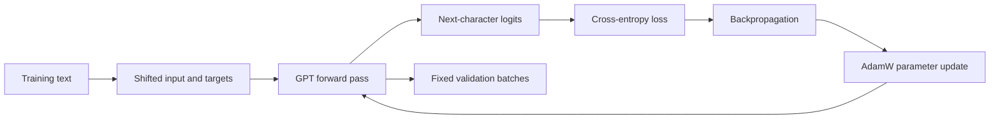

# Build Your First GPT

[Project README](../README.md) · [All research chapters](README.md) · [Technical reference](TECHNICAL_README.md)

This path builds a small decoder-only Transformer one component at a time. Each stage answers four questions: what are we building, why is it needed, what should the program print, and how do we know it works?

## Setup

Run everything from the repository root:

```bash
python3 -m venv .venv
source .venv/bin/activate
python -m pip install -r requirements.txt
```

The examples use CPU tensors and need no downloaded model or corpus. Numeric values from randomly initialized layers can vary; shapes and structural properties are the checks that matter.

## 1. Tokenization

**Build:** a reversible mapping between characters and integer token IDs.

**Why:** neural networks operate on numbers. A tokenizer defines the model's vocabulary and the exact unit it predicts.

**How:** [`src/tokenizer.py`](../src/tokenizer.py) sorts the unique training characters, assigns contiguous IDs, and provides `encode` and `decode`.

```bash
python src/tokenizer.py
```

You should see a vocabulary size, an integer list, and `Decoded: hello mike`. The round trip is the check: decoding the encoded text must recover the original characters exactly. Continue with [chapter 1](01-tokenization.md).

## 2. Token embeddings

**Build:** a trainable vector for every token ID.

**Why:** attention and feed-forward layers need continuous features rather than arbitrary integer labels.

**How:** [`src/embeddings.py`](../src/embeddings.py) uses `torch.nn.Embedding` to look up a width-4 vector for each of five tokens.

```bash
python src/embeddings.py
```

Expect `Shape: torch.Size([5, 4])`. Repeated token IDs must produce identical rows. The vector values are random until training. Continue with [chapter 2](02-token-embeddings.md).

## 3. Positional embeddings

**Build:** a second trainable vector that identifies each sequence position.

**Why:** self-attention alone does not know whether a token came first or last. Position information makes order visible.

**How:** [`src/positional_embeddings.py`](../src/positional_embeddings.py) adds a token vector and a position vector element by element.

```bash
python src/positional_embeddings.py
```

Expect token, position, and combined matrices with final shape `[5, 4]`. The same character at positions 2 and 3 receives the same token vector but a different combined vector. Continue with [chapter 3](03-positional-embeddings.md).

## 4. Self-attention and causal masking

**Build:** weighted information sharing between tokens, restricted to the current and earlier positions.

**Why:** attention lets each position use relevant context. The causal mask prevents a next-token model from reading future answers.

**How:** [`src/attention.py`](../src/attention.py) computes similarity scores, replaces future scores with negative infinity, and applies softmax.

```bash
python src/attention.py
```

The printed mask must be lower triangular. Every attention weight above the diagonal must be zero, while every row sums to approximately one.



Continue with [dot-product attention](04-dot-product-attention.md) and [causal masking](05-causal-masking.md).

## 5. Query, Key, and Value

**Build:** learned projections for what a token seeks, how it can be matched, and what information it contributes.

**Why:** comparing raw embeddings forces one representation to serve every role. Separate Q, K, and V projections let training learn better matching and content spaces.

**How:** [`src/causal_self_attention.py`](../src/causal_self_attention.py) computes scaled `Q @ Kᵀ`, applies the causal mask, and uses the resulting weights to combine V.

```bash
python src/causal_self_attention.py
```

Expect Q, K, V, and output shapes `[5, 4]`, followed by `Causal masking verified!`. Continue with [chapter 6](06-query-key-value.md).

## 6. Multi-head attention

**Build:** several independent causal attention heads followed by concatenation and an output projection.

**Why:** different heads can learn different relationships in parallel while preserving the model width.

**How:** [`src/multi_head_attention.py`](../src/multi_head_attention.py) splits 12 features across three heads, concatenates their outputs, and projects back to 12 features.

```bash
python src/multi_head_attention.py
```

Expect input and output shapes `[2, 5, 12]`, three heads, and 588 trainable parameters.


Continue with [chapter 7](07-multi-head-attention.md).

## 7. Feed-forward network

**Build:** a small multilayer perceptron applied independently to every token position.

**Why:** attention mixes information between positions; the feed-forward network transforms each position's features nonlinearly.

**How:** [`src/feed_forward.py`](../src/feed_forward.py) expands width 12 to 48, applies GELU, and projects back to 12.

```bash
python src/feed_forward.py
```

Expect `[2, 5, 12] -> [2, 5, 48] -> [2, 5, 12]` conceptually, with 1,212 trainable parameters. Continue with [chapter 8](08-feed-forward.md).

## 8. Transformer blocks

**Build:** pre-normalized attention and feed-forward sublayers with residual connections.

**Why:** LayerNorm stabilizes feature scales. Residual paths let each sublayer learn a correction while retaining the existing representation.

**How:** [`src/transformer_block.py`](../src/transformer_block.py) implements:

```text
x = x + attention(layer_norm_1(x))
x = x + feed_forward(layer_norm_2(x))
```

```bash
python src/transformer_block.py
```

The block must preserve `[2, 5, 12]` and report 1,848 trainable parameters. Continue with [chapter 9](09-transformer-block.md).

## 9. GPT architecture

**Build:** token and position embeddings, multiple Transformer blocks, final LayerNorm, and a linear vocabulary head.

**Why:** the complete model must turn every input prefix into logits for the next token at every position.

**How:** [`src/gpt.py`](../src/gpt.py) stacks independent blocks and returns logits shaped `[batch, sequence, vocabulary]`.

```bash
python src/gpt.py
```

Expect input shape `[2, 5]`, logits shape `[2, 5, 4]`, two blocks, and 4,008 parameters in this tiny shape demonstration. Continue with [chapter 10](10-gpt-model.md).

## 10. Training

**Build:** shifted input/target windows, cross-entropy loss, backpropagation, AdamW updates, fixed validation batches, and a checkpoint.

**Why:** random weights do not encode the training pattern. Gradient descent changes the parameters to assign more probability to observed next characters.

For the clearest proof, run the clean-clone demonstration:

```bash
python scripts/quick_demo.py
```

The program shows random output, trains for 150 updates, and then prints the learned color cycle. The reference validation loss falls from 2.7454 to 0.3196.



The reusable trainer is [`src/train.py`](../src/train.py). Its separate built-in demonstration runs with:

```bash
python src/train.py
```

Both commands create ignored checkpoints under `runs/`. Verify learning by comparing step 0 with the final validation loss, not by judging one generated sample. Continue with [chapter 11](11-training.md).

## 11. Evaluation

**Build:** full-stream next-character scoring with loss, perplexity, bits per character, and accuracy.

**Why:** training loss alone can reward memorization. A fixed validation stream measures unseen targets under a documented context policy.

Train the reusable demonstration and evaluate its matching built-in validation text:

```bash
python src/train.py
python src/evaluate.py
```

[`src/evaluate.py`](../src/evaluate.py) scores each target once and writes `runs/first-training/evaluation.json`. Check that `scored_tokens` equals the validation length minus one and that perplexity equals `exp(mean_nll)`. Continue with [chapter 13](13-evaluation.md).

## 12. Text generation

**Build:** an autoregressive loop that repeatedly predicts and appends one character.

**Why:** generation exposes what next-token learning produces when the model must consume its own output.

After `python src/train.py`, run:

```bash
python src/generate.py --prompt "a model" --max-new-tokens 80 --temperature 0.8 --seed 42
python src/generate.py --prompt "a model" --max-new-tokens 80 --temperature 0
```

[`src/generate.py`](../src/generate.py) preserves the prompt and adds exactly the requested number of characters. Temperature 0 uses deterministic argmax; positive temperature samples reproducibly with the seed. Generated fluency is not the training criterion—the validation metrics remain the quantitative evidence. Continue with [chapter 12](12-text-generation.md).

## Verify the complete path

```bash
PYTHONPATH=src python -m unittest discover -s tests -q
```

The tests cover reversibility, shapes, causality, gradient flow, deterministic training, checkpoint reload, evaluation, generation, and the later research diagnostics. When you are ready for the full experimental history, continue with the [41-chapter index](README.md).
