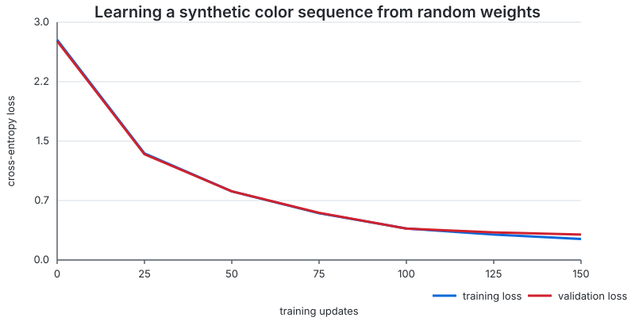

# Results and Lessons from Mike-LLM v0.1

Mike-LLM v0.1 is a completed educational project: a small GPT-style language model built from first principles in Python and PyTorch. Its value is the transparent implementation and the documented experiments, including negative results. It is not a general-purpose assistant.

For a fast, reproducible proof that the training loop works, start with the [five-minute demo](../README.md#five-minute-learning-demo). For the implementation sequence, follow [Build Your First GPT](GETTING_STARTED.md). The full 41-chapter research record remains available in the [documentation index](README.md).

## What v0.1 demonstrates

The project implements and connects the essential parts of a decoder-only Transformer:

- character tokenization;
- token and positional embeddings;
- scaled dot-product attention and causal masking;
- learned Query, Key, and Value projections;
- multi-head self-attention;
- feed-forward networks;
- LayerNorm and residual connections;
- stacked Transformer blocks and a language-modeling head;
- next-token training, checkpointing, evaluation, and autoregressive generation.

The implementation shows that these pieces form a working learning system. It also shows where a tiny character-level model stops being useful.

## Reproducible quick-demo result

The quick demo trains a randomly initialized model on an embedded cyclic color sequence. It requires no downloaded corpus or checkpoint. With the default seed and 150 steps, the archived run produced:

| Metric | Before training | After training |
|---|---:|---:|
| Validation loss | 2.7454 | 0.3196 |
| Validation perplexity | 15.57 | 1.38 |
| Greedy continuation | noisy characters | repeating the learned color order |

The validation loss fell by 88.4%. The model changed its continuation from noise to:

```text
red blue green yellow red blue green yellow red blue green yellow re
```



The machine-readable evidence is stored in [`docs/results/quick-demo.json`](results/quick-demo.json). Runtime depends on the machine; the archived CPU run spent 0.25 seconds inside the training loop, while a clean environment also needs time to create the virtual environment and install PyTorch.

This is intentionally an easy synthetic task. It proves that gradients, optimization, validation, and generation work together; it does not measure language understanding.

## Final held-out evaluation

The final v0.1 checkpoint was selected using validation data and evaluated once on the reserved test split. The documented result was:

| Split | Character loss | Character perplexity | Next-character accuracy |
|---|---:|---:|---:|
| Validation | 1.838747 | 6.288657 | 44.85% |
| Reserved test | 1.749336 | 5.750783 | 46.33% |

The test result is useful as a final audit because the test split was not used to select the configuration. The local checkpoint and licensed source text are intentionally excluded from Git, so this particular evaluation cannot be reproduced from a clean clone without rebuilding the corpus and retraining. The experiment commands, configurations, manifests, and recorded metrics remain in the research chapters.

## What the generated text shows

On the book experiment, the model learned character frequencies, common fragments, spaces, punctuation, and some short English-like transitions. Examples recorded during the project include:

```text
the creature and the should and the should...
```

and, at a higher temperature:

```text
the creature when i not and on live the beings the affecture undered from sticling...
```

These samples are not coherent answers. The first collapses into repetition; the second is more varied but contains invented words and broken grammar. They are evidence of local statistical learning, not evidence that the model understands the story or can answer questions about arbitrary topics.

## Main experimental findings

### A small real corpus improves language-like structure

Moving from the synthetic teaching corpus to licensed book text produced more recognizable English fragments. It also exposed the limits of the model size, character tokenization, and training data.

### More context did not automatically improve validation

Context lengths 16 and 64 were compared across training budgets and seeds. The longer model initially received fewer examples for each relative position, which made the comparison unfair. Increasing its training budget corrected that exposure difference, but did not produce a reliable advantage large enough to justify selecting context 64 for v0.1.

### Multiple seeds changed the conclusion

Single-run comparisons were often misleading. Repeating experiments showed meaningful seed-to-seed variation and prevented a favorable run from being treated as a general result.

### Positional encoding was not the sole bottleneck

Learned and sinusoidal positional embeddings were evaluated in both context regimes. Sinusoidal positions changed some per-position behavior, but did not unlock a consistent long-context gain. The limitation came from the interaction of data, capacity, optimization, and attention behavior rather than one embedding choice.

### Distant history had mixed value

History-mask ablations retained 8, 16, 32, or 48 recent tokens while preserving positional IDs. Validation did not improve monotonically as more history became visible. Per-head masking showed that some heads benefited from the added tokens while others introduced enough harmful attention to offset those gains. Evaluating all 64 head-mask combinations made those interactions measurable, but checkpoint-specific masks were kept as analysis tools rather than presented as a general architecture improvement.

### Corpus work matters as much as model code

The corpus-v2 pipeline added source licensing, provenance, deterministic cleaning, exact and near-duplicate detection, topic balance analysis, and a reserved test policy. The pilot reached 69 documents and 8,022,458 characters, but it was not used to train the final v0.1 model. Its topic and author distribution was still too uneven for claims about broad knowledge.

## What worked well

- Each mathematical component has a small executable example.
- Shape checks and causal-mask checks make failures visible early.
- Training, evaluation, and generation share the same checkpoint format.
- Seeds, configurations, manifests, and metrics are recorded.
- Validation guided model selection and the reserved test remained untouched until closure.
- Negative results were retained instead of removed from the narrative.
- The quick demo now provides a clean-clone entry point with a visible before-and-after result.

## Limitations

The final model has roughly 17,000 parameters, uses characters as tokens, and generates with only 16 characters of usable context. Its training corpus for the final experiment is small and narrow. It has no instruction tuning, retrieval, tool use, factuality mechanism, safety training, or conversational objective.

A modern language model uses vastly more parameters, data, compute, context, and engineering. Mike-LLM therefore cannot compete with current assistants on knowledge, reasoning, reliability, or fluency. That comparison is outside the purpose of the project.

It also helps to separate three ideas:

- **Memorization:** reproducing sequences seen in training.
- **Prediction:** assigning useful probabilities to the next token on unseen text.
- **Understanding:** forming robust concepts that transfer across tasks and contexts.

The quick demo mainly demonstrates memorization and prediction on a controlled pattern. The held-out book metrics demonstrate limited next-character generalization. Neither result establishes human-like understanding.

## Research safeguards and caveats

The project used validation repeatedly to compare many configurations. That is normal during development, but extensive comparison can gradually overfit decisions to the validation split. The final reserved-test evaluation reduces that risk; it does not remove it or make the small corpus representative.

Generation samples are qualitative and sensitive to prompt, seed, decoding method, and temperature. The examples above include both repetition and malformed language so that the presentation does not rely on a single favorable sample.

## Future Work (v0.2)

A future version could:

- train on the cleaned, deduplicated, licensed corpus-v2 collection after improving topic balance;
- replace character tokenization with a subword tokenizer;
- establish a stronger, larger baseline before another context-length study;
- add experiment tracking and resumable training for longer runs;
- build a separate question-answering stage with suitable data and evaluation.

These are proposals, not unfinished v0.1 requirements. Version 0.1 is closed as a reproducible educational implementation and research record.
